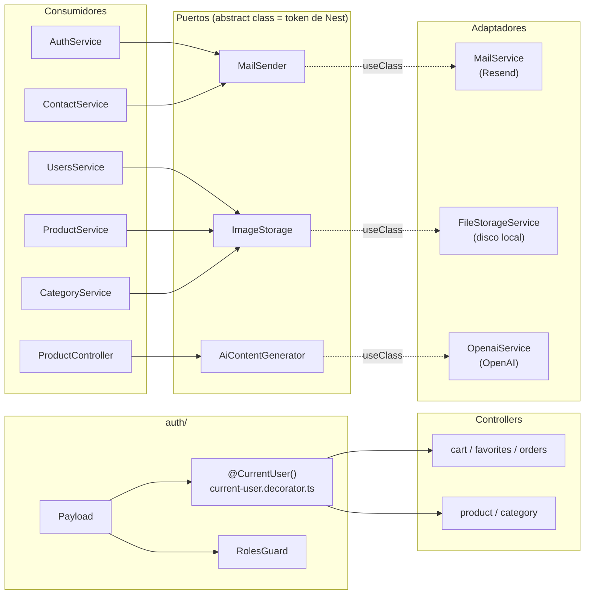
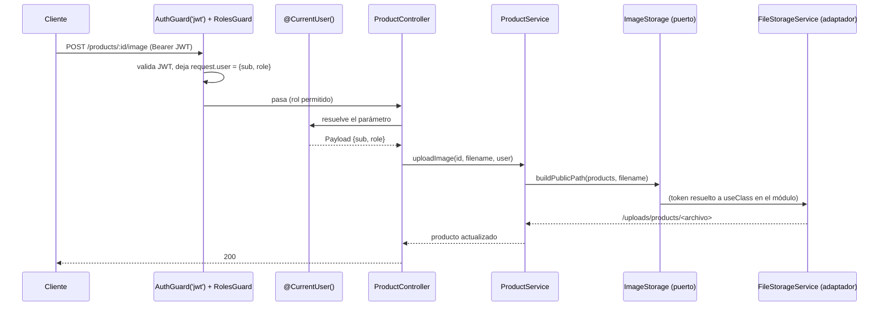

# Diseño: backend-architecture

Respuesta directa a `requirements.md`. Es un refactor sin cambios de API, de base ni de dependencias: se agrega un decorador y tres puertos, y se reconectan los consumidores. Nada de lo que se describe acá cambia lo que ve un cliente HTTP.

## 1. Hallazgos que condicionan el diseño

Leídos del código el 2026-10-13:

- **Los specs ya reemplazan el servicio concreto con un doble** (`{ provide: MailService, useValue: mail }`). Lo que cambia con el puerto no es eso, sino *qué se nombra*: el consumidor pasa a depender de un contrato que no arrastra el SDK, y los tests de integración dejan de tener que esquivar el constructor del adaptador.
- **Un adaptador registrado además del puerto se seguiría instanciando.** Los adaptadores validan su API key en el constructor (`RESEND_API_KEY`, `OPENAI_API_KEY`). Si el módulo registrara `MailService` *y* el puerto con `useExisting`, un test que reemplace solo el puerto igual construiría `MailService` y lanzaría sin clave. Por eso el diseño registra el adaptador **bajo el token del puerto** (`useClass`), sin proveedor propio.
- **Los tests de integración y e2e sí nombran a los adaptadores:** `contact.integration.spec.ts` y `test/catalog-access.helpers.ts` hacen `overrideProvider(MailService)` / `overrideProvider(OpenaiService)`. Al cambiar el token hay que migrarlos, o el adaptador real se construiría y lanzaría sin clave.
- **`ProductCategoryOption`** se exporta hoy desde `openai.service.ts` y lo usa la firma de `generateProductFromImage`. Para que el puerto no importe al adaptador, el tipo se mueve al archivo del puerto.
- **`ValidationPipe` global** (`whitelist`, `forbidNonWhitelisted`, `transform`) no valida los parámetros de decoradores propios mientras `validateCustomDecorators` esté en su valor por defecto (`false`); se confirma con las e2e (verificar en doc oficial de NestJS antes de implementar).
- **`SelfOrAdminGuard` ya lee el usuario sin `AuthenticatedRequest`** (`getRequest<{ user?: Payload; params }>()`): no necesita cambios. Solo `RolesGuard` depende de esa interfaz.
- **Swagger** se publica en `/docs` (JSON en `/docs-json`) fuera de producción: sirve para comparar el contrato antes y después.

## 2. Arquitectura: qué cambia y dónde



La flecha punteada se declara una sola vez, en el módulo dueño de cada adaptador. Los consumidores no importan nunca los archivos de la derecha.

## 3. Componentes

### D1. `@CurrentUser()` (REQ-1)

Archivo nuevo `backend/src/auth/current-user.decorator.ts`, junto a `roles/` y `models/`:

```ts
import { createParamDecorator, ExecutionContext } from '@nestjs/common';
import { Payload } from './models/payload.model';

export const currentUserFactory = (_data: unknown, ctx: ExecutionContext): Payload | undefined =>
  ctx.switchToHttp().getRequest<{ user?: Payload }>().user;

export const CurrentUser = createParamDecorator(currentUserFactory);
```

- Se exporta la **función** además del decorador: es lo que se prueba en unitario (REQ-4.1), sin armar un módulo de Nest.
- El parámetro se declara `@CurrentUser() user: Payload` (REQ-1.2). El tipo `Payload | undefined` del factory no se propaga al handler: en rutas con `AuthGuard('jwt')` el usuario existe (REQ-1.3 describe el caso sin guard).
- Sin argumentos de decorador (`@CurrentUser('sub')`): descartado por ahora. Se agregaría sin romper nada cuando haga falta; hoy solo ensanchar la API.

**Cambios por controller** (todos con `AuthGuard('jwt')` ya aplicado, no se tocan los guards ni los `@Roles`):

| Controller | Hoy | Después |
|---|---|---|
| `cart`, `favorites`, `orders` | `@Request() req: AuthenticatedRequest` y `req.user.sub` / `req.user.role` | `@CurrentUser() user: Payload` y `user.sub` / `user.role` |
| `product` (`create`, `update`, `publish`, `remove`, `uploadImage`, `deleteImage`) | `req` sin tipo, `req: { user: Payload }` y `req.user as Payload` | `@CurrentUser() user: Payload` en los seis. Se eliminan los `eslint-disable`. `create` sigue pasando `user.sub` y `user.role` al servicio |
| `category` (`create`, `update`, `remove`, `uploadImage`, `deleteImage`) | ídem | ídem |
| `auth.login` | `@Request() req: { user: User }` | **sin cambios** (usuario de la estrategia `local`, no el `Payload`) |

**Guards:** `RolesGuard` reemplaza `getRequest<Partial<AuthenticatedRequest>>()` por `getRequest<{ user?: Payload }>()`, igual que `SelfOrAdminGuard`. Con eso `authenticated-request.model.ts` queda sin usos y se **elimina** (REQ-1.7).

**Alternativa descartada:** guardar el `Payload` tipado con `declare global` (extender `Express.Request`). Evita el genérico, pero mete un tipo global que afecta a todo el proyecto y se descubre por magia.

### D2. Puertos (REQ-2)

Cada puerto es una **clase abstracta** en el módulo que ya aloja a su adaptador. Una clase abstracta sirve de token de inyección de Nest sin `@Inject()` ni `Symbol`, y respeta `emitDecoratorMetadata`:

| Puerto | Archivo (nuevo) | Contrato |
|---|---|---|
| `MailSender` | `mail/mail-sender.port.ts` | `sendVerificationEmail(to, token): Promise<void>`; `sendResetPasswordMail(to, subject, resetToken): Promise<void>`; `sendContactMessage(input: ContactMessageInput): Promise<void>`; el tipo `ContactMessageInput` (`{ to, name, email, message }`) se exporta del mismo archivo |
| `ImageStorage` | `files/image-storage.port.ts` | `buildPublicPath(folder: UploadFolder, filename): string`; `deleteByPublicPath(publicPath?: string \| null): Promise<void>` |
| `AiContentGenerator` | `ai/ai-content-generator.port.ts` | `generateProductContent(name): Promise<{ description; slug }>`; `generateProductFromImage(imageUrl, categories: ProductCategoryOption[]): Promise<{ name; description; categoryId; categoryName; slug }>`; el tipo `ProductCategoryOption` se mueve acá |

Los tipos de retorno se escriben a mano a partir de lo que hoy devuelven los adaptadores, para no cambiar la inferencia de los consumidores.

**Adaptadores:** `MailService implements MailSender`, `FileStorageService implements ImageStorage`, `OpenaiService implements AiContentGenerator`. Solo se agrega el `implements` y, en `OpenaiService`, se importa `ProductCategoryOption` desde el puerto. El cuerpo no cambia (REQ-2.7). `getUploadAbsoluteDir` y `onModuleInit` de `FileStorageService` quedan **fuera** del puerto: no los usa ningún consumidor.

**Wiring:** en cada módulo, el adaptador se registra bajo el token del puerto y solo el puerto se exporta:

```ts
// mail.module.ts
providers: [{ provide: MailSender, useClass: MailService }],
exports: [MailSender],
```

(`FilesModule` → `ImageStorage`/`FileStorageService`; `AiModule` → `AiContentGenerator`/`OpenaiService`.) `OnModuleInit` de `FileStorageService` se sigue ejecutando porque Nest lo invoca también para proveedores con `useClass`. `MailController` (vacío) sigue en `MailModule`.

**Consumidores:** el constructor pasa a tipar el puerto (`private readonly mail: MailSender`, `ImageStorage`, `AiContentGenerator`). Sin cambios de lógica; `ContactService` conserva su `withTimeout` y mensajes (REQ-2.9).

**Alternativas descartadas:**
- *Interfaz + `Symbol` + `@Inject(TOKEN)`*: más ceremonia en cada constructor, sin ganancia aquí.
- *`useExisting` con el adaptador también registrado*: obliga a construir el adaptador en los tests (ver hallazgos).
- *Un puerto por método* (por ejemplo, separar el envío de contacto): sobre-diseño; hoy hay un solo implementador.
- *Poner los puertos en una carpeta `ports/` común*: junta archivos de dominios distintos; se prefiere que cada puerto viva donde vive su adaptador. Se asume el compromiso de que el puerto no pertenece al consumidor (inversión de dependencias estricta); se anota para cuando haya un segundo adaptador.

### D3. Migración de pruebas (REQ-2.5, REQ-4)

| Archivo | Cambio |
|---|---|
| `auth.service.spec.ts`, `auth.service.security.spec.ts` | `{ provide: MailSender, useValue: … }` |
| `contact.service.spec.ts` | el doble se declara como `MailSender` |
| `contact.integration.spec.ts` | `overrideProvider(MailSender)` |
| `users.service.spec.ts`, `product.service.spec.ts`, `category.service.spec.ts` | `{ provide: ImageStorage, useValue: … }` |
| `test/catalog-access.helpers.ts` (e2e) | `overrideProvider(AiContentGenerator)` en lugar de `OpenaiService` |

**Specs nuevos** (REQ-4):
- `auth/current-user.decorator.spec.ts`: la factory devuelve el `Payload` si hay usuario y `undefined` si no.
- `cart.controller.spec.ts`, `favorites.controller.spec.ts`, `orders.controller.spec.ts`, `product/controllers/product.controller.spec.ts`, `category.controller.spec.ts`: por controller, un caso que arma un request con `user: { sub: 7, role: … }` y verifica que el servicio recibe `7` y el rol (REQ-4.2), con guards reemplazados. Los controllers de producto y categoría suman el caso de `create` con rol `GUEST`.
- En `product.controller.spec.ts`, además, un doble de `AiContentGenerator` (REQ-4.3).

**Cómo se invoca un handler con `@CurrentUser()` en un spec:** al ser un decorador de parámetro, llamar al método a mano no pasa por el decorador. Para probar que el controller *lee* `user`, los specs de controller usan `Test.createTestingModule` + `supertest` con un guard falso que inyecta `request.user`; así el `@CurrentUser()` real corre. Costo: son specs algo más largos que los de delegación pura; es la única forma de cubrir REQ-4.2 de verdad.

### D4. Documentación (REQ-5)

- `.claude/steering/structure.md`: sección "Puertos y adaptadores" (dónde viven, el patrón `provide/useClass`, cómo se prueba) y una línea sobre `@CurrentUser()`.
- `.claude/specs/pendientes.md`: corregir la nota del hash (REQ-5.2) y dejar lo que sigue abierto de la Fase 3 backend (REQ-5.3).
- `AuthenticatedRequest` desaparece: se anota en el registro de la spec.

## 4. Flujo principal: un request con usuario autenticado



Con token ausente o inválido el flujo termina en el guard con 401 y nunca llega al decorador (REQ-1.8).

## 5. Orden de entrega

Cada paso deja el repo compilando y los tests en verde:

1. `@CurrentUser()` + su spec, sin tocar controllers todavía.
2. Controllers de `cart`, `favorites`, `orders`, con spec nuevo cada uno; `RolesGuard`. Luego `product` y `category`. Al terminar, se elimina `AuthenticatedRequest`.
3. Puerto de correo (`MailSender`): adaptador, módulo, consumidores, specs, `contact.integration.spec`.
4. Puerto de archivos (`ImageStorage`) y su migración.
5. Puerto de IA (`AiContentGenerator`), incluido `test/catalog-access.helpers.ts`.
6. Verificación: suite completa, lint, build, e2e en serie, humo de la pila local, y comparación del JSON de Swagger antes y después.
7. Documentación y cierre.

## 6. Decisiones técnicas sin requisito directo

- **Clase abstracta como token** (D2): necesaria para que el puerto sea inyectable sin ceremonia; no está en ningún requisito.
- **Registro `useClass` bajo el token del puerto** (D2): se deriva de REQ-2.5/2.8 y del hallazgo sobre el constructor del adaptador.
- **Specs de controller con `supertest`** (D3): es lo que hace verificable REQ-4.2.

## 7. Trazabilidad

| Requisito | Qué lo cubre |
|---|---|
| REQ-1.1, 1.2, 1.3 | D1: `currentUserFactory` y `CurrentUser` |
| REQ-1.4, 1.5 | D1, tabla de controllers |
| REQ-1.6, 1.7 | D1, guards y eliminación de `AuthenticatedRequest` |
| REQ-1.8 | D1 (guards sin cambio), flujo de la sección 4 |
| REQ-2.1, 2.2, 2.3 | D2, tabla de puertos y consumidores |
| REQ-2.4 | D2, wiring `useClass` |
| REQ-2.5 | D2 y D3 |
| REQ-2.6 | D2 (solo el puerto se exporta) y verificación por `grep` |
| REQ-2.7 | D2 (`implements` sin tocar cuerpos) |
| REQ-2.8 | D2 (constructores intactos) y `validateEnv` sin cambios |
| REQ-2.9 | D2 (`ContactService` sin cambios de lógica) |
| REQ-3.1–3.6 | Orden de entrega, paso 6 |
| REQ-4.1, 4.2, 4.3 | D3, specs nuevos y migrados |
| REQ-5.1, 5.2, 5.3 | D4 |

**Auto-revisión:** todos los requisitos tienen componente; los tres elementos sin requisito directo están en la sección 6. Dos puntos que no puedo cerrar sin ejecutar: (1) que `ValidationPipe` global no interfiera con el decorador propio (se confirma con las e2e y en la doc oficial); (2) que los tipos de retorno escritos a mano en los puertos coincidan con lo que devuelven hoy los adaptadores (lo verifica `tsc` al agregar `implements`).
