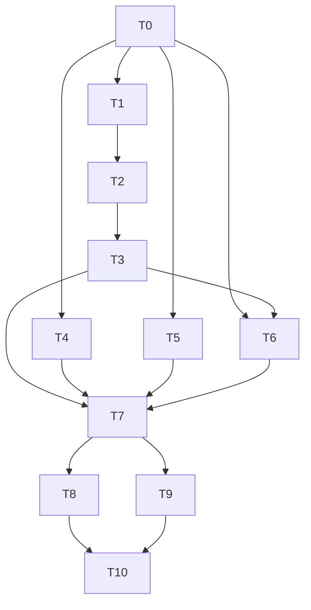

# Tareas: backend-architecture

Orden pensado para que cada tarea deje el backend compilando y los tests en verde. Refactor sin cambios de API: **antes de empezar (T0) se captura el contrato y la línea base** para poder comparar al final.

Convenciones: `[ ]` pendiente, `[x]` hecha. **(O)** = opcional. Todos los comandos, desde `backend/` salvo que se indique.
Commits (solo cuando el usuario los pida): código y docs de la spec van **separados**. Rama sugerida: `refactor/backend-architecture`, desde `origin/main`.

## Grupo A: línea base

- [x] **T0. Línea base del contrato y de los tests** — REQ-3.1, 3.2, 3.3
  - Con la rama creada y **antes de tocar código**: guardar en el scratchpad `docs-json.before.json` (levantar el backend con una base descartable, sin `NODE_ENV=production`, y pedir `GET /docs-json`); correr `npm test` (esperado: 33 suites, 308 tests) y las e2e en serie (esperado: 10 de 11 suites, 132 de 133; falla solo `app.e2e-spec.ts`).
  - Depende de: —
  - Verificación: archivo guardado, y los números de arriba anotados en el registro de abajo. Si no coinciden, parar y avisar.

## Grupo B: `@CurrentUser()`

- [x] **T1. Decorador y su prueba** — REQ-1.1, 1.2, 1.3, 4.1
  - Crear `src/auth/current-user.decorator.ts` con `currentUserFactory` y `CurrentUser` (ver diseño D1) y `src/auth/current-user.decorator.spec.ts`: con usuario devuelve el `Payload`; sin usuario devuelve `undefined` y no lanza.
  - Antes de escribir: confirmar en la doc oficial de NestJS que `ValidationPipe` no valida parámetros de decoradores propios por defecto (`validateCustomDecorators: false`).
  - Depende de: T0
  - Verificación: `npx jest src/auth/current-user` en verde; `npx eslint` sobre los dos archivos en 0.

- [x] **T2. Controllers `cart`, `favorites`, `orders` y `RolesGuard`** — REQ-1.4, 1.6, 4.2
  - Reemplazar `@Request() req: AuthenticatedRequest` por `@CurrentUser() user: Payload` y `req.user.x` por `user.x`.
  - `RolesGuard`: `getRequest<{ user?: Payload }>()`; sin `AuthenticatedRequest`.
  - Specs nuevos `cart.controller.spec.ts`, `favorites.controller.spec.ts`, `orders.controller.spec.ts`: con `supertest` y un guard falso que fija `request.user = { sub: 7, role }`, comprobar que cada servicio recibe `7` (y el rol donde corresponda: `getOrderByIdForRole(id, sub, role)`), y que el valor sale del usuario autenticado y no del body ni de la URL.
  - Depende de: T1
  - Verificación: specs nuevos en verde; `npx jest src/auth/roles src/cart src/favorites src/orders` en verde; `npm run build` ok.

- [x] **T3. Controllers `product` y `category`; eliminar `AuthenticatedRequest`** — REQ-1.4, 1.5, 1.7, 4.2
  - `product.controller` (`create`, `update`, `publish`, `remove`, `uploadImage`, `deleteImage`) y `category.controller` (`create`, `update`, `remove`, `uploadImage`, `deleteImage`): `@CurrentUser() user: Payload`; `create` sigue pasando `user.sub` y `user.role` al servicio; se quitan los `eslint-disable`.
  - Specs nuevos `product.controller.spec.ts` y `category.controller.spec.ts` (mismo enfoque que T2), con un caso de `create` con rol `GUEST` y otro con `ADMIN`.
  - Borrar `src/auth/models/authenticated-request.model.ts` cuando `grep -rn AuthenticatedRequest src test` no devuelva nada.
  - Depende de: T2
  - Verificación: `grep -rn "AuthenticatedRequest\|@Request()" src` solo muestra `auth.controller.ts` (login con estrategia `local`); `npm test`, `npx eslint` y `npm run build` en verde.

## Grupo C: puertos (cada uno es independiente de los otros dos)

- [x] **T4. Puerto `MailSender`** — REQ-2.1, 2.4, 2.5, 2.6, 2.7, 2.8, 2.9, 4.3
  - Crear `src/mail/mail-sender.port.ts` (clase abstracta + tipo `ContactMessageInput`). `MailService implements MailSender` (cuerpo sin cambios).
  - `mail.module.ts`: `providers: [{ provide: MailSender, useClass: MailService }]`, `exports: [MailSender]`.
  - `AuthService` y `ContactService` inyectan `MailSender`.
  - Migrar specs: `auth.service.spec.ts`, `auth.service.security.spec.ts`, `contact.service.spec.ts` (doble tipado como `MailSender`) y `contact.integration.spec.ts` (`overrideProvider(MailSender)`).
  - Depende de: T0 (independiente de T1–T3, se puede hacer en paralelo)
  - Verificación: `npx jest src/mail src/auth src/contact` en verde, y `mail.service.spec.ts` / `mail.service.contact.spec.ts` **sin modificar**; `grep -rn "mail.service'" src test | grep -v "src/mail/\|spec.ts"` sin resultados; ningún consumidor usa `jest.mock('resend')`; build ok.

- [x] **T5. Puerto `ImageStorage`** — REQ-2.2, 2.4, 2.5, 2.6, 2.7, 4.3
  - Crear `src/files/image-storage.port.ts` (`buildPublicPath`, `deleteByPublicPath`). `FileStorageService implements ImageStorage`; `getUploadAbsoluteDir` y `onModuleInit` quedan fuera del puerto.
  - `files.module.ts`: `useClass` bajo el token del puerto y `exports: [ImageStorage]`. Confirmar que `onModuleInit` se sigue ejecutando (se crean las carpetas de `uploads/` al arrancar).
  - `UsersService`, `ProductService`, `CategoryService` inyectan `ImageStorage`; migrar sus tres specs.
  - Depende de: T0
  - Verificación: `npx jest src/users src/product` en verde; `grep -rn "file-storage.service'" src test | grep -v "src/files/\|spec.ts"` sin resultados; en el humo (T8) se ve que se crean `uploads/{products,categories,profiles}` y que subir y borrar una imagen funciona.

- [x] **T6. Puerto `AiContentGenerator`** — REQ-2.3, 2.4, 2.5, 2.6, 2.7, 2.8, 4.3
  - Crear `src/ai/ai-content-generator.port.ts` con el contrato y mover ahí `ProductCategoryOption`. `OpenaiService implements AiContentGenerator` (importa el tipo desde el puerto; cuerpo sin cambios).
  - `ai.module.ts`: `useClass` bajo el token del puerto y `exports: [AiContentGenerator]`.
  - `ProductController` inyecta `AiContentGenerator`; en `product.controller.spec.ts` (T3) se agrega el doble del puerto y un caso de `generate-ai/:name` y otro de `generate-from-image`.
  - `test/catalog-access.helpers.ts` (e2e): `overrideProvider(AiContentGenerator)` en lugar de `OpenaiService`.
  - Depende de: T0; el spec del controller, de T3
  - Verificación: `npx jest src/ai src/product` en verde, `openai.service.spec.ts` **sin modificar**; `grep -rn "openai.service'" src test | grep -v "src/ai/\|spec.ts"` sin resultados; la suite e2e de IA (`catalog-ai.e2e-spec.ts`) en verde en T7; sin `OPENAI_API_KEY` en el entorno el arranque sigue fallando con el mismo mensaje (REQ-2.8).

## Grupo D: verificación

- [x] **T7. Suite completa, e2e y comparación del contrato** — REQ-3.1, 3.2, 3.3, 3.4, 3.5
  - `npm test`, `npx eslint "{src,apps,libs,test}/**/*.ts"`, `npm run build`.
  - E2e en serie con la base descartable (`--runInBand`, `TEST_DB_*`).
  - Guardar `docs-json.after.json` con el mismo procedimiento que T0 y comparar con `docs-json.before.json`: mismo conjunto de `paths`, métodos y códigos de respuesta (se admite diferencia solo si se explica).
  - `git diff --stat origin/main -- backend/package.json backend/package-lock.json backend/src/database` sin cambios (REQ-3.5); sin variables de entorno nuevas en `.env-example`.
  - Depende de: T3, T4, T5, T6
  - Verificación: resultados anotados abajo. Números esperados: 0 suites fallidas; tests ≥ 308 (anotar cuáles se reemplazaron); e2e 10 de 11 suites; diff de Swagger vacío.

- [x] **T8. Humo de la pila local y del arranque** — REQ-2.8, 3.6
  - `docker compose -p <nombre> --env-file <archivo en el scratchpad> -f docker-compose.yml -f docker-compose.dev.yml up -d --build`: `/health` 200, frontend `/` 200, backend con UID 1000, carpetas `uploads/*` creadas.
  - Subir y borrar una imagen de producto con un usuario admin (curl con JWT) para confirmar `ImageStorage` de punta a punta.
  - Arrancar el backend sin `RESEND_API_KEY` y sin `OPENAI_API_KEY` (una vez cada una): falla igual que antes y no queda un contenedor colgado.
  - Limpiar sin `-v` y **pedir confirmación** antes de borrar volúmenes.
  - Depende de: T7
  - Verificación: resultados anotados; 0 contenedores sobrantes.

## Grupo E: documentación y cierre

- [x] **T9. Documentación** — REQ-5.1, 5.2, 5.3
  - `.claude/steering/structure.md`: sección "Puertos y adaptadores" y línea de `@CurrentUser()`.
  - `.claude/specs/pendientes.md`: corregir la nota que dice que `UsersService` devuelve el hash (y la de `quality-baseline` que la repite); anotar lo abierto de la Fase 3 backend (DTOs de respuesta, repositorios por contexto, reglas de dominio, `MailController` vacío).
  - Depende de: T7
  - Verificación: lectura de ambos archivos; `grep -rn "hash de la contraseña" specs` no deja la afirmación incorrecta.

- [ ] **T10. Cierre de la spec** — todos
  - Recorrer cada criterio de `requirements.md` (sí/no con evidencia) y anotarlo abajo. Si el despliegue lo hace una persona (PR, Actions, producción: health, login, un alta con imagen, un pedido y un envío de contacto), anotar lo que informe.
  - Depende de: T7, T8, T9

### Opcionales

- [ ] **T11 (O). Borrar `MailController`** (vacío). Es código muerto, pero está fuera de alcance: solo con confirmación explícita.
- [ ] **T12 (O). Regla de lint contra imports de adaptadores** (`no-restricted-imports` para `mail.service`, `file-storage.service`, `openai.service` fuera de su módulo), para que REQ-2.6 no dependa de un `grep` manual. Cambia la configuración de ESLint: confirmar antes.

## Dependencias entre tareas

Independientes entre sí (se pueden hacer en cualquier orden o en paralelo, después de T0): la cadena **T1→T2→T3** y los puertos **T4** y **T5**. T6 necesita de T3 solo para completar su spec del controller. Los cuatro caminos se juntan en T7.

## Trazabilidad

| Requisito | Tareas |
|---|---|
| REQ-1.1, 1.2, 1.3 | T1 |
| REQ-1.4 | T2, T3 |
| REQ-1.5 | T3 |
| REQ-1.6 | T2 |
| REQ-1.7 | T3 |
| REQ-1.8 | T7 (e2e de acceso sin token) |
| REQ-2.1 | T4 |
| REQ-2.2 | T5 |
| REQ-2.3 | T6 |
| REQ-2.4, 2.5, 2.6, 2.7 | T4, T5, T6 |
| REQ-2.8 | T4, T6, T8 |
| REQ-2.9 | T4 |
| REQ-3.1, 3.2, 3.3, 3.4, 3.5 | T0, T7 |
| REQ-3.6 | T8 |
| REQ-4.1 | T1 |
| REQ-4.2 | T2, T3 |
| REQ-4.3 | T3, T4, T5, T6 |
| REQ-5.1, 5.2, 5.3 | T9 |

## Registro de ejecución

*(se completa durante la implementación)*

### Línea base (T0), 2026-10-13, `origin/main` en `df6e3d6`
- `npm test`: 33 suites, 308 tests en verde.
- E2e en serie (Postgres descartable): 10 de 11 suites, 132 de 133 tests; falla solo `app.e2e-spec.ts` (preexistente).
- Swagger (`GET /swagger/json`, backend con `NODE_ENV=development`): 35 paths, 26 233 bytes. Guardado en el scratchpad como `docs-json.before.json`.

### Desvíos respecto del diseño
- **URL del documento OpenAPI:** el diseño decía `/docs-json`; el código lo publica en **`/swagger/json`** (`jsonDocumentUrl` en `app.setup.ts`). La comparación se hizo con esa ruta.
- **Helper de specs de controller:** `test/controller-testing.ts` ganó un cuarto parámetro `bypassGuards` (para dejar pasar `AiThrottlerGuard`, que necesita infraestructura de throttler). No estaba en el diseño.
- **Tipos de los puertos:** además de `ProductCategoryOption`, el puerto de IA exporta `GeneratedProductContent` y `GeneratedProductFromImage` (los tipos de retorno que antes eran inferidos). `tsc` confirmó con `implements` que coinciden con lo que devuelve el adaptador.
- **`backend/.env` local:** existe un `.env` (ignorado por git, no se leyó ni se modificó) que provee `OPENAI_API_KEY` y `RESEND_API_KEY` si el backend se arranca desde `backend/`. Para probar el arranque sin claves hubo que correr `node` desde otro directorio de trabajo. Quien pruebe REQ-2.8 a mano tiene que saberlo.
- **Pruebas nuevas:** 36 más que la línea base (de 308 a 344): 2 del decorador, 15 de `cart`/`favorites`/`orders`, 19 de `product`/`category`. Ninguna prueba existente se reemplazó ni se eliminó, solo cambiaron los tokens de los dobles.

### Verificación (T7 y T8), 2026-10-13
| Comprobación | Resultado |
|---|---|
| `npm test` | 39 suites, **344 tests** en verde (línea base: 33 y 308) |
| `npx eslint "{src,apps,libs,test}/**/*.ts"` | código 0 |
| `npm run build` | ok |
| E2e en serie | 10 de 11 suites, 132 de 133 tests: **igual que la línea base** |
| Swagger antes vs. después | **idéntico byte a byte** (26 233 bytes, 35 paths, 50 operaciones con las mismas respuestas y parámetros) |
| `git diff origin/main` en `package.json`, lock, `src/database` y `.env-example` | sin cambios (REQ-3.5) |
| Adaptadores sin modificar sus specs | `mail.service.spec.ts`, `mail.service.contact.spec.ts` y `openai.service.spec.ts` sin cambios y en verde |
| `grep` de imports de `mail.service`, `file-storage.service` y `openai.service` fuera de su módulo | sin resultados (REQ-2.6) |
| `jest.mock('resend')` / `jest.mock('openai')` fuera de `src/mail` y `src/ai` | sin resultados (REQ-2.5) |
| `@Request()` en `src` | solo `auth.controller.ts` (login) |
| Pila local (compose base + dev) | `/health` 200, frontend 200, backend con UID 1000, carpetas `uploads/{categories,products,profiles}` creadas al arrancar (`onModuleInit` del adaptador funciona con `useClass`) |
| Humo con un ADMIN firmado: crear producto, subir imagen, borrar imagen, borrar producto | 201, 201 (archivo en el volumen), 200 (archivo borrado), 200 |
| Ruta protegida sin token | 401 (REQ-1.8) |
| Arranque sin `RESEND_API_KEY` / sin `OPENAI_API_KEY` | código de salida 1, con el mensaje de `validateEnv` ("X es obligatoria"). Los constructores de los adaptadores (que también lanzan) siguen cubiertos por sus specs |

Queda limpio: contenedores y red de la prueba de humo. **Quedan dos volúmenes Docker** (`archsmoke_postgres_data`, `archsmoke_uploads_data`) a la espera de confirmación para borrarlos.

### Cierre de criterios (T10)
Verificación de `spec-verifier` (2026-10-16), corrida desde `backend/`: `npm test` 39 suites y 344 tests en verde, eslint sin salida, `npm run build` ok, `git status` limpio. Sin hallazgos de calidad de evidencia de severidad alta (sin `.skip` ni tests deshabilitados en `npm test`; `describe.skip` en `test/orders-integrity.helpers.ts:38` es el mecanismo de las e2e sin `TEST_DB_*`).

**Resultado: 27 SÍ, 0 NO, 4 NO VERIFICABLE.**

| Criterio | ¿Cumplido? | Evidencia |
|---|---|---|
| REQ-1.1 a REQ-1.7 | SÍ | `current-user.decorator.spec.ts`; `grep` de `AuthenticatedRequest` y `@Request()` solo deja `auth.controller.ts:26` (login `local`); specs de `product`/`category` con GUEST, ADMIN y 403 de CLIENT; `roles.guard.ts` y `self-or-admin.guard.ts` sin `any` |
| REQ-1.8 | NO VERIFICABLE | Las e2e y el humo en docker no se reprodujeron en la verificación. Registro de T8: 401 sin token |
| REQ-2.1 a REQ-2.9 | SÍ | Consumidores inyectan `MailSender`, `ImageStorage` y `AiContentGenerator`; módulos con `{ provide, useClass }` y `exports: [<Puerto>]`; `grep` de adaptadores fuera de su módulo y de `jest.mock('resend'/'openai')` sin resultados; tope de 10 s del contacto con 503 (`contact.service.spec.ts`, `contact.integration.spec.ts:144`) |
| REQ-3.1 | SÍ | 344 tests (línea base 308), 0 fallidos |
| REQ-3.2 | NO VERIFICABLE | E2e necesitan Postgres. Registro de T7: 10 de 11 suites y 132 de 133 tests, igual que la línea base |
| REQ-3.3 | NO VERIFICABLE | Swagger idéntico byte a byte según T7; no reproducido |
| REQ-3.4, REQ-3.5 | SÍ | Lint y build en 0; `git diff origin/main` de `package.json`, lock, `src/database` y `.env-example` vacío |
| REQ-3.6 | NO VERIFICABLE | Requiere docker. Registro de T8: `/health` 200 y UID 1000 |
| REQ-4.1 a REQ-4.3 | SÍ | Specs del decorador y de `cart` (5), `favorites` (4), `orders` (6), `product` (11) y `category` (8); dobles del puerto en los consumidores |
| REQ-5.1 a REQ-5.3 | SÍ | `.claude/steering/structure.md` (convención de `@CurrentUser()` y puertos); `pendientes.md` con la nota del hash corregida y lo abierto de la Fase 3 |

**Pendiente de confirmar por una persona antes de tildar T10:** REQ-1.8, REQ-3.2, REQ-3.3 y REQ-3.6 (se sostienen con el registro de T7/T8, que el verificador no pudo reproducir), y el despliegue manual: login, alta con imagen, pedido y envío de contacto. Los dos volúmenes `archsmoke_*` siguen sin borrar.
