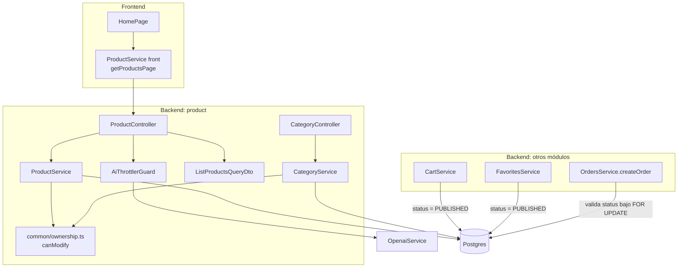
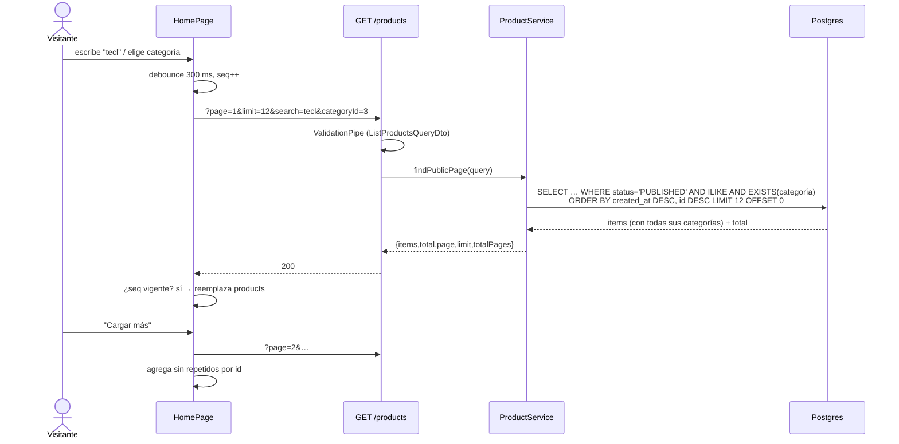
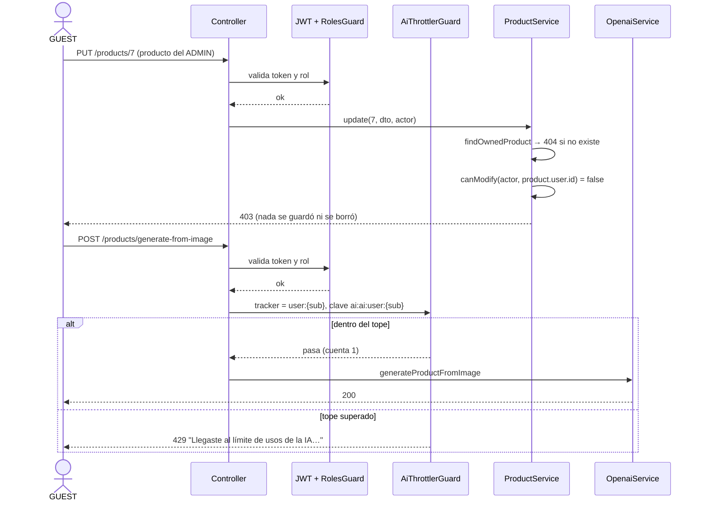

# Diseño: catalog-access

## Resumen y decisiones clave

**No hay migración ni cambio de esquema.** Todo se resuelve en la capa de servicios y controladores del backend y en el home del frontend. Por eso el `status` de los datos existentes no se toca (REQ-1.8) y no hay nada que revertir en la base.

Cuatro ideas ordenan el diseño:

1. **Un único punto de entrada público por forma de lectura.** `ProductService` gana métodos explícitos para el público (`findPublicPage`, `findPublishedById`, `findPublishedBySlug`, `findPublishedByUserId`) y los métodos internos (`findProductById`, usado por crear/editar/publicar) siguen sin filtrar. Así, ninguna ruta pública puede filtrar por olvido: el controlador público solo llama a los métodos `Published`/`Public`.
2. **La propiedad se decide en el servicio, con una función pura.** `canModify(actor, ownerId)` (ADMIN, o `sub === ownerId`) vive en `common/ownership.ts`. Cada método de escritura de productos y categorías busca el recurso (404), llama a la función y lanza 403 si falla, **antes** de tocar archivos o la base. Los controladores solo pasan el `Payload` del token.
3. **El tope de IA es un guard de `@nestjs/throttler` con tracker por usuario.** Se reutiliza la dependencia que ya está instalada (v6.7.1): se sobrescriben `getTracker` (id del token) y `generateKey` (sin el nombre del handler, para que los dos endpoints compartan contador).
4. **El home deja de filtrar en el navegador.** Pide páginas al servidor; la búsqueda y la categoría viajan como parámetros y cada respuesta se compara con un número de petición para descartar las tardías.

## Arquitectura



## Componentes e interfaces

### Backend: listado público paginado

#### `product/dto/list-products-query.dto.ts` (nuevo)
- **Responsabilidad:** validar `page`, `limit`, `search`, `categoryId` de `GET /products`.
- **Cubre:** REQ-2.2, REQ-2.3, REQ-2.5, REQ-2.7
- **Interfaz:**
  ```ts
  export class ListProductsQueryDto {
    @IsOptional() @IsInt() @Min(1)            page: number = 1;
    @IsOptional() @IsInt() @Min(1) @Max(50)   limit: number = 12;
    @IsOptional() @IsString() @MaxLength(100)
    @Transform(({ value }) => (typeof value === 'string' && value.trim() ? value.trim() : undefined))
    search?: string;
    @IsOptional() @IsInt() @Min(1)            categoryId?: number;
  }
  ```
  El `ValidationPipe` global ya tiene `transform` + `enableImplicitConversion` + `forbidNonWhitelisted`, así que `"abc"` → `NaN` falla `@IsInt` y un parámetro desconocido da 400. Un `search` vacío o solo espacios se trata como ausente.

#### `ProductService.findPublicPage(query)` (nuevo; reemplaza a `findAll`)
- **Responsabilidad:** devolver una página de productos `PUBLISHED`.
- **Cubre:** REQ-1.1, REQ-2.1, REQ-2.4, REQ-2.6, REQ-2.8, REQ-2.9, REQ-2.10, REQ-2.11, REQ-2.12
- **Interfaz:**
  ```ts
  interface ProductPage { items: Product[]; total: number; page: number; limit: number; totalPages: number }
  findPublicPage(query: ListProductsQueryDto): Promise<ProductPage>
  ```
- **Consulta (QueryBuilder sobre `Product`):**
  ```ts
  const qb = repo.createQueryBuilder('p')
    .leftJoinAndSelect('p.user', 'u').leftJoinAndSelect('u.profile', 'up')
    .leftJoinAndSelect('p.categories', 'c')
    .where('p.status = :status', { status: Status.PUBLISHED });
  if (search) qb.andWhere(`(p.name ILIKE :q ESCAPE '\\' OR p.description ILIKE :q ESCAPE '\\')`,
                          { q: `%${escapeLike(search)}%` });
  if (categoryId) qb.andWhere(`EXISTS (SELECT 1 FROM product_categories pc
                                       WHERE pc.product_id = p.id AND pc.category_id = :categoryId)`, { categoryId });
  qb.orderBy('p.createdAt', 'DESC').addOrderBy('p.id', 'DESC').skip((page - 1) * limit).take(limit);
  const [items, total] = await qb.getManyAndCount();
  ```
  - **El filtro de categoría usa `EXISTS` y no un `WHERE` sobre el join de `c`**, para que cada producto conserve **todas** sus categorías (REQ-2.6) y para que `skip/take` pagine productos y no filas del join.
  - `escapeLike` antepone `\` a `\`, `%` y `_` (REQ-2.4): los comodines del usuario se buscan literalmente.
  - `totalPages = Math.ceil(total / limit)` (0 cuando `total = 0`, REQ-2.11). Una `page` mayor que `totalPages` simplemente devuelve `items: []` con el `total` real (REQ-2.10).
  - **Forma del producto (REQ-2.12):** `items` son instancias de `Product`; `ClassSerializerInterceptor` (global) aplica el `@Transform` del dueño. Es el punto con más riesgo de regresión silenciosa (la entidad va anidada dentro de un objeto plano), por eso tiene prueba HTTP propia (tarea 7).

#### `ProductController.findAll`
- **Cambio:** `findAll(@Query() query: ListProductsQueryDto)` → `this.productService.findPublicPage(query)`. Sigue siendo público (sin guards).
- **Cubre:** REQ-2.1

### Backend: visibilidad (solo `PUBLISHED`)

| Método | Cambio | Cubre |
|---|---|---|
| `ProductService.findPublishedById(id)` (nuevo) | `findOne({ where: { id, status: PUBLISHED }, relations })`; 404 si no hay. `GET /products/:id` pasa a usarlo. | REQ-1.2 |
| `ProductService.findOneBySlug(slug)` | agrega `status: PUBLISHED` al `where`; mantiene 400 (slug vacío), 404 y 409 (duplicado entre publicados). | REQ-1.2 |
| `ProductService.findPublishedByUserId(id)` (nuevo) | `where: { user: { id }, status: PUBLISHED }`; **devuelve `[]`** en lugar de 404 si no hay. `GET /products/user/:id` pasa a usarlo. | REQ-1.3 |
| `ProductService.findProductByCategoryId(id)` | agrega `status: PUBLISHED` al `where`; se elimina la rama `if (!product)` (código muerto: `find` nunca devuelve `null`). | REQ-1.4 |
| `FavoritesService.add` | el `findOne` del producto agrega `status: PUBLISHED`; si no, 404 (mismo mensaje que hoy). | REQ-1.5 |
| `FavoritesService.findAllByUser` | `where: { userId, product: { status: PUBLISHED } }`. | REQ-1.6 |
| `UsersService.getPorductsByUserId` | **sin cambios**: el dueño y el ADMIN ven todos los estados. | REQ-1.7 |

`findProductById`, `findOne`, `create`, `update`, `publish` quedan sin filtro porque son internos y los usa el panel de administración.

### Backend: propiedad (GUEST)

#### `common/ownership.ts` (nuevo)
- **Responsabilidad:** regla única de "quién puede modificar un recurso".
- **Cubre:** REQ-3.1 a 3.4
- **Interfaz:**
  ```ts
  export const canModify = (actor: Pick<Payload, 'sub' | 'role'>, ownerId: number | null | undefined): boolean =>
    actor.role === 'ADMIN' || (ownerId != null && ownerId === actor.sub);
  ```
  Una categoría sin dueño (`user_id` es `nullable`) solo la modifica un ADMIN.

#### Cambios en servicios
- `ProductService.update | remove | uploadImage | deleteImage` reciben `actor: Payload` y hacen primero `const product = await this.findOwnedProduct(id, actor)`: busca (404, REQ-3.5), evalúa `canModify(actor, product.user.id)` y lanza `ForbiddenException('No tenés permiso sobre este producto')` (REQ-3.1). Todo lo demás del método queda igual.
- `CategoryService.update | remove | uploadImage | deleteImage` igual con `findOwnedCategory(id, actor)`: carga `relations: ['user']` y evalúa `canModify(actor, category.user?.id)`.
- **Rechazo sin efectos en disco (REQ-3.7):** el chequeo ocurre antes de `deleteByPublicPath`/`save`. Como `FileInterceptor` ya escribió el archivo subido antes de entrar al handler, `uploadImage` borra ese archivo recién subido (`deleteByPublicPath(buildPublicPath(folder, filename))`) cuando el chequeo de dueño falla. Decisión técnica: sin esto un GUEST podría llenar `uploads/` con archivos huérfanos mediante subidas rechazadas.
- **Controladores:** `@Roles('ADMIN', 'GUEST')` se mantiene (así `CLIENT` sigue recibiendo 403 y sin sesión 401, REQ-3.6). Cada handler agrega `@Request() req` y pasa `req.user as Payload`.

### Backend: carrito y checkout

| Punto | Cambio | Cubre |
|---|---|---|
| `CartService.upsertItem` | el `findOne` del producto agrega `status: PUBLISHED`; si no, el 404 existente. | REQ-4.1 |
| `CartService.findAllByUser` / `removeItem` | **sin cambios**: siguen listando y permitiendo quitar un producto ya no publicado. | REQ-4.2 |
| `OrdersService.createOrder` | en el bucle de validación (ya bajo `FOR UPDATE`), antes de la comprobación de precio: `if (product.status !== Status.PUBLISHED) throw new BadRequestException(\`Product ${product.name} is not available\`)`. Como la validación ocurre antes de escribir, no se descuenta stock ni se crea nada y el carrito se conserva. | REQ-4.3, REQ-4.4 |
| Órdenes existentes | `order_items` guarda `product_name` y `unit_price` como instantánea; no se consulta el estado del producto al leerlas. Sin cambios. | REQ-4.5 |

Verificar el estado **dentro de la transacción y con la fila bloqueada** evita la carrera "el admin archiva mientras el cliente confirma".

### Backend: tope de IA

#### `ai/ai-throttler.guard.ts` (nuevo)
- **Responsabilidad:** limitar por usuario las llamadas que cuestan dinero.
- **Cubre:** REQ-5.1 a 5.4, 5.7, 5.8
- **Interfaz:**
  ```ts
  @Injectable()
  export class AiThrottlerGuard extends ThrottlerGuard {
    protected async getTracker(req: Record<string, any>): Promise<string> {
      return `user:${(req.user as Payload).sub}`;
    }
    protected generateKey(_ctx: ExecutionContext, tracker: string, throttlerName: string): string {
      return `ai:${throttlerName}:${tracker}`;   // sin clase ni handler: contador compartido
    }
  }
  ```
  - Se aplica **al final** de la cadena: `@UseGuards(AuthGuard('jwt'), RolesGuard, AiThrottlerGuard)` en `generateAi` y `generateFromImage`. Si JWT o roles rechazan, el throttler no corre y no consume tope (REQ-5.8). Si el throttler deja pasar y OpenAI falla, el conteo ya ocurrió (REQ-5.7).
  - Sin `req.user` (no puede ocurrir tras `AuthGuard`) cae a `ip:${req.ip}` como defensa.
  - El almacenamiento es el `ThrottlerStorageService` en memoria: se reinicia con el proceso y sirve para una sola instancia (declarado fuera de alcance).

#### Configuración
- `ProductModule` importa `ThrottlerModule.forRootAsync` con un único throttler `{ name: 'ai', ttl: ttlSeconds * 1000, limit }` y `errorMessage: 'Llegaste al límite de usos de la IA. Probá de nuevo más tarde.'` (HTTP 429). Es el mismo patrón que `ContactModule`.
- `ai/ai-rate-limit.config.ts` (nuevo, función pura): `readPositiveInt(raw, fallback): { value: number; valid: boolean }`. Si la variable está definida y no es entero positivo, devuelve el valor por defecto con `valid: false` y el módulo registra un `Logger.warn` (REQ-5.6). Defaults: `AI_RATE_LIMIT = 20`, `AI_RATE_TTL_SECONDS = 3600` (REQ-5.5).
- Las variables se documentan en `backend/.env-example` y `.env-example` de la raíz (comentadas, con el default) y se pasan en el servicio `backend` de `docker-compose.yml` con `${AI_RATE_LIMIT:-20}` y `${AI_RATE_TTL_SECONDS:-3600}`, igual que `ORDER_PAYMENT_TTL_HOURS`. Se agregan a `env.model.ts` si ese archivo lista las demás variables opcionales.

### Frontend

#### `ProductService` (front): `getProductsPage` (reemplaza a `getAllProducts`)
- **Cubre:** REQ-6.1
  ```ts
  export interface ProductPage { items: ProductResModel[]; total: number; page: number; limit: number; totalPages: number }
  getProductsPage(opts: { page: number; limit?: number; search?: string; categoryId?: number | null }): Observable<ProductPage>
  ```
  Usa `HttpParams` (omite `search` vacío y `categoryId` nulo). `getAllProducts` se elimina; su único uso real es el home. `product-list.component.ts` tiene un método `getAllProducts()` sin llamadores: se borra porque dejaría de compilar.

#### `HomePage` (`features/home/home-page.ts` y `.html`)
- **Cubre:** REQ-6.1 a 6.9
- **Estado (signals):** `products: ProductResModel[]`, `page`, `totalPages`, `total`, `loading` (carga inicial o de reemplazo), `loadingMore`, `error`, `loadMoreError`. Se elimina el `computed filteredProducts` y el filtrado local; `searchTerm` desaparece.
- **Flujo:**
  - `searchControl.valueChanges` → `debounceTime(300)` + `distinctUntilChanged()` + `takeUntilDestroyed` → `reload()` (REQ-6.5).
  - `setCategory`/`clearFilters` → `reload()` (REQ-6.6).
  - `reload()`: incrementa `requestSeq`, pone `loading`, pide la página 1 con `search` y `categoryId` actuales y **reemplaza** `products`.
  - `loadMore()`: ignora si `loadingMore` o no quedan páginas; pide `page + 1` y **agrega**, **descartando por `id`** los ya mostrados (en un catálogo ordenado del más nuevo al más antiguo, un producto publicado mientras se navega desplaza al resto y repetiría uno; ver Limitaciones).
  - Toda respuesta compara el `seq` con el vigente y se descarta si cambió (REQ-6.7). Esto cubre carga inicial, reemplazo y `loadMore`.
  - Si falla `reload()`: se muestra el bloque de error existente con "Reintentar" (`retryLoad` llama a `reload`). Si falla `loadMore()`: se conservan los productos, el botón pasa a "Reintentar" y no se reemplaza la página por el error (REQ-6.9).
- **Plantilla:** el contador usa `total()` (`{{ total() }} resultados`); la grilla itera `products()`; `hasProducts = products().length > 0` y el estado vacío existente cubre REQ-6.8; debajo de la grilla, `@if (page() < totalPages()) { <button (click)="loadMore()" [disabled]="loadingMore()">Cargar más</button> }` (REQ-6.2 a 6.4).

#### Tipos y insignias (REQ-7)
- `prd-res.model.ts`, `product.model.ts`, `product-form-dialog.component.ts` y `product-list.component.ts`: `'PUBLIC'` → `'PUBLISHED'`.
- `product-list.html:134` y `product-mobile-card.component.html:18`: la comparación pasa a `'PUBLISHED'`.
- REQ-7.3 queda garantizado por el tipo (el compilador impide enviar `'PUBLIC'`) y por una prueba del formulario.

## Flujos principales

### Listado público del home



### Modificación con propiedad y tope de IA



## Pruebas (estrategia)

- **Unitarias (Jest):** `ownership.spec.ts` (ADMIN, dueño, otro usuario, `ownerId` nulo), `ai-rate-limit.config.spec.ts` (válido, ausente, `0`, negativo, `abc`, decimal), `list-products-query.dto.spec.ts` (todas las combinaciones inválidas y los defaults), `ai-throttler.guard.spec.ts` (tracker por usuario, clave compartida entre handlers, 21.ª llamada → 429, otro usuario no afectado), `cart.service.spec.ts` y `favorites.service.spec.ts` (estado no publicado → 404).
- **Integración (Postgres real, el mismo arnés de `orders-integrity`):** `catalog-access.e2e-spec.ts` por HTTP con la app Nest, `AuthGuard('jwt')` sobrescrito para inyectar usuario y `RolesGuard` real. Cubre visibilidad, paginación (orden, páginas, búsqueda con `%` y `_`, categoría que conserva todas sus categorías, forma del dueño), propiedad (GUEST propio/ajeno, ADMIN, 404, archivo huérfano), carrito y checkout con producto archivado. `seedProduct` de `orders-integrity.helpers.ts` ya siembra `PUBLISHED` (el checkout seguirá pasando), pero no deja elegir el estado: se le agrega un `status` opcional. `createHttpApp` no registra `ClassSerializerInterceptor`, que es lo que aplica el `@Transform` del dueño: la prueba de REQ-2.12 lo registra a mano. `OpenaiService` lanza si falta `OPENAI_API_KEY`: la suite lo reemplaza por un doble.
_(Corregido al armar las tareas: una versión anterior decía que los helpers sembraban `DRAFT`; no es así.)_
- **Frontend (Karma, TestBed + `HttpTestingController`):** `home-page.spec.ts` (primera página, botón, `loadMore` agrega sin repetir, ocultar en la última página, debounce, categoría, respuesta tardía descartada, vacío, errores) y prueba de insignias.
- **Manual (antes de desplegar):** contar productos por estado y publicar los que correspondan (tarea de cierre, igual que la tarea 15 de la spec anterior).

## Limitaciones y alternativas descartadas

- **Paginación por offset, no por cursor.** Más simple y suficiente para "Cargar más" con pocas decenas de productos. Si se publica un producto entre dos páginas, el resto se desplaza y aparecería uno repetido (el front lo descarta por `id`); si se despublica uno, un producto podría saltarse hasta recargar. Alternativa descartada: cursor `(createdAt, id)`, que evita ambos casos pero complica el contrato sin un problema real hoy.
- **Búsqueda con `ILIKE '%…%'` sin índice.** Recorre la tabla de productos publicados; es lo que hacía el navegador, ahora en la base. Alternativas descartadas: índice `pg_trgm` y `tsvector` (migración y extensión sin necesidad con el volumen actual). Si el catálogo crece a miles de productos, se revisa.
- **Sin migración ni índice nuevo.** Un índice `(status, created_at)` mejoraría el listado a escala, pero no hay datos que lo justifiquen y obligaría a una migración. Descartado.
- **Guard genérico `OwnerOrAdminGuard` con un repositorio por recurso.** Descartado: necesita inyectar repositorios dinámicos o un mapa de recursos, y el servicio ya carga el recurso para dar el 404. La función pura `canModify` es más simple y testeable.
- **Throttler por IP (el comportamiento por defecto).** Descartado: la demo se usa detrás de la misma IP y un usuario podría rotar IP; el costo se asocia al usuario autenticado.
- **Caché de `GET /products`.** Descartado: nada lo pide y complica la invalidación al publicar o archivar.
- **Contador de IA compartido entre instancias (Redis).** Fuera de alcance: hay una sola instancia.

## Trazabilidad

| Requisito | Qué lo cubre |
|---|---|
| REQ-1.1 | `findPublicPage` (`status = PUBLISHED`) |
| REQ-1.2 | `findPublishedById`, `findOneBySlug` con `PUBLISHED` |
| REQ-1.3 | `findPublishedByUserId` (devuelve `[]`) |
| REQ-1.4 | `findProductByCategoryId` con `PUBLISHED` |
| REQ-1.5 | `FavoritesService.add` con `PUBLISHED` |
| REQ-1.6 | `FavoritesService.findAllByUser` con `product.status` |
| REQ-1.7 | `UsersService.getPorductsByUserId` sin cambios |
| REQ-1.8 | No hay migración; ningún código nuevo escribe `status` |
| REQ-2.1 | `findPublicPage`, `ProductPage`, `totalPages` |
| REQ-2.2, 2.3, 2.5, 2.7 | `ListProductsQueryDto` |
| REQ-2.4 | `ILIKE` con `escapeLike` |
| REQ-2.6 | `EXISTS` para `categoryId` + joins de categorías sin filtrar |
| REQ-2.8 | `search` y `categoryId` combinados con `AND` |
| REQ-2.9 | `ORDER BY created_at DESC, id DESC` |
| REQ-2.10, 2.11 | `totalPages` y `items: []` con `total` real |
| REQ-2.12 | Entidad `Product` + `ClassSerializerInterceptor` (prueba HTTP) |
| REQ-3.1 a 3.5 | `canModify` + `findOwnedProduct` / `findOwnedCategory` (403 tras 404) |
| REQ-3.6 | `@Roles('ADMIN','GUEST')` sin cambios |
| REQ-3.7 | Chequeo previo a archivos + borrado del archivo recién subido |
| REQ-4.1 | `CartService.upsertItem` con `PUBLISHED` |
| REQ-4.2 | `findAllByUser` / `removeItem` sin cambios |
| REQ-4.3, 4.4 | Validación de `status` en `createOrder` bajo `FOR UPDATE` |
| REQ-4.5 | Instantánea en `order_items` (sin cambios) |
| REQ-5.1 a 5.4 | `AiThrottlerGuard` (tracker por usuario, clave compartida) |
| REQ-5.5, 5.6 | `ai-rate-limit.config.ts` + variables en env/compose |
| REQ-5.7, 5.8 | Orden de guards: JWT → roles → throttler → handler |
| REQ-6.1 a 6.9 | `getProductsPage`, `HomePage` (`reload`, `loadMore`, `requestSeq`, debounce) |
| REQ-7.1 a 7.3 | Tipos `'PUBLISHED'` y comparaciones en las dos plantillas |

**Decisiones técnicas sin requisito directo:** borrado del archivo recién subido cuando se rechaza una subida (evita huérfanos), y eliminación del código muerto `if (!product)` en `findProductByCategoryId` y del `getAllProducts()` sin llamadores.

---

## Autorrevisión (antes de pedir aprobación)

- **¿Todos los requisitos tienen un componente?** Sí, ver tabla de trazabilidad: los 7 REQ y todos sus criterios aparecen. REQ-1.8 y REQ-4.5 se cubren por ausencia de cambio (sin migración; instantánea ya existente) y tienen verificación explícita en las tareas.
- **¿Hay algún componente sin requisito?** Dos, ambos justificados arriba como decisión técnica.
- **¿Algo ya existente que esta spec rompe?** El contrato de `GET /products` (con tarea). Los tests de `orders-integrity` no se rompen: sus productos de siembra ya son `PUBLISHED`.
- **Riesgos abiertos:** (1) que el `@Transform` del dueño no se aplique a entidades anidadas dentro del objeto de página; mitigado con prueba HTTP y, si falla, con un mapeo explícito del dueño en `findPublicPage`. (2) `generateKey` y `getTracker` son `protected` en el guard de v6.7.1 (verificado en `throttler.guard.d.ts`); una actualización mayor del paquete podría cambiar las firmas.
