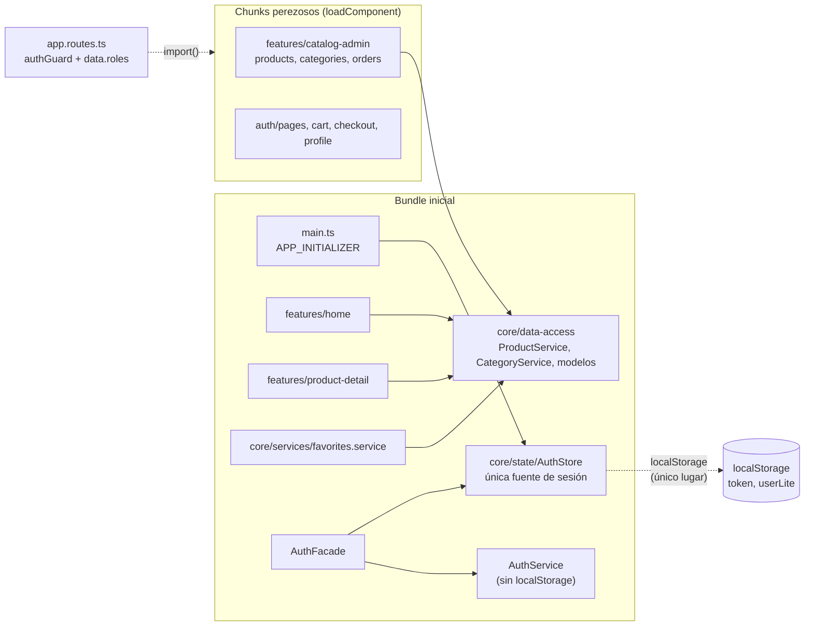
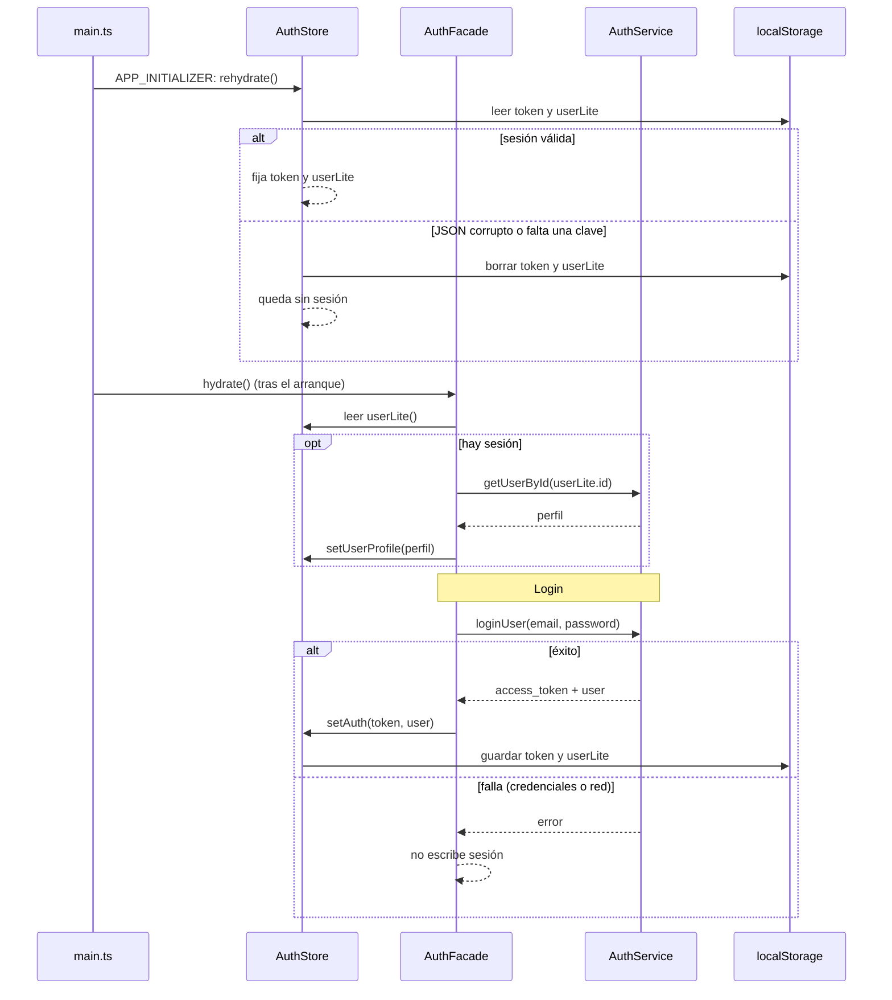

# Diseño: frontend-cleanup

Responde a `requirements.md` (REQ-1 a REQ-8). Es un refactor del frontend sin cambios de API ni de pantallas.

## 1. Mediciones previas (2026-10-16)

Build de producción en `a6e3d71`, con `--stats-json`. El presupuesto `initial` cuenta JS + CSS:

| Parte | Tamaño |
|---|---|
| `main-*.js` | 782,7 kB |
| `styles-*.css` | 99,7 kB |
| **Total inicial** | **882,4 kB** (hay que bajar al menos **82,4 kB**) |

Composición de `main` por origen (kB, sin comprimir):

| Origen | kB | Se puede mover a un chunk perezoso |
|---|---|---|
| `@angular/core` | 165,2 | No |
| `@angular/cdk` | 123,7 | Parcial: lo usa el `Dialog` del admin, del perfil y del `confirm-dialog` |
| `@angular/router` | 68,3 | No |
| `@fortawesome/fontawesome-svg-core` | 67,9 | No (los íconos ya se importan uno por uno: `free-solid-svg-icons` no aparece en el bundle) |
| `@angular/common` + `forms` + `platform-browser` + `rxjs` | 121,5 | No |
| `zone.js` | 34,7 | No: `src/main.ts` hace `import 'zone.js'` y la app del navegador corre con zone (ver decisión D6) |
| `features/catalog-admin` (products 34,3 + categories 15,3 + orders 11,0 + shared 4,7) | 65,3 | **Sí** |
| `features/auth/pages` | 15,7 | **Sí** |
| `features/cart` (10,9) + `checkout` (13,3, incluye la pantalla de éxito) | 24,2 | **Sí** |
| `features/profile` | 3,8 | **Sí** |
| `features/home` + `product-detail` + `auth/components` + `shared` + `core` | ~57 | No (ruta de entrada) |

Las pantallas que se pueden diferir suman **≈109 kB** (65,2 + 15,7 + 24,2 + 3,8), más la parte de CDK `Dialog` que se vaya con ellas (hoy lo usan el admin, `profile` y `image-field`, todos perezosos). Los pasos 1 y 2 solos suman 80,9 kB, 1,5 kB menos de los 82,4 kB necesarios: el paso 3 es el que asegura el margen.

## 2. Arquitectura

La dependencia va siempre de `features/` hacia `core/`, nunca al revés (REQ-5.3).

### Secuencia: arranque con sesión guardada y login

## 3. Decisiones

### D1. Sesión única (REQ-1)
- `AuthStore.rehydrate()` pasa a validar: `token` string no vacío y `userLite` JSON con `id` numérico. Si la sesión es inválida (JSON roto, falta una clave, forma incorrecta) borra ambas claves y deja el store vacío, sin lanzar (`try/catch` alrededor de `JSON.parse`). → REQ-1.3, 1.5, 1.6, 1.7.
- `AuthService.loginUser` pierde el `tap` que escribe `token`; queda solo la llamada HTTP y el `catchError`. `AuthFacade.loginUser` ya hace `store.setAuth(...)` solo tras el éxito, así que el login fallido no escribe nada. → REQ-1.1, 1.2, 1.10.
- `AuthFacade.hydrate()` deja de leer `localStorage`: toma `store.userLite()` (ya restaurado por el `APP_INITIALIZER`), y si hay sesión pide el perfil con `getUserById(userLite.id)`. Hoy esa llamada no tiene `try/catch`: si falla, la promesa de `hydrate` se rechaza sin manejar y `loadingProfile` queda en `true` para siempre. **Decisión (a confirmar al aprobar):** envolverla en `try/catch/finally`; en la falla la sesión sigue, el perfil queda sin cargar y `loadingProfile` vuelve a `false`. Es el único cambio de comportamiento de esta spec en la sesión además de REQ-1.5 a 1.7, y se prueba (ver sección 5). → REQ-1.3, 1.4, 1.11.
- `clear()` y `setAuth()` no cambian. → REQ-1.8, 1.9.
- **Alternativa descartada:** mover toda la persistencia a un `SessionStorage` aparte. Agrega una clase que nadie pidió; `AuthStore` ya concentra el estado y su persistencia.

### D2. `OnPush` en los 28 componentes que faltan (REQ-2)
- Se agrega `changeDetection: ChangeDetectionStrategy.OnPush` a cada componente sin `OnPush`, **de las hojas hacia la raíz**: hojas de `shared/` (`header`, `toast-container`, `confirm-dialog`, `image-field`) → `auth` → `cart`/`checkout`/`home`/`product-detail` → `catalog-admin` → `profile` (D3) → **al final `layout` y `app.ts`**.
- **Por qué ese orden (corregido el 2026-10-16, al empezar T13):** la app del navegador corre con `zone.js` (`main.ts`). Un componente `OnPush` solo se revisa si lo marcan sucio un evento de su plantilla, un `input()` nuevo o una señal que lee. Si un ancestro `OnPush` tiene descendientes en `Default` cuyos campos comunes cambian por HTTP o temporizadores, nada marca sucio al ancestro y esos cambios no se ven. `App` y `Layout` son los ancestros de todas las pantallas: pasarlos a `OnPush` primero rompería cualquier página con estado mutable sin señal (por ejemplo `LoginForm.isLoading`). Regla: **un componente pasa a `OnPush` solo cuando todo su subárbol ya es seguro** (señales o sin estado mutable); dentro de cada grupo, hojas primero y padres después. `Header` no es ancestro de las pantallas: el `router-outlet` lo declara `Layout` y solo se proyecta en el `ng-content` de `Header`.
- Antes de cada grupo se inventarían los campos que cambian por eventos, HTTP o temporizadores y que usa la plantilla (por ejemplo `LoginForm.isLoading`, que hoy es un campo común). Se pasan a `signal`/`computed`, y cada componente con estado mutable gana un test que cambie el valor, llame a `detectChanges` y compruebe el DOM. → REQ-2.1, 2.2, 2.3.
- **REQ-2.4 se cubre con ESLint (D7).** La regla `@angular-eslint/prefer-on-push-component-change-detection` impide que vuelva a entrar un componente sin `OnPush`. REQ-2.1 se verifica además con el `grep` de la sección 4.
- **Alternativa descartada:** pasar a zoneless para que `OnPush` sea gratis. Ver D6.

### D3. `Profile` con signals (REQ-3)
- Campos como `signal`: `selectedImageFile`, `imageError`, `isUploadingImage`, `isDeletingImage`, `enableEdit`. `profile` y `avatar` pasan a `computed` desde `store.userProfile()`.
- Un `effect()` copia el perfil al `FormGroup` **solo cuando `enableEdit()` es `false`**; sustituye al `ngAfterViewInit` (que hoy hace `patchValue` una sola vez). Así, subir o borrar la imagen durante la edición cambia el perfil en el store (`avatar`) pero no pisa lo que el usuario está escribiendo. Con perfil `null` el formulario queda vacío y deshabilitado. → REQ-3.1, 3.4.
- **Alternativa descartada:** `patchValue` manual en cada handler. Repite la lógica en subida, borrado y cambio del store, y es lo que hoy deja el formulario desactualizado.
- Los handlers de subida y borrado fijan los signals en este orden: al empezar `true`; en éxito `false` + `avatar` actualizado (vía el store); en falla `false` + `imageError` con el mensaje. Elegir archivo limpia `imageError`. → REQ-3.5 a 3.11.
- `edit()` habilita el formulario y fija `enableEdit(true)`. → REQ-3.2, 3.3.
- Los tests nuevos de `Profile` (un `it` por criterio REQ-3.x, con el id en el nombre) se agregan al `profile.spec.ts` existente, que ya provee `provideHttpClient`, `provideHttpClientTesting` y `provideZonelessChangeDetection`; hoy solo tiene un `should create`.

### D4. Código muerto (REQ-4)
- Se borra la cadena `LoginForm.postItems()` → `AuthFacade.newPost()` → `AuthService.postItems()` (y su `POST /posts`). → REQ-4.1, 4.2.
- `HomePage` pasa a `selector: 'app-home-page'`. `Layout` no se toca (su `<app-header>` es el `Header` real, con `ng-content`). → REQ-4.3.
- `AuthStore.rehydrate()` se conserva (lo usa `main.ts`). → REQ-4.4.

### D5. `core/data-access` (REQ-5)
- Se mueven con `git mv`, sin cambiar su contenido más que los imports:
  - `features/catalog-admin/products/services/product.service.ts` (+ su `.spec.ts`) → `core/data-access/products/`
  - `features/catalog-admin/products/models/prd-res.model.ts` y `product.model.ts` → `core/data-access/products/`
  - `features/catalog-admin/categories/services/category.service.ts` y `models/category.model.ts` → `core/data-access/categories/`
- `ProductService` importa `ProductModel` y `CategoryService` importa `CategoryModel`, así que esos modelos se mueven con ellos. Si no, `core/` importaría de `catalog-admin` y se rompería REQ-5.3.
- El admin, `home`, `product-detail` y `favorites.service` importan desde `core/data-access`. Las llamadas HTTP no cambian porque el contenido de los servicios no cambia. → REQ-5.1 a 5.4.
- Se mueve el servicio entero (lectura y escritura): partirlo en uno de lectura y uno de administración obligaría a tocar tests y componentes que nadie pidió. Queda anotado como mejora futura.
- Los estados loading/empty/error de `home` y detalle dependen del componente y no se tocan. → REQ-5.5.

### D6. Bundle (REQ-6)
- Rutas perezosas con `loadComponent: () => import(...)`, en este orden y midiendo el build después de cada paso:
  1. `admin/product`, `admin/category`, `admin/orders` (65,2 kB).
  2. `auth/pages` (check-email, forgot/request/reset password, verify-email: 15,7 kB). Acumulado: 80,9 kB, todavía por debajo de lo necesario.
  3. `cart`, `checkout`, `checkout/success` y `profile` (28 kB). Con este paso se supera la meta.
- Se para en cuanto el total inicial sea de 800 kB o menos; no se difiere más de lo necesario. `login` y `register` se quedan eager (entrada frecuente).
- Los `canActivate: [authGuard]` y `data.roles` quedan en la definición de la ruta: el guard corre antes de descargar el chunk, así que el acceso al admin no cambia. Roles actuales que se conservan y se prueban: `admin/product` y `admin/category` admiten `ADMIN` y `GUEST` (el invitado de la demo); `admin/orders` admite solo `ADMIN`. Un rol que no figura en `data.roles` de la ruta se redirige a `/home`; sin sesión, a `/login`. → REQ-5.6, 6.3.
- **Plan B (REQ-6, decisión de la spec):** si con los tres pasos sigue sobre 800 kB, se para y se vuelve a la spec con la medición.
- **Alternativas descartadas:** (a) quitar `zone.js` de `main.ts`: la app del navegador arranca con `main.ts` (sin `provideZonelessChangeDetection`; ese proveedor solo está en `app.config.ts`) y pasar a zoneless es una spec aparte; (b) subir `maximumWarning` (prohibido por REQ-6.4); (c) `@defer` de bloques: no aporta sobre `loadComponent` para pantallas enteras.
- Fuera de alcance, anotado: `main.ts` y `app.config.ts` duplican la lista de providers y difieren (zone vs. zoneless, `AuthFacade`, `APP_INITIALIZER`). No se unifican aquí.

### D7. ESLint en el frontend (REQ-9, REQ-2.4)
- Se instala con el flujo oficial de Angular, `ng add angular-eslint`, o equivalente manual: `eslint`, `typescript-eslint` y `angular-eslint` como `devDependencies` en versiones compatibles con Angular 20 y ESLint 9. Como el proyecto fija Angular en versión exacta y `npm install` da `ERESOLVE` por peers, la instalación usa `--legacy-peer-deps` (misma nota que en `pendientes.md`). La versión exacta se elige en la tarea con `npm view` y se anota. → REQ-9.6.
- Configuración plana (`frontend/eslint.config.js`): recomendadas de `typescript-eslint` y de `angular-eslint` para `*.ts` y para `*.html` (plantillas), más `@angular-eslint/prefer-on-push-component-change-detection` como error. Los selectores siguen el prefijo `app` ya usado. → REQ-9.2, 2.4.
- Script `"lint": "ng lint"` en `package.json` (usa el builder de `angular-eslint`) o `eslint "src/**/*.{ts,html}"` si el schematic no se puede usar. Sin `--fix` en el CI, igual que en el backend. → REQ-9.1.
- **Primero se mide y se corrige:** se corre el lint sobre el código actual, se anota cuántos errores hay por regla y se corrige el código, no la configuración. Una excepción puntual lleva `eslint-disable-next-line` con el motivo; se cuentan al cerrar. Si la cantidad de errores de una regla es desproporcionada (por ejemplo cientos), se para y se vuelve a la spec para decidir, en vez de silenciarla. → REQ-9.3, 9.4.
- CI (`.github/workflows/ci.yml`, job `frontend`): se agrega `- run: npm run lint` después de `npm ci` y antes de `ng test`. Bloqueante. → REQ-9.5.
- El orden de las tareas pone el lint **antes** de los cambios de código (para tener línea base) y lo vuelve a correr al final de cada grupo. Así cada grupo se cierra con el lint en verde.
- **Alternativas descartadas:** (a) `eslint-config-prettier` y reglas de formato: otra dependencia sin pedido; el formato lo sigue cubriendo Prettier. (b) Desactivar reglas ruidosas en la configuración: lo prohíbe REQ-9.3.
- `npm audit --omit=dev` no cambia, porque ESLint va solo en `devDependencies`.

### D8. Documentación (REQ-8)
Se actualizan al cerrar: `.claude/specs/pendientes.md`; `.claude/steering/structure.md` (carpeta `core/data-access` y `AuthStore` como única fuente de sesión); `.claude/steering/tech.md` y la sección «Comandos» de `CLAUDE.md` (ESLint y `npm run lint` en el frontend). → REQ-8.1 a 8.4.

## 4. Verificación de los criterios por inspección

| Criterios | Método |
|---|---|
| REQ-1.11 | `grep -rnE "localStorage\.[a-zA-Z]+\(\s*'(token\|userLite)'" frontend/src/app --include=*.ts` sin specs: solo `core/state/auth.store.ts` (el patrón con `localStorage.` evita coincidencias con `queryParamMap.get('token')`) |
| REQ-2.1 | `grep -rL OnPush` sobre los `.ts` con `@Component` (sin specs): vacío |
| REQ-4.1, 4.2 | `grep -rn "postItems\|newPost\|/posts" frontend/src/app` (sin specs): vacío |
| REQ-4.3 | `grep -rn "selector: 'app-header'"`: solo `shared/header/header.ts` |
| REQ-4.4 | `grep -n "rehydrate" frontend/src/main.ts`: una coincidencia |
| REQ-5.3 | `grep -rn "catalog-admin" frontend/src/app/features/home frontend/src/app/features/product-detail frontend/src/app/core`: vacío |
| REQ-6.1 | Salida de `npm run build -- --configuration production`: total inicial ≤ 800 kB y sin la advertencia de presupuesto |
| REQ-6.4 | `git diff origin/main -- frontend/angular.json`: sin cambios en `budgets` |
| REQ-7.3, 9.6 | `git diff origin/main -- frontend/package.json`: sin cambios en `dependencies`; solo `devDependencies` de ESLint y el script `lint` |
| REQ-9.1 | `cd frontend && npm run lint` con código 0 |
| REQ-9.4 | `grep -rn "eslint-disable" frontend/src`: cada coincidencia con motivo; el total se anota en el cierre |
| REQ-9.5 | `grep -n "npm run lint" .github/workflows/ci.yml` en el job `frontend`, antes de `ng test` |

## 5. Estrategia de testing

Karma + Jasmine, con `provideZonelessChangeDetection` y `provideHttpClientTesting` como en los specs actuales. Cada test lleva el id del criterio en su nombre (`it('REQ-1.5: ...')`).

| Criterios | Spec (existente o nuevo) | Qué prueba |
|---|---|---|
| REQ-1.1, 1.8, 1.9 | `core/state/auth.store.spec.ts` (nuevo) | `setAuth` guarda ambas claves; `clear` las borra y vacía token, usuario y perfil |
| REQ-1.3, 1.5, 1.6, 1.7 | `core/state/auth.store.spec.ts` | `rehydrate` con sesión válida, con `userLite` roto, con una sola clave, y que en los inválidos borra las claves y no lanza |
| REQ-1.2, 1.10 | `features/auth/services/auth.service.spec.ts` (nuevo) y `auth.facade.spec.ts` (existente) | `loginUser` no toca `localStorage`; un login con 401 y uno con error de red no dejan sesión en el store ni en `localStorage` |
| REQ-1.4 | `auth.facade.spec.ts` | `hydrate` pide `getUserById(userLite.id)` con la sesión restaurada; no pide nada sin sesión; si falla, `loadingProfile` vuelve a `false` |
| REQ-2.2, 2.3 | un spec por cada componente que pasa estado a signals (por ejemplo `login-form.spec.ts`, `profile.spec.ts`) | Cambiar el signal y llamar a `detectChanges` actualiza el DOM |
| REQ-3.1 a 3.11 | `features/profile/profile.spec.ts` | Un `it` por criterio, incluido «subir imagen durante la edición no pisa los campos del formulario» |
| REQ-5.4 | `core/data-access/products/product.service.spec.ts` (el existente, movido) y uno nuevo para `CategoryService` | Mismas rutas, métodos y cuerpos que antes |
| REQ-5.5 | `features/home/home-page.spec.ts` (existente) | Estados loading, vacío y error de `home`, más uno nuevo para `product-detail-page` si no está cubierto |
| REQ-5.6 | `core/guards/auth-guard.spec.ts` (existente) | `ADMIN` y `GUEST` pasan en las rutas de `product`/`category`; `CLIENT` rebota a `/home`; `orders` solo deja pasar a `ADMIN`; sin sesión va a `/login` |
| REQ-6.2, 6.3, 7.4 | Humo manual en el navegador | Lo describe REQ-7.4; se anota el resultado en las tareas |
| REQ-2.4 | Comprobación manual en la tarea de lint | Quitar `OnPush` a un componente de prueba, correr `npm run lint` (debe fallar) y revertir |
| REQ-1.11, 2.1, 4.x, 5.3, 6.1, 6.4, 7.2, 7.3, 9.x | Inspección (sección 4) | `grep`, build, `npm run lint` y `git diff` |

## 6. Trazabilidad

| Requisito | Qué lo cubre |
|---|---|
| REQ-1.1, 1.2, 1.10 | D1 (`loginUser` sin `tap`; `setAuth` solo tras éxito) |
| REQ-1.3, 1.4 | D1 (`rehydrate` en el `APP_INITIALIZER`; `hydrate` sin releer) |
| REQ-1.5, 1.6, 1.7 | D1 (validación y limpieza en `rehydrate`) |
| REQ-1.8, 1.9 | D1 (`clear()` sin cambios, con tests) |
| REQ-1.11 | D1 + `grep` de la sección 4 |
| REQ-2.1 a 2.3 | D2 |
| REQ-2.4 | D2 y D7 (regla `prefer-on-push-component-change-detection`) |
| REQ-3.1 a 3.11 | D3 |
| REQ-4.1 a 4.4 | D4 |
| REQ-5.1 a 5.4 | D5 |
| REQ-5.5 | D5 (componentes sin tocar) + tests de `home` |
| REQ-5.6 | D6 (guards en la ruta) + test del guard |
| REQ-6.1 | D6 |
| REQ-6.2, 6.3 | D6 + humo manual |
| REQ-6.4 | D6 + `git diff` de la sección 4 |
| REQ-7.1 a 7.4 | Todas las decisiones; ng test, build, `git diff` y humo manual |
| REQ-8.1 a 8.4 | D8 |
| REQ-9.1 a 9.6 | D7 |

Decisiones técnicas sin requisito propio: mover los modelos junto con los servicios (D5) y conservar el servicio entero (D5); ambas existen para cumplir REQ-5.3 con el menor cambio.
