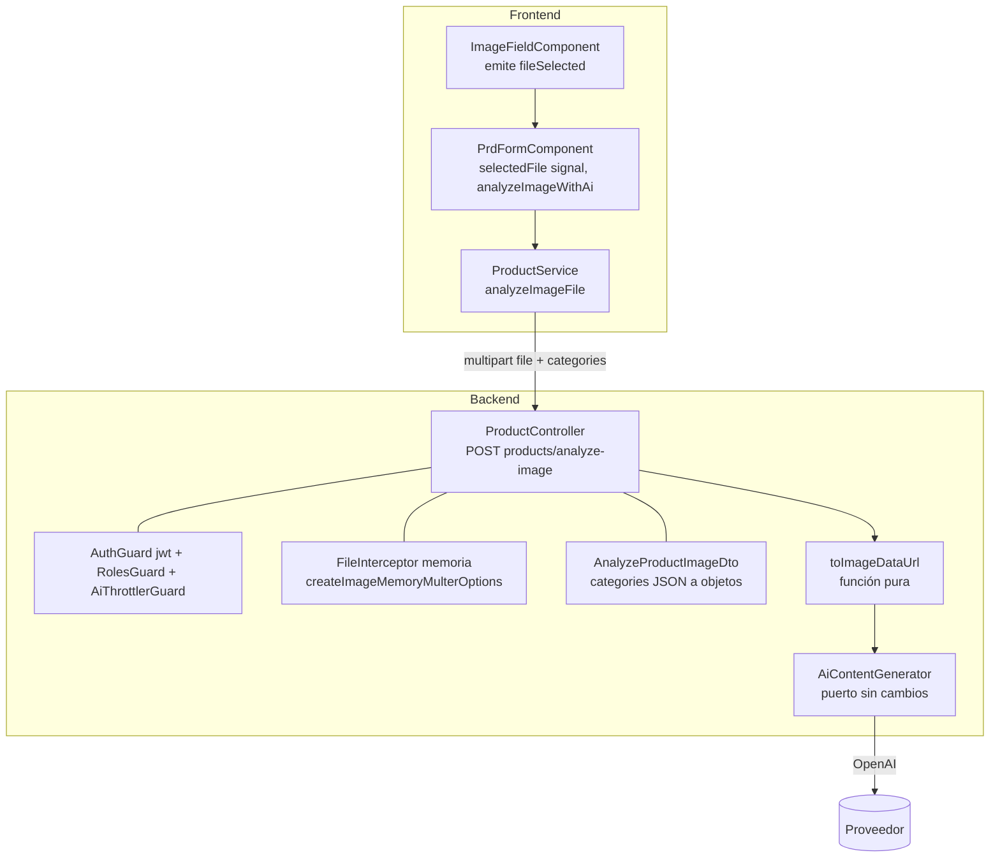
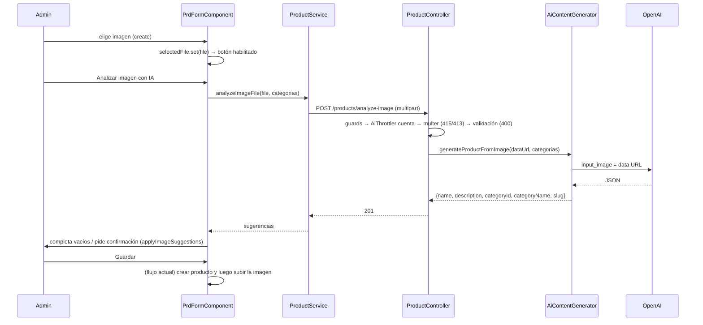

# Diseño: ia-al-crear-producto

Estado: **aprobado de corrido por el usuario** (v2, 2026-10-22; la v1 fue revisada por `spec-reviewer`: 1 bloqueante y 6 menores, todos incorporados). Requisitos: `requirements.md` (aprobados, con las enmiendas REQ-1.3/1.3a, 1.17, 1.18 y 1.19 surgidas de esta revisión).

## 1. Resumen y decisiones clave

- **Un endpoint nuevo recibe la imagen por `multipart` y la analiza en memoria** (`POST /products/analyze-image`). No se guarda nada en disco y no hay estado que limpiar. Cubre REQ-2.
- **El frontend guarda el `File` elegido en `PrdFormComponent`** (un signal) y lo manda a ese endpoint solo en modo `create`. En `edit` sigue el camino actual por URL. Cubre REQ-1.
- **Reutilización máxima:** mismo guard stack que `generate-from-image` (`JWT` + `RolesGuard('ADMIN','GUEST')` + `AiThrottlerGuard`), mismo puerto `AiContentGenerator` sin cambios, mismo `applyImageSuggestions` y mismos avisos en el cliente.
- **Ruta elegida: `POST /products/analyze-image`.** Es de un solo segmento, así que no choca con las rutas `POST products/:id/image`. No hay otro `@Post` de un segmento con parámetro.
- **El `data:` URL resuelve `localhost`:** OpenAI recibe los bytes de la imagen y no tiene que descargar nada.

## 2. Arquitectura



Orden de ejecución en Nest: **guards → interceptor (multer) → pipes (validación del cuerpo) → handler**. Por eso `AiThrottlerGuard` cuenta antes de validar (REQ-2.14).

## 3. Componentes e interfaces

### 3.1 Backend: opciones de multer en memoria
- **Archivo:** `backend/src/files/multer-image-options.factory.ts` (se amplía) — se extrae del factory actual el filtro y el tope para compartirlos.
- **Responsabilidad:** que el endpoint nuevo acepte exactamente los mismos formatos y tamaño que las subidas a disco, sin escribir en `uploads/`.
- **Cubre:** REQ-2.4, REQ-2.5, REQ-2.11.
- **Interfaz:**
  ```ts
  // se exportan para compartirlos (mismo comportamiento que hoy)
  export const imageFileFilter: MulterOptions['fileFilter'];     // 415 si el MIME no es jpeg/png/webp
  export const imageFileSizeLimit = (): number;                  // MAX_IMAGE_SIZE_BYTES o el default de 5 MB
  export const createImageMemoryMulterOptions = (): MulterOptions; // memoryStorage + limits + fileFilter
  ```
  `createImageMulterOptions(folder)` queda igual para sus llamadores, usando las mismas dos piezas.

  **Topes del multipart (enmienda por la auditoría, REQ-2.19 a 2.21):** `createImageMemoryMulterOptions()` agrega a `limits` `files: 1`, `fields: 1`, `parts: 2` y `fieldSize: 64 * 1024`. Multer responde con `LIMIT_FILE_COUNT`, `LIMIT_FIELD_COUNT`, `LIMIT_PART_COUNT` o `LIMIT_FIELD_VALUE`, que Nest traduce a 400. Solo afecta al endpoint nuevo; `createImageMulterOptions` (a disco) no cambia.

### 3.2 Backend: función de conversión
- **Archivo nuevo:** `backend/src/files/image-data-url.ts`.
- **Responsabilidad:** convertir el archivo en memoria al `data:` URL que consume el puerto de IA. Es una función pura, sin Nest, fácil de probar.
- **Cubre:** REQ-2.17.
- **Interfaz:**
  ```ts
  export const toImageDataUrl = (file: { mimetype: string; buffer: Buffer }): string =>
    `data:${file.mimetype};base64,${file.buffer.toString('base64')}`;
  ```

### 3.3 Backend: DTO del cuerpo
- **Archivo nuevo:** `backend/src/product/dto/analyze-product-image.dto.ts` (reutiliza `GenerateProductFromImageCategoryDto`).
- **Responsabilidad:** convertir el campo de texto `categories` en una lista de objetos validada, y que cualquier forma inválida termine en 400 por el `ValidationPipe` global.
- **Cubre:** REQ-2.8, REQ-2.9, REQ-2.10.
- **Interfaz:**
  ```ts
  export class AnalyzeProductImageDto {
    // multipart entrega texto: se interpreta el JSON y cada elemento se instancia como
    // GenerateProductFromImageCategoryDto para que @ValidateNested lo valide.
    // Si el JSON no se puede interpretar (o `categories` falta), se deja el valor tal cual y @IsArray falla → 400.
    @Transform(({ value }) => parseCategories(value))
    @IsArray() @ArrayMinSize(1) @ArrayMaxSize(200) @ValidateNested({ each: true })   // ArrayMaxSize: REQ-2.18
    categories: GenerateProductFromImageCategoryDto[];
  }
  ```
  `parseCategories` vive en el mismo archivo del DTO:
  ```ts
  const parseCategories = (value: unknown): unknown => {
    if (typeof value !== 'string') return value;                 // ya es otra cosa: que la validación decida
    let parsed: unknown;
    try { parsed = JSON.parse(value); } catch { return value; }  // JSON no interpretable: se deja el texto → @IsArray falla → 400
    return Array.isArray(parsed) ? plainToInstance(GenerateProductFromImageCategoryDto, parsed) : parsed; // no-array → @IsArray falla → 400
  };
  ```
  **Detalle que importa:** `@Type` no se aplica sobre un valor `string`, por eso el `@Transform` devuelve instancias con `plainToInstance(GenerateProductFromImageCategoryDto, parsed)`; con objetos planos `class-validator` rechazaría todo por «valor desconocido». Un test cubre el caso feliz (REQ-2.1) justamente para detectar esto.

### 3.4 Backend: endpoint
- **Archivo:** `backend/src/product/controllers/product.controller.ts` (un método nuevo).
- **Responsabilidad:** exigir el archivo, convertirlo y delegar en el puerto. Delgado: sin lógica de negocio.
- **Cubre:** REQ-2.1 a REQ-2.17, NFR-4.
- **Interfaz:**
  ```ts
  @ApiOperation({ summary: 'Analyze a product image (not stored) and suggest product data' })
  @ApiConsumes('multipart/form-data')
  @ApiBody({ schema: { type: 'object', required: ['file', 'categories'], properties: {
      file: { type: 'string', format: 'binary' },
      categories: { type: 'string', description: 'JSON: [{"id":1,"name":"Teclados"}]' } } } })
  @UseGuards(AuthGuard('jwt'), RolesGuard, AiThrottlerGuard)
  @Roles('ADMIN', 'GUEST')
  @Post('analyze-image')
  @UseInterceptors(FileInterceptor('file', createImageMemoryMulterOptions()))
  analyzeImage(@UploadedFile() file: { mimetype: string; buffer: Buffer; size: number } | undefined,
               @Body() body: AnalyzeProductImageDto) {
    if (!file) throw new BadRequestException('File is required');           // REQ-2.6
    if (file.size === 0) throw new BadRequestException('File is empty');   // REQ-2.7
    return this.openAiService.generateProductFromImage(toImageDataUrl(file), body.categories); // REQ-2.1, 2.15-2.17
  }
  ```
  El 201 sale del `POST` por defecto. Los 502 y 400 de la IA los lanza el adaptador, igual que en `generate-from-image`.

### 3.5 Frontend: servicio
- **Archivo:** `frontend/src/app/core/data-access/products/product.service.ts`.
- **Cubre:** REQ-1.4, REQ-1.5.
- **Interfaz:**
  ```ts
  analyzeImageFile(file: File, categories: ProductImageCategoryOption[]): Observable<GenerateProductFromImageResponse> {
    const formData = new FormData();
    formData.append('file', file);
    formData.append('categories', JSON.stringify(categories));
    return this.http.post<GenerateProductFromImageResponse>(`${this.apiUrl}/products/analyze-image`, formData);
  }
  ```
  `HttpClient` fija solo el `Content-Type` con el *boundary*; el interceptor solo agrega `Authorization`.

### 3.6 Frontend: formulario del producto
- **Archivo:** `frontend/src/app/features/catalog-admin/products/components/product-form/product-form.component.ts` y `product-form.html`.
- **Responsabilidad:** recordar el archivo elegido, habilitar el botón, llamar al endpoint según el modo y bloquear el guardado mientras se analiza.
- **Cubre:** REQ-1.1 a REQ-1.17.
- **Cambios:**
  ```ts
  readonly selectedFile = signal<File | null>(null);          // REQ-1.1 a 1.3a

  onImageFileSelected(file: File | null) {
    // ImageFieldComponent emite null solo al quitar; al rechazar un archivo inválido no emite y conserva
    // el válido anterior (el mismo que muestra la vista previa): por eso REQ-1.3a.
    this.selectedFile.set(file);
    this.imageFileSelected.emit(file);
  }

  canAnalyzeImageWithAi() {                                   // REQ-1.1, 1.2, 1.3, 1.15, 1.17, 1.18
    const hasImage = !!this.resolvedImageUrl() || !!this.selectedFile();
    return hasImage && !this.loadingCategories() && !this.isAnalyzingImage();
  }

  analyzeImageWithAi() {
    // La fuente se decide por el dato y no por el modo: si hay imagen ya subida (resolvedImageUrl) se usa el
    // endpoint actual por URL (REQ-1.17); si no, pero hay archivo local, se usa analyzeImageFile (REQ-1.4, 1.18).
    // En 'create' nunca hay URL, así que siempre es el archivo. El resultado, los avisos de error y el manejo de
    // isAnalyzingImage son los de hoy (REQ-1.6, 1.9 a 1.13).
  }
  ```
  - **Destrucción del componente (REQ-1.20):** la suscripción del análisis usa `takeUntilDestroyed(this.destroyRef)` para no abrir diálogos ni avisos sobre un formulario destruido.
  - **Carga de categorías:** `loadCategoriesByUserId` pone `loadingCategories.set(false)` también en `error` (REQ-1.19). Es un cambio de una línea; con la lista vacía el botón avisa «No hay categorías disponibles…» (REQ-1.14).
  - **Guardado:** el botón de guardar (`product-form.html`) suma `|| isAnalyzingImage()` a su `[disabled]` (REQ-1.8). «Generar descripción y slug» ya se deshabilita con `isAnalyzingImage()` (REQ-1.7).
  - **Sin categorías:** el aviso actual de `analyzeImageWithAi` cubre REQ-1.14; REQ-1.15 evita el aviso engañoso mientras cargan.
  - **Guardar tras analizar (REQ-1.16):** el diálogo padre no cambia; sigue creando y luego subiendo `selectedImageFile`. Analizar no toca ese flujo, así que la imagen se sube una sola vez.

## 4. Modelo de datos

Sin cambios: ni tablas, ni migraciones, ni entidades (NFR-3). La imagen analizada no se persiste.

## 5. Flujos principales



## 6. Manejo de errores

| Situación | Backend | Frontend |
|---|---|---|
| Sin token / token inválido | 401 (no cuenta tope) | el interceptor/guard actual de sesión |
| Rol `CLIENT` | 403 (no cuenta tope) | no aplica: la pantalla es del admin |
| MIME no permitido | 415, sin llamar a la IA (cuenta tope) | `image-rules.ts` ya lo rechaza antes de enviar y el botón no se habilita |
| Más de `MAX_IMAGE_SIZE_BYTES` | 413 (cuenta tope) | ídem |
| Sin archivo / archivo vacío | 400 (cuenta tope) | no ocurre: el botón exige un archivo |
| `categories` ausente, vacía, no JSON o con forma inválida | 400 (cuenta tope) | no ocurre: el cliente arma el JSON |
| Tope de IA agotado | 429 | aviso «No se pudo analizar la imagen con IA.» (REQ-1.11) |
| OpenAI falla | 502 `OpenAI request failed` | mismo aviso |
| Respuesta de la IA inválida o sin nombre | 400 | mismo aviso |

Cualquier error del análisis en el cliente deja formulario e imagen intactos y rehabilita el botón (REQ-1.12, 1.13).

## 7. Estrategia de testing

Cada test lleva el id del criterio en el nombre.

**Backend (Jest, sin base de datos):**
- `image-data-url.spec.ts` — REQ-2.17.
- `multer-image-options.factory.spec.ts` (nuevo) — el filtro rechaza lo que rechazaba (REQ-2.4) y las opciones en memoria no usan `diskStorage` (REQ-2.11). Las opciones a disco no cambian de comportamiento.
- `analyze-product-image.dto.spec.ts` — REQ-2.8, 2.9, 2.10 y el caso feliz (REQ-2.1, detecta el `plainToInstance`), con un `ValidationPipe` con las opciones de producción (como `list-products-query.dto.spec.ts`).
- `product.controller.analyze-image.spec.ts` con `createControllerApp` y un doble del puerto — REQ-2.1, 2.2, 2.3, 2.4, 2.5, 2.6 (archivo ausente **y** archivo en un campo con otro nombre, que multer rechaza con `LIMIT_UNEXPECTED_FILE` → 400), 2.7, 2.15, 2.16, 2.17 (que llegue el `data:` URL y las categorías) y 2.11 (la carpeta `uploads/` no cambia).
- `product.controller.analyze-image.throttle.spec.ts` — REQ-2.12, 2.13, 2.14, con el `AiThrottlerGuard` **real** y `ThrottlerModule.forRoot` con tope bajo. Verifica el 429, el contador compartido con `generate-ai`/`generate-from-image` y que un 415 consume tope y un 401 no.
- **Cambio aditivo en `test/controller-testing.ts`:** `createControllerApp` gana un 5.º parámetro opcional `options` con valores por defecto que dejan todo como hoy:
  ```ts
  { imports?: ModuleMetadata['imports'];                      // p. ej. ThrottlerModule.forRoot(...)
    validationPipeOptions?: ValidationPipeOptions;            // los de producción (app.setup.ts): whitelist, forbidNonWhitelisted, transform, transformOptions.enableImplicitConversion
    rejectUnauthenticatedWith401?: boolean }                  // el guard falso lanza UnauthorizedException en vez de devolver false (que Nest convierte en 403)
  ```
  Los specs nuevos pasan las opciones de producción y `rejectUnauthenticatedWith401: true` (necesario para REQ-2.2 y para «un 401 no consume tope»). Los specs existentes no pasan nada y no cambian.
- e2e existentes (`catalog-ai.e2e-spec.ts`) no se tocan; no corren en el CI.
- NFR-1: el documento Swagger de `generate-from-image` y `generate-ai` se compara antes y después (como en `backend-architecture`).

**Frontend (Karma):**
- `product-form.component.spec.ts` — REQ-1.1 a 1.8, 1.11 a 1.15 y 1.17 a 1.19, incluida 1.3a (estado del botón, endpoint correcto según haya URL o archivo local, avisos, bloqueo del guardado, `loadingCategories` en error).
- `product.service.spec.ts` — REQ-1.4 (método, URL, `FormData` con `file` y `categories` como JSON).
- `product-form-dialog.component.spec.ts` — REQ-1.5 y REQ-1.16 (analizar no llama a `createProduct` ni a `uploadProductImage`; guardar después sube la imagen una sola vez).
- Reglas de fusión de sugerencias (REQ-1.9, 1.10) ya tienen tests; se verifica que sigan en verde y se agrega uno por criterio en el camino `create`.

**Manual:** probar en local con `npm run start:dev` y `npm start`: crear un producto, elegir imagen, analizar y guardar.

## 8. Decisiones descartadas

- **Subir a una carpeta temporal y analizar por URL:** agrega estado en disco y limpieza de huérfanos, y no resuelve `localhost`. Descartada con el usuario.
- **Mandar la imagen como base64 en el JSON del endpoint existente:** el *body parser* de Nest limita el JSON a ~100 kB por defecto; subirlo globalmente para 5 MB de imagen (≈ 6,7 MB en base64) agranda la superficie de abuso en todo el API. `multipart` con tope propio queda acotado al endpoint.
- **Tipar la conversión como método de `ProductService`:** el controller ya habla con el puerto de IA (`generate-from-image`); una función pura de `files/` evita sumar una dependencia al servicio sin necesidad.
- **Hacer que las peticiones rechazadas por validación no consuman tope:** exigiría mover el conteo después de la validación (un guard no puede). No lo pide ningún caso y el endpoint actual se comporta igual.
- **Que `ImageFieldComponent` emita `null` al rechazar un archivo** para limpiar la selección: cambia la vista previa y el estado del diálogo en perfil, producto y categoría; se prefirió conservar el archivo válido anterior (REQ-1.3a).

## 9. Trazabilidad

| Requisito | Cubierto por |
|---|---|
| REQ-1.1, 1.2, 1.3, 1.3a, 1.15, 1.17, 1.18 | 3.6 `selectedFile` y `canAnalyzeImageWithAi()` (fuente por dato: URL o archivo) |
| REQ-1.19 | 3.6 `loadingCategories.set(false)` en `error` |
| REQ-1.4, 1.5 | 3.5 `analyzeImageFile` y 3.6 `analyzeImageWithAi()` (sin tocar crear/subir) |
| REQ-1.6, 1.7 | 3.6 (plantilla actual del botón; «Generar» ya depende de `isAnalyzingImage`) |
| REQ-1.8 | 3.6 `[disabled]` del botón de guardar |
| REQ-1.9, 1.10 | 3.6 reutiliza `applyImageSuggestions` |
| REQ-1.11, 1.12, 1.13 | 3.6 manejo de error y `isAnalyzingImage` de hoy |
| REQ-1.14 | 3.6 aviso existente sin categorías |
| REQ-1.16 | diálogo padre sin cambios (3.6) |
| REQ-2.1 | 3.4 endpoint, 3.3 DTO (caso feliz) |
| REQ-2.2, 2.3 | 3.4 `AuthGuard('jwt')` + `RolesGuard` + `@Roles('ADMIN','GUEST')` |
| REQ-2.4, 2.5, 2.11 | 3.1 `createImageMemoryMulterOptions` |
| REQ-2.6, 2.7 | 3.4 comprobaciones del handler |
| REQ-2.8, 2.9, 2.10 | 3.3 `AnalyzeProductImageDto` |
| REQ-2.12, 2.13, 2.14 | 3.4 `AiThrottlerGuard` antes del interceptor (sección 2) |
| REQ-2.15, 2.16 | adaptador existente (`openai.service.ts`) |
| REQ-2.17 | 3.2 `toImageDataUrl` y 3.4 |
| NFR-1 | no se modifican las rutas existentes; comparación de Swagger |
| NFR-2 | tareas de verificación (lint, tests, build) |
| NFR-3 | no hay dependencias, migraciones ni variables (`multer` ya instalado) |
| NFR-4 | 3.4 decoradores de Swagger |
| NFR-5 | 3.6 `selectedFile` es signal; el componente sigue `OnPush` |
| NFR-6 | cambios mínimos de frontend; se mide con `npm run build` |

---
**Estado:** Aprobado (2026-10-22, aprobación de corrido)
