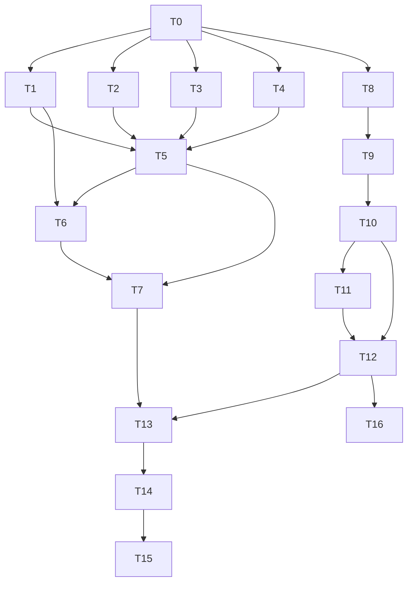

# Tareas: ia-al-crear-producto

Estado: **aprobado de corrido por el usuario** (v1, 2026-10-22). Requisitos: `requirements.md`. Diseño: `design.md`. Rama: `feat/ia-al-crear-producto` (desde `main` `c84fc73`). Sin commits hasta que el usuario los pida.

Convención: cada tarea con código lleva sus tests, que se nombran con el id del criterio (`REQ-x.y`). Obligatorias salvo marca (O). Los comandos de backend se corren en `backend/` y los de frontend en `frontend/`.

## Backend

- [x] **T0. Línea base** — NFR-1, NFR-2, NFR-6
  - Registrar en «Registro de ejecución»: `npm test` (suites y tests), eslint, `npm run build`; en frontend `npm run lint`, `npx ng test --no-watch --browsers=ChromeHeadless` y `npm run build` con el tamaño del bundle inicial. Guardar en el scratchpad el Swagger de desarrollo (`GET /swagger/json`, backend con `NODE_ENV=development`, variables falsas y una base descartable o el arranque sin base si no hace falta) para comparar luego.
  - Depende de: —
  - Verificación: números anotados. Criterio de comparación para T7 y T12: **mismo número de suites y tests o más, 0 fallos**, y bundle inicial ≤ 800 kB.

- [x] **T1. Opciones nuevas de `createControllerApp`** — soporte de testing (design 7)
  - `backend/test/controller-testing.ts`: 5.º parámetro opcional `options` con `imports`, `validationPipeOptions` y `rejectUnauthenticatedWith401`. Valores por defecto = comportamiento actual.
  - Depende de: T0
  - Verificación: `npm test` completo sigue igual que la línea base (ningún spec existente cambia). Las tres opciones nuevas se cubren indirectamente con los specs de T5 y T6, que las usan (no hay spec propio del helper).

- [x] **T2. `toImageDataUrl`** — REQ-2.17
  - `backend/src/files/image-data-url.ts` y `image-data-url.spec.ts`.
  - Depende de: T0
  - Verificación: test `REQ-2.17` (jpeg/png/webp → `data:<mime>;base64,<contenido>` con bytes conocidos).

- [x] **T3. Opciones de multer en memoria** — REQ-2.4, REQ-2.5, REQ-2.11
  - `backend/src/files/multer-image-options.factory.ts`: exportar `imageFileFilter` y `imageFileSizeLimit`, agregar `createImageMemoryMulterOptions()` y hacer que `createImageMulterOptions` use las mismas piezas sin cambiar su comportamiento. Spec nuevo `multer-image-options.factory.spec.ts`.
  - Depende de: T0
  - Verificación: tests `REQ-2.4` (415 para MIME fuera de la lista), `REQ-2.5` (límite = `MAX_IMAGE_SIZE_BYTES` o 5 MB), `REQ-2.11` (el `storage` en memoria no es `diskStorage`); los specs que ya usan `createImageMulterOptions` siguen en verde.

- [x] **T4. DTO del cuerpo** — REQ-2.1, REQ-2.8, REQ-2.9, REQ-2.10
  - `backend/src/product/dto/analyze-product-image.dto.ts` (con `parseCategories`) y `analyze-product-image.dto.spec.ts`, con las opciones de producción del `ValidationPipe`.
  - Depende de: T0
  - Verificación: tests `REQ-2.1` (JSON válido → instancias válidas), `REQ-2.8` (falta o vacía), `REQ-2.9` (no es JSON), `REQ-2.10` (no es lista de `{id,name}` válidos; campos extra rechazados).

- [x] **T5. Endpoint `POST /products/analyze-image`** — REQ-2.1 a REQ-2.10 (a nivel de controller), REQ-2.11, REQ-2.15 a REQ-2.17, NFR-4
  - `backend/src/product/controllers/product.controller.ts`: método `analyzeImage` según `design.md` 3.4. Spec `product.controller.analyze-image.spec.ts` con `createControllerApp` y un doble de `AiContentGenerator`.
  - Depende de: T1, T2, T3, T4
  - Verificación: tests `REQ-2.1` (201 y forma de la respuesta), `REQ-2.2` (401), `REQ-2.3` (403 para `CLIENT`), `REQ-2.4` (415), `REQ-2.5` (413), `REQ-2.6` (sin archivo y archivo en otro campo → 400), `REQ-2.7` (0 bytes → 400), `REQ-2.8`, `REQ-2.9` y `REQ-2.10` (`categories` ausente, no JSON o con forma inválida → 400 por HTTP, con las opciones de producción), `REQ-2.11` (`uploads/` sin archivos nuevos), `REQ-2.15` (502), `REQ-2.16` (400), `REQ-2.17` (el doble recibe el `data:` URL y las categorías); en 2.4 a 2.7 y 2.10 el doble no se llama. Los decoradores de Swagger se comprueban en T7.

- [x] **T6. Tope de IA** — REQ-2.12, REQ-2.13, REQ-2.14
  - Spec `product.controller.analyze-image.throttle.spec.ts` con el `AiThrottlerGuard` real y `ThrottlerModule.forRoot` con tope bajo (sin cambios de producción).
  - Depende de: T1, T5
  - Verificación: tests `REQ-2.12` (la llamada que supera el tope → 429), `REQ-2.13` (los tres endpoints comparten contador), `REQ-2.14` (un 415, un 413 y un 400 cuentan; un 401 y un 403 no).

- [x] **T7. Cierre del backend** — NFR-1, NFR-2, NFR-3, NFR-4
  - `npm test`, eslint y `npm run build` en verde, sin tests existentes modificados. Comparar el Swagger: `generate-from-image` y `generate-ai` idénticos a la línea base y el endpoint nuevo documentado con `multipart/form-data`, `file` binario y `categories` de texto. `git diff main` en ambos `package.json`, locks, `src/database` y `.env-example` vacío.
  - Depende de: T5, T6
  - Verificación: salida de los comandos y de la comparación anotada abajo.

## Frontend

- [x] **T8. `ProductService.analyzeImageFile`** — REQ-1.4
  - `frontend/src/app/core/data-access/products/product.service.ts` y su spec.
  - Depende de: T0
  - Verificación: test `REQ-1.4` (`POST {API}/products/analyze-image`, `FormData` con `file` y `categories` como JSON; sin `Content-Type` manual).

- [x] **T9. Estado del botón en `PrdFormComponent`** — REQ-1.1, 1.2, 1.3, 1.3a, 1.15, 1.17, 1.18, 1.19, NFR-5
  - `selectedFile` (signal), `onImageFileSelected`, `canAnalyzeImageWithAi()` por dato (URL o archivo local) y `loadingCategories.set(false)` en `error`. Tests en `product-form.component.spec.ts`.
  - Depende de: T8
  - Verificación: tests `REQ-1.1` (create + archivo → habilitado), `REQ-1.2` (create sin archivo → deshabilitado), `REQ-1.3` (quitar → deshabilitado), `REQ-1.3a` (rechazado con uno válido → sigue el anterior), `REQ-1.15` (cargando → deshabilitado), `REQ-1.17` (edit con URL → habilitado), `REQ-1.18` (edit sin URL y con archivo → habilitado), `REQ-1.19` (error de carga → no queda cargando; con imagen elegida y lista vacía tras el error, el botón está habilitado y al pulsarlo muestra «No hay categorías disponibles para sugerir una coincidencia.» sin llamar al backend).

- [x] **T10. Flujo de análisis y bloqueo de guardado** — REQ-1.4 a 1.14, REQ-1.17, REQ-1.18
  - `analyzeImageWithAi()` elige `analyzeImageFile` o `generateFromImage` según haya URL o archivo; `product-form.html`: el botón de guardar suma `|| isAnalyzingImage()`. Tests en `product-form.component.spec.ts`.
  - Depende de: T9
  - Verificación: tests `REQ-1.4` (create: llama `analyzeImageFile` con el archivo y las categorías; evidencia canónica de REQ-1.4 en el formulario, la del servicio es T8), `REQ-1.6` (texto «Analizando imagen...»), `REQ-1.7` («Generar» deshabilitado), `REQ-1.8` (guardar deshabilitado), `REQ-1.9` (campo vacío se completa), `REQ-1.10` (con contenido pide confirmación), `REQ-1.11` (aviso de error), `REQ-1.12` (formulario e imagen intactos), `REQ-1.13` (botón habilitado de nuevo), `REQ-1.14` (sin categorías: aviso y sin llamada), `REQ-1.17` (edit con URL llama `generateFromImage`), `REQ-1.18` (edit sin URL con archivo llama `analyzeImageFile`).

- [x] **T11. Guardar después de analizar** — REQ-1.5, REQ-1.16
  - Test en `product-form-dialog.component.spec.ts`; sin cambios de producción previstos (el diálogo no se toca).
  - Depende de: T10
  - Verificación: tests `REQ-1.5` (analizar no llama a `createProduct` ni a `uploadProductImage`) y `REQ-1.16` (analizar y luego guardar crea el producto y sube la imagen una sola vez). Si hiciera falta tocar el diálogo, **parar y actualizar la spec**.

- [x] **T12. Cierre del frontend** — NFR-2, NFR-5, NFR-6
  - `npm run lint`, `npx ng test --no-watch --browsers=ChromeHeadless` y `npm run build` en verde; bundle inicial ≤ 800 kB; `OnPush` intacto.
  - Depende de: T10, T11
  - Verificación: salida de los comandos y tamaño del bundle anotados.

## Cierre

- [x] **T13. Auditoría de código** — `code-auditor`
  - Seguridad (el archivo en memoria y el tope de tamaño, el JSON del cuerpo, los guards), alcance (solo los archivos del diseño), convenciones e integridad de los tests (ninguno debilitado).
  - Depende de: T7, T12
  - Verificación: informe sin hallazgos altos abiertos; los hallazgos se corrigen con el `implementer`.

- [x] **T13b. Correcciones de la auditoría** — REQ-1.20, REQ-2.18 a REQ-2.21 (y refuerzo de REQ-2.11)
  - Enmiendas aprobadas de corrido: topes del multipart y `@ArrayMaxSize(200)` (backend), `takeUntilDestroyed` en el análisis (frontend), y un test más fuerte de REQ-2.11 en `multer-image-options.factory.spec.ts` (comprobar que el storage en memoria deja `buffer` y no `path`). Primero los tests (`test-writer`), después el código (`implementer`).
  - Depende de: T13
  - Verificación: tests `REQ-2.18` (201 con 200 categorías y 400 con 201), `REQ-2.19` (dos archivos → 400), `REQ-2.20` (dos campos de texto → 400), `REQ-2.21` (campo de 64 KB + 1 → 400), `REQ-1.20` (la respuesta llega tras `destroy()` y no hay avisos ni diálogo); suites completas, lint y build en verde.

- [x] **T14. Documentos de la spec y `pendientes.md`**
  - Pasar a `requirements.md` la tabla de «Verificación final»; en `pendientes.md` marcar hecho el abierto «Análisis con IA antes de guardar el producto» (y corregir la línea que dice que «requiere carpeta temporal»), y anotar lo que quede abierto.
  - Depende de: T13b
  - Verificación: lectura de ambos archivos.

- [x] **T15. Verificación de cierre** — `spec-verifier`
  - Recorre cada criterio con evidencia (test, comando o `archivo:línea`) y devuelve SÍ/NO/NO VERIFICABLE.
  - Depende de: T14
  - Verificación: tabla completa; sin `NO`. Los `NO VERIFICABLE` se confirman con el usuario.

- [x] **T16 (O, manual). Humo con OpenAI real**
  - Lo hace una persona con `OPENAI_API_KEY` válida: `npm run start:dev` y `npm start`; crear un producto, elegir imagen, «Analizar imagen con IA», revisar campos y guardar. Probar también un archivo de más de 5 MB y uno que no es imagen.
  - Depende de: T12
  - Verificación: lo que informe el usuario, anotado abajo.
  - **Resultado (2026-10-23):** el usuario comprobó en producción la creación de un producto y el análisis con IA: «quedó perfecto». No informó las pruebas del archivo de más de 5 MB ni del que no es imagen.

## Dependencias

Tras T0, son independientes entre sí T1, T2, T3, T4 y T8; el backend (T1 a T7) y el frontend (T8 a T12) no se esperan.

## Trazabilidad

| Requisito | Tareas |
|---|---|
| REQ-1.1, 1.2, 1.3, 1.3a, 1.15, 1.18, 1.19 | T9 |
| REQ-1.4 | T8, T10 |
| REQ-1.5 | T11 (evidencia canónica en el spec del diálogo) |
| REQ-1.6 a 1.14 | T10 |
| REQ-1.16 | T11 |
| REQ-1.17 | T9, T10 |
| REQ-2.1 | T4, T5 |
| REQ-2.2 a 2.3, 2.6, 2.7, 2.15, 2.16 | T5 |
| REQ-2.4, 2.5, 2.11 | T3, T5 |
| REQ-2.8, 2.9, 2.10 | T4 (DTO), T5 (por HTTP) |
| REQ-2.12, 2.13, 2.14 | T6 |
| REQ-2.17 | T2, T5 |
| NFR-1 | T0, T7 |
| NFR-3 | T7 |
| NFR-4 | T5, T7 |
| NFR-2 | T0, T7, T12 |
| NFR-5 | T9, T12 |
| NFR-6 | T0, T12 |

## Registro de ejecución

*(se completa durante la implementación)*

### Línea base (T0), 2026-10-22, `main` en `c84fc73`
- Backend: `npm test` 39 suites y 344 tests en verde; eslint código 0; `npm run build` ok.
- Frontend: `npm run lint` código 0; Karma 310 de 310 en verde; `npm run build` ok con bundle inicial **764,37 kB** (presupuesto 800 kB).
- Swagger de la línea base: se compara en T7 contra un worktree de `main` `c84fc73` (igual que en `backend-architecture`).

### Ejecución (2026-10-22)
- **Tests primero (`test-writer`):** backend 70 tests nuevos (47 en rojo por la razón correcta: stubs `not implemented` o ruta 404); frontend 25 nuevos (22 en rojo; los de REQ-1.2 y REQ-1.17 pasaban porque describen el comportamiento actual). Se verificó la corrida completa tras cada subagente.
- **Backend (T1 a T7):** `npm test` 44 suites y **414 tests** en verde (línea base 39 y 344); eslint 0; `npm run build` ok; `git diff` de `package.json`, lock, `src/database` y `.env-example` vacío. T6 no necesitó código propio: el spec del tope de IA pasó con la implementación de T5. `createControllerApp` ganó el 5.º parámetro opcional `options` (aditivo; los specs existentes no cambian).
- **Swagger (NFR-1):** contra un worktree de `main` `c84fc73`: 35 paths antes y 36 después; agregado solo `/products/analyze-image` (`multipart/form-data`, `file` y `categories` requeridos); `generate-from-image` y `generate-ai/{name}` idénticos; ningún otro path cambió.
- **Frontend (T8 a T12):** Karma **336 de 336** tras T13b (335 antes de REQ-1.20; línea base 310); `npm run lint` 0; `npm run build` ok con bundle inicial **764,54 kB** (línea base 764,37 kB; límite 800 kB); `product-form-dialog.component.ts` e `ImageFieldComponent` sin cambios. REQ-1.5 y REQ-1.16 pasaron sin tocar el diálogo, como preveía el diseño.
- **Auditoría (`code-auditor`, T13):** aprobable, sin hallazgos altos. 3 medios y 4 bajos. Corregidos en T13b con enmiendas de la spec: topes del multipart y `@ArrayMaxSize(200)` (REQ-2.18 a 2.21), `takeUntilDestroyed` en el análisis (REQ-1.20) y test más fuerte de REQ-2.11. Documentado como límite conocido: edición con imagen subida y archivo local sin subir (M3). Tras T13b: backend 44 suites y **421 tests**, frontend **336**, bundle **764,54 kB**.
- **Verificación de cierre (`spec-verifier`, T15):** 0 NO; tabla en `requirements.md`, sección 5. T16 (humo manual con OpenAI real) hecho el 2026-10-23.
- **Desvíos del diseño:** el diseño no preveía los topes del multipart ni `takeUntilDestroyed`; se agregaron por la auditoría (ver arriba y las enmiendas de `requirements.md`/`design.md`).

---
**Estado:** Aprobado (2026-10-22, aprobación de corrido)
