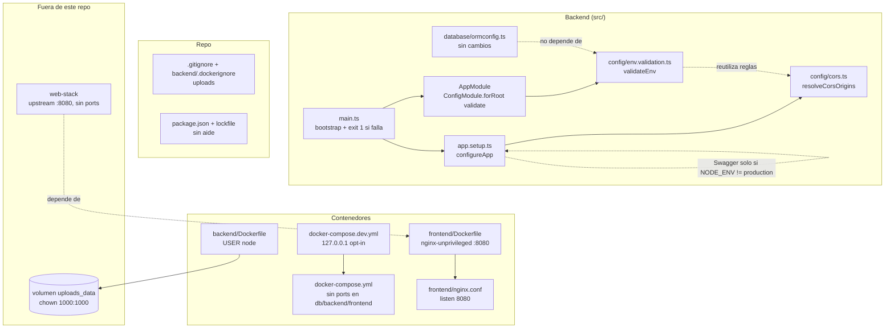
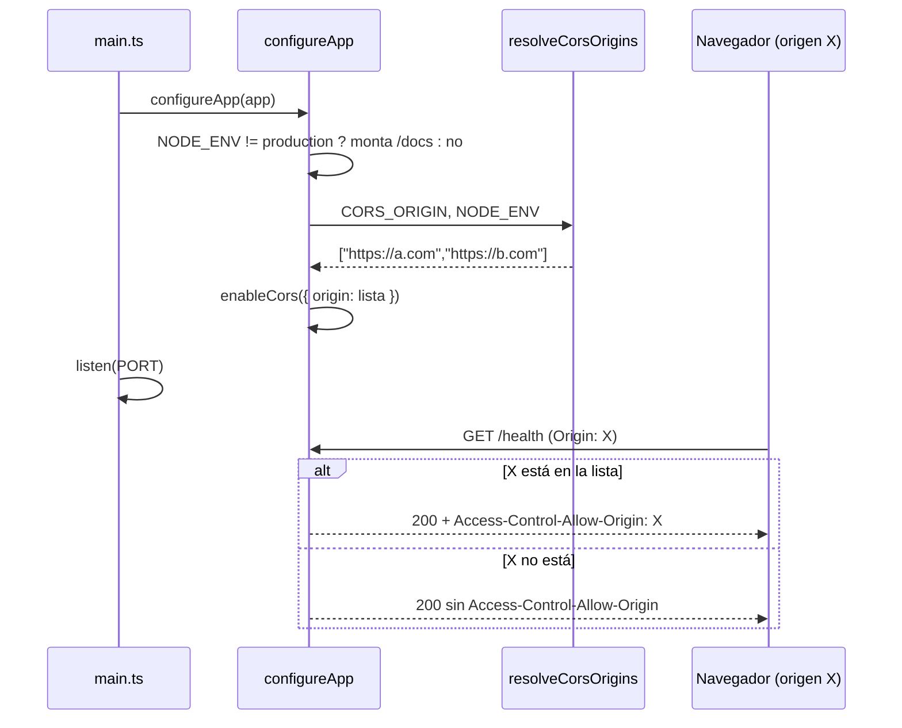

# Diseño: infra-hardening

## Resumen y decisiones clave

**No hay migración ni cambio de esquema ni de contrato HTTP.** Los cambios son de configuración de contenedores, de arranque del backend y de higiene del repo. El único cambio observable para un cliente es que `/docs` y `/swagger/json` dejan de existir en producción.

Cuatro ideas ordenan el diseño:

1. **Una sola función pura valida el entorno.** `validateEnv(raw)` (en `src/config/env.validation.ts`) recibe las variables, acumula **todos** los errores y lanza un único `Error` con la lista. Se enchufa a `ConfigModule.forRoot({ validate })`, así que corre antes de crear ningún módulo y cubre REQ-4 y REQ-5 con el mismo mecanismo. Devuelve la configuración **sin transformarla**: ningún servicio existente cambia (REQ-5.7).
2. **`main.ts` pasa a ser delgado y el cableado se extrae a `configureApp(app)`** (`src/app.setup.ts`): pipes, serializer, Swagger condicional, helmet, `/uploads`, CORS y `trust proxy`. Es lo único que permite probar REQ-3 y REQ-4.5 con `supertest` sin levantar el proceso. No es una abstracción especulativa: sin ella esos criterios solo se verifican a mano.
3. **CORS tiene una función pura propia.** `resolveCorsOrigins(raw, nodeEnv)` (`src/config/cors.ts`) devuelve la lista de orígenes; la validación (REQ-4.1/4.2) vive en `validateEnv` y la resolución con el valor por defecto de desarrollo (REQ-4.4) en esta función. Así `main.ts` nunca más escribe `?? '*'`.
4. **Los contenedores se endurecen en su Dockerfile y en el compose, no en el código.** Backend: `USER node` con el dueño de `/app` resuelto en el build. Frontend: imagen `nginx-unprivileged` en el 8080. Los puertos se quitan del compose base y se publican solo desde un archivo `docker-compose.dev.yml` que no se carga solo.

## Arquitectura



## Componentes e interfaces

### C1. `validateEnv` (REQ-4.1, 4.2, REQ-5.1 a 5.9)

Archivo nuevo `backend/src/config/env.validation.ts`. Función pura, sin Nest.

```ts
export function validateEnv(raw: Record<string, unknown>): Record<string, unknown>;
```

Reglas (cada una agrega un mensaje a una lista; al final, si la lista no está vacía, `throw new Error('Configuración inválida:\n- …')`):

| Variable | Regla | REQ |
|---|---|---|
| `JWT_SECRET` | obligatoria; con `NODE_ENV=production`, mínimo 32 caracteres | 5.1, 5.2 |
| `DB_HOST` o `POSTGRES_HOST` | al menos una, no vacía | 5.3 |
| `DB_NAME`, `DB_USER`, `DB_PASSWORD` (o `POSTGRES_*`) | cada una con su alternativa; el mensaje nombra ambas | 5.4 |
| `PORT`, `DB_PORT` (o `POSTGRES_PORT`) | si están, entero positivo | 5.5 |
| `ORDER_PAYMENT_TTL_HOURS`, `AI_RATE_LIMIT`, `AI_RATE_TTL_SECONDS` | si están, entero positivo | 5.5 |
| `CORS_ORIGIN` | con `NODE_ENV=production`: obligatoria, ningún elemento de la lista igual a `*` ni vacío | 4.1, 4.2 |
| `OPENAI_API_KEY`, `RESEND_API_KEY`, `CONTACT_TO_EMAIL` | obligatorias, no vacías (los constructores de `OpenaiService`, `MailService` y `ContactService` ya las exigían; _enmienda de T7_) | 5.8 |

- "Entero positivo" = `/^[1-9]\d*$/` sobre el texto: rechaza `0`, `-1`, `1.5`, `abc` y vacío. Una variable ausente no es un error (rige el valor por defecto actual de cada servicio, REQ-5.7).
- `NODE_ENV` ausente equivale a no-producción.
- Devuelve `raw` tal cual: `ConfigModule` y los servicios existentes siguen leyendo lo mismo que hoy.
- **Integración:** `AppModule` pasa `validate: validateEnv` a `ConfigModule.forRoot`. `ormconfig.ts` (migraciones) no importa `AppModule` ni `ConfigModule`, así que `migrations:run:prod` no exige `JWT_SECRET` ni `CORS_ORIGIN` (REQ-5.9). Se comprueba con una prueba, no se asume.
- **Falla limpia:** `bootstrap()` termina con `.catch((err) => { console.error(err.message); process.exit(1); })`, para que el mensaje salga sin trazas de Nest y el código de salida sea `1` (REQ-4.1/5.x, "código de salida distinto de 0").

### C2. `resolveCorsOrigins` (REQ-4.3, 4.4, 4.5)

Archivo nuevo `backend/src/config/cors.ts`.

```ts
export function resolveCorsOrigins(raw: string | undefined, nodeEnv: string | undefined): string[];
```

- Con valor: `raw.split(',').map(trim).filter(Boolean)` (REQ-4.3).
- Sin valor y `nodeEnv !== 'production'`: `['http://localhost:4200', 'http://localhost:8080']` (REQ-4.4).
- Sin valor en producción: `validateEnv` ya abortó el arranque, pero la función lanza igual como defensa (no devuelve `*`).
- `configureApp` llama a `app.enableCors({ origin: resolveCorsOrigins(...) })`. Con una lista de orígenes, el paquete `cors` solo emite `Access-Control-Allow-Origin` cuando el origen de la petición coincide (REQ-4.5).

### C3. `configureApp` y `main.ts` (REQ-3, REQ-4, REQ-6.5)

`backend/src/app.setup.ts` recibe lo que hoy hace `main.ts` (pipes globales, `ClassSerializerInterceptor`, helmet, `/uploads` con creación del directorio, CORS, `trust proxy`) y agrega:

```ts
if (config.get('NODE_ENV') !== 'production') {
  // DocumentBuilder + SwaggerModule.setup('docs', …, { jsonDocumentUrl: '/swagger/json' })
}
```

- Con `NODE_ENV=production` las rutas `/docs` y `/swagger/json` no se registran: Nest responde 404 (REQ-3.1/3.2). Con cualquier otro valor se registran (REQ-3.3).
- La creación del directorio de uploads se mueve tal cual (REQ-6.5: no se rompe).
- `main.ts` queda: `NestFactory.create` → `configureApp(app)` → `app.listen(port)`.
- Lectura de variables: `app.get(ConfigService)` para `NODE_ENV`, `CORS_ORIGIN`, `PORT`. `ConfigModule` ya cargó el `.env` en `process.env` antes (comportamiento actual).

**Decisión técnica (no traza a un REQ):** el `ValidationPipe` y el serializer se mueven a `configureApp` junto con el resto para que una prueba arme la app idéntica a la real; sin esto las pruebas montarían un cableado distinto del de producción.

### C4. Backend `Dockerfile` (REQ-2.1, 2.3, 2.4)

Cambios en la etapa `runner`:

```dockerfile
FROM node:22-alpine AS runner
WORKDIR /app
ENV NODE_ENV=production

COPY package*.json ./
RUN npm ci --omit=dev && npm cache clean --force

COPY --from=builder /app/dist ./dist
# El volumen uploads_data nuevo hereda este dueño; el existente se corrige una vez (ver C9).
RUN mkdir -p /app/uploads && chown -R node:node /app
USER node

EXPOSE 3000
CMD ["sh", "-c", "npm run migrations:run:prod && node dist/main"]
```

- `node` (UID 1000 en `node:22-alpine`) viene en la imagen; no se crea usuario.
- `chown -R node:node /app` incluye `node_modules` y `dist` (solo lectura necesaria) y `/app/uploads` (escritura). Cuesta una capa extra de peso; se acepta.
- Migraciones y servidor corren como `node`: las migraciones solo leen `dist/` y la conexión.
- **Alternativa descartada:** un `entrypoint` que arranque como root, haga `chown` al volumen y baje privilegios con `gosu`. Deja root dentro del contenedor hasta el último paso y agrega una dependencia; se prefirió un `chown` único y documentado del volumen existente.

### C5. Frontend `Dockerfile` y `nginx.conf` (REQ-2.2, 2.5)

- Etapa `runner`: `FROM nginxinc/nginx-unprivileged:1.27-alpine AS runner` (UID 101, escucha en 8080, escribe pid y temporales en rutas del usuario). `EXPOSE 8080`.
- `COPY nginx.conf /etc/nginx/conf.d/default.conf` y `COPY --from=builder … /usr/share/nginx/html`: se copian como root con permisos de lectura global, suficiente para el usuario 101.
- `nginx.conf`: `listen 8080;` en lugar de `listen 80;`. Nada más cambia.
- Se elimina `/etc/letsencrypt` y `443` porque el TLS lo termina el borde.

### C6. `docker-compose.yml` y `docker-compose.dev.yml` (REQ-1, REQ-2.6)

Base (`docker-compose.yml`):

- `db`: se borra el bloque `ports`.
- `backend`: se borra `ports`. `BACKEND_PORT` deja de usarse y se quita del compose.
- `frontend`: se borran `ports` (80/443) y el montaje `/etc/letsencrypt`.
- Se agrega `NODE_ENV: production` ya presente en `backend`; no hay otras variables nuevas. `CORS_ORIGIN` conserva su default `http://localhost:8080` en el compose, que **pasa a ser** un valor válido de producción solo si el operador lo cambia; el compose de producción (web-stack) define el real.

`docker-compose.dev.yml` (nombre elegido para que Compose no lo cargue solo; ver la enmienda en `requirements.md`):

```yaml
services:
  db:
    ports: ["127.0.0.1:5433:5432"]
  backend:
    ports: ["127.0.0.1:3000:3000"]
  frontend:
    ports: ["127.0.0.1:8080:8080"]
```

Uso: `docker compose -f docker-compose.yml -f docker-compose.dev.yml up`. `backend/docker-compose.yml` (solo base de datos para desarrollo del backend) también publica el 5433; se pasa a `127.0.0.1:${DB_EXTERNAL_PORT:-5433}:5432`, que es lo mínimo coherente con el criterio de no exponer Postgres.

### C7. Higiene del repo: `uploads/` y `aide` (REQ-6, REQ-7)

- `.gitignore` raíz: bloque `backend/uploads/*` con excepción `!backend/uploads/.gitkeep` si se decide conservar la carpeta; se agrega `backend/uploads/**/.gitkeep` solo si hace falta (el backend ya crea el directorio, así que **no** se agrega `.gitkeep`).
- `git rm -r --cached backend/uploads`: quita los 25 archivos del índice sin tocar el disco (REQ-6.1, 6.4). Se ejecuta **con confirmación del usuario** (regla de `AGENTS.md`).
- `backend/.dockerignore`: línea `uploads` (REQ-6.3).
- `package.json`: se borran el script `aide` y la dependencia `aide`. `package-lock.json`: se borran la entrada `packages["…"].dependencies.aide` y el bloque `node_modules/aide`. La edición del lockfile se verifica con `npm ci` y `npm run build` en limpio (REQ-7.3/7.4); si el lockfile queda inconsistente, se regenera con `npm install --package-lock-only` y se revisa el diff.

### C8. Documentación (REQ-8)

- `README.md` y `backend/.env-example`: se agregan `NODE_ENV`, `CORS_ORIGIN` (obligatoria en producción) y la nota de que Swagger está apagado en producción. `backend/.env-example` contiene `MY_VAR=` sin uso: se quita junto con su entrada en `Env` solo si ninguna parte del código lo lee (se verifica antes con grep; si algo lo usa, se deja).
- **No se toca `backend/.env`** (regla de `AGENTS.md`).
- `Env` (`env.model.ts`) gana `NODE_ENV: string`.

### C9. Checklist de despliegue manual (REQ-2.4, REQ-8.1)

Va en `tasks.md`. Orden obligatorio, porque el cambio de puerto del frontend y el `USER node` del backend son incompatibles con la configuración actual de `web-stack` y del volumen:

1. Revisar que `JWT_SECRET` de producción tenga ≥ 32 caracteres y que `CORS_ORIGIN` esté definida y no sea `*`.
2. En el servidor, antes del despliegue del backend: `docker run --rm -v <volumen_uploads_data>:/app/uploads alpine chown -R 1000:1000 /app/uploads`. Solo hace falta una vez; con el volumen ya corregido, el backend viejo (root) sigue funcionando.
3. En `web-stack`: apuntar el upstream del frontend a `catalog_frontend:8080` **en el mismo despliegue** que la imagen nueva del frontend, y quitar los `ports` de db y backend si los define ahí.
4. Desplegar backend; comprobar `GET /health` y subir una imagen de prueba.
5. Desplegar frontend; comprobar el sitio.

## Flujos principales

### Arranque con configuración inválida (REQ-4.1, 4.2, 5.x)

```mermaid
sequenceDiagram
  participant P as Proceso (node dist/main)
  participant M as main.ts bootstrap
  participant N as NestFactory
  participant C as ConfigModule.forRoot
  participant V as validateEnv
  P->>M: bootstrap()
  M->>N: create(AppModule)
  N->>C: carga .env + process.env
  C->>V: validate(config)
  V-->>C: throw Error("Configuración inválida: - JWT_SECRET …")
  C-->>N: propaga el error
  N-->>M: rechazo de la promesa
  M->>P: console.error(message); process.exit(1)
```

### Arranque válido y petición CORS (REQ-3, REQ-4.3, 4.5)



## Pruebas (estrategia)

- **Unitarias** (`src/config/*.spec.ts`, imports relativos para no depender del `moduleNameMapper` que hoy rompe otras suites): `validateEnv` con una tabla de casos por variable (válido, ausente, inválido, varios errores a la vez, alternativa `POSTGRES_*`, producción vs. desarrollo) y `resolveCorsOrigins` (lista con espacios, vacío en desarrollo, vacío en producción).
- **Integración** (`test/infra-config.e2e-spec.ts`, mismo arnés que `catalog-access.helpers.ts` pero con un módulo mínimo `HealthModule` + `configureApp`): Swagger 404/200 según `NODE_ENV`, y cabecera CORS presente/ausente según el origen. No necesita base de datos.
- **Arranque real** (script de verificación manual en `tasks.md`): `NODE_ENV=production node dist/main` sin `CORS_ORIGIN`, con `CORS_ORIGIN=*` y sin `JWT_SECRET`; se comprueba el mensaje y `echo $?` ≠ 0. También `migrations:run:prod` sin `JWT_SECRET` (REQ-5.9).
- **Contenedores** (manual, requiere Docker): `docker compose config` para REQ-1 y REQ-2.6; `docker run … id -u` para REQ-2.1/2.2; `docker run -v` con un volumen creado como root, antes y después del `chown`, para REQ-2.3/2.4; `curl localhost:8080` contra el frontend para REQ-2.5.
- **Repo** (comandos): `git ls-files`, `git check-ignore`, `grep aide`, `npm ci && npm run build` en un clon limpio.

## Limitaciones y alternativas descartadas

- **`class-validator` o `joi` para el esquema:** `class-validator` ya es dependencia, pero un esquema con reglas condicionales por entorno (producción vs. resto, alternativas `DB_*`/`POSTGRES_*`) queda más claro en una función de 60 líneas que en decoradores, y evita sumar `joi`. Se puede migrar después sin cambiar el contrato.
- **Flag `ENABLE_SWAGGER` para reactivarlo en producción:** no se pidió; en un incidente se levanta con `NODE_ENV` distinto en un entorno de staging.
- **`.gitkeep` en `backend/uploads/`:** innecesario; el backend crea la carpeta al arrancar (`main.ts` actual, REQ-6.5).
- **No se reescribe el historial:** los 25 archivos siguen en commits viejos; si alguna imagen fuera sensible habría que usar `git filter-repo`, fuera de alcance.
- **El `CORS_ORIGIN` por defecto del compose (`http://localhost:8080`) es válido para el validador:** no es `*`. En producción lo pisa `web-stack`; esta spec no puede garantizar que el valor real sea correcto, solo que no sea comodín ni esté vacío.
- **Límite del chequeo de `JWT_SECRET`:** valida largo, no entropía.

## Trazabilidad

| Requisito | Qué lo cubre |
|---|---|
| REQ-1.1, 1.2, 1.5 | C6: `ports` borrados de `db` y `backend` en `docker-compose.yml`; verificación con `docker compose config` |
| REQ-1.3 | C6: no se toca `DB_HOST=db`/`DB_PORT=5432`; verificación con el arranque del stack |
| REQ-1.4 | C6: `docker-compose.dev.yml` en loopback |
| REQ-2.1, 2.3, 2.4 | C4: `USER node`, `chown` en el build, `chown` único del volumen existente (C9) |
| REQ-2.2, 2.5 | C5: `nginx-unprivileged`, `listen 8080` |
| REQ-2.6 | C5 y C6: sin 80/443 ni letsencrypt en el frontend |
| REQ-3.1, 3.2, 3.3 | C3: Swagger condicional en `configureApp` |
| REQ-4.1, 4.2 | C1: regla de `CORS_ORIGIN` en `validateEnv` + `process.exit(1)` en `main.ts` |
| REQ-4.3, 4.4, 4.5 | C2: `resolveCorsOrigins` y `enableCors` con lista |
| REQ-5.1 a 5.6 | C1: tabla de reglas y mensaje único con todos los errores |
| REQ-5.7, 5.8 | C1: `validateEnv` devuelve `raw` sin tocar; exige `OPENAI_API_KEY`, `RESEND_API_KEY` y `CONTACT_TO_EMAIL` |
| REQ-5.9 | C1: `ormconfig.ts` queda fuera del camino de `ConfigModule`; prueba de `migrations:run:prod` |
| REQ-6.1 a 6.4 | C7: `git rm --cached`, `.gitignore`, `.dockerignore` |
| REQ-6.5 | C3: la creación del directorio se mueve sin cambios |
| REQ-7.1 a 7.4 | C7: borrado en `package.json` y lockfile; `npm ci` + `build` |
| REQ-8.1 | C9: checklist manual |
| REQ-8.2 | C8: README y `.env-example` |

**Decisiones técnicas sin REQ propio:** mover pipes/serializer/helmet a `configureApp` (C3, para probar el cableado real); `NODE_ENV` en `Env` y limpieza de `MY_VAR` (C8); `backend/docker-compose.yml` en loopback (C6, coherencia con REQ-1).

## Autorrevisión (antes de pedir aprobación)

- **¿Todos los REQ tienen un componente?** Sí, ver la tabla: cada criterio de REQ-1 a REQ-8 aparece al menos una vez.
- **¿Algún componente sin REQ y sin justificar?** No: los tres que no trazan están listados como decisiones técnicas.
- **Enmienda detectada en esta fase:** el archivo de desarrollo pasó de `docker-compose.override.yml` a `docker-compose.dev.yml` (ya reflejado en `requirements.md`).
- **Riesgos que el diseño no elimina, solo documenta:** (a) el orden del despliegue (C9): si el frontend nuevo sale antes de actualizar el upstream de `web-stack`, el sitio cae; (b) con `USER node` y sin el `chown` previo del volumen, las subidas de imágenes fallan con `EACCES`; (c) un `JWT_SECRET` corto en producción impide el arranque.
- **Punto a confirmar en implementación:** que `ConfigModule.forRoot({ validate })` se ejecute antes de `TypeOrmModule.forRootAsync` (así lo documenta `@nestjs/config`; se comprueba en la prueba de arranque).
