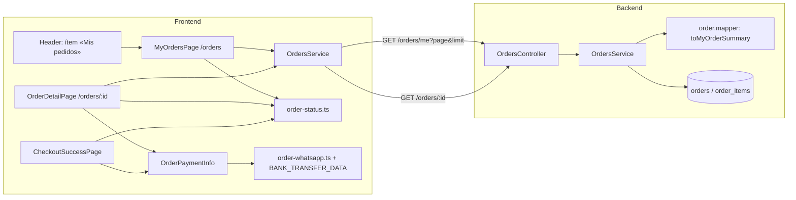
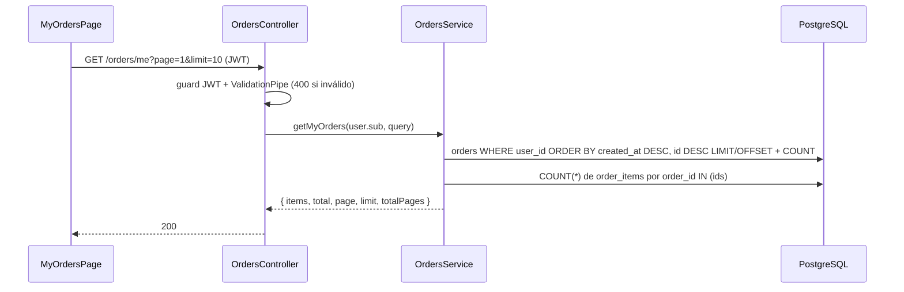
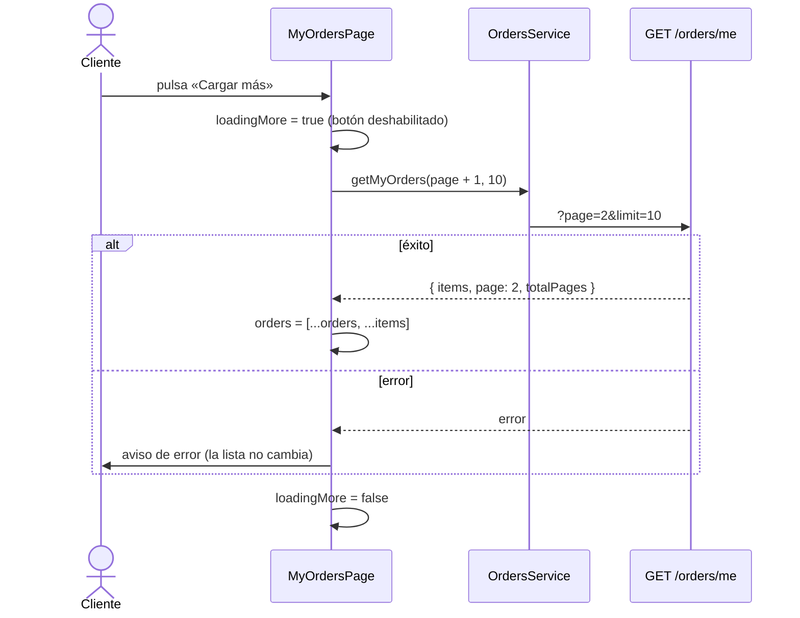

# Diseño: mis-pedidos

Responde a `requirements.md` (aprobado). Backend NestJS 11 + frontend Angular 20, sin migración. Sigue las convenciones de `.claude/steering/`: controller delgado, lógica en el service, DTO que valida, `@CurrentUser()`, componentes standalone `OnPush` con signals y carga perezosa.

## 1. Arquitectura

## 2. Backend

Cambios dentro de `backend/src/orders/`; no se toca ningún endpoint existente.

| Pieza | Decisión |
|---|---|
| `dto/list-my-orders-query.dto.ts` (nuevo) | `ListMyOrdersQueryDto` con `page` (`@IsInt @Min(1)`, por defecto 1) y `limit` (`@IsInt @Min(1) @Max(50)`, por defecto 10). Mismo estilo que `ListProductsQueryDto`, con sus propias constantes (`DEFAULT_ORDERS_LIMIT = 10`, `MAX_ORDERS_LIMIT = 50`) porque el límite por defecto de productos es otro. El `ValidationPipe` de producción ya transforma y rechaza (400). |
| `orders.controller.ts` | `@Get('me')` **declarado antes** de `@Get(':id')`, con `@ApiOperation`, `@ApiResponse` y `@Query() query: ListMyOrdersQueryDto`, y `@CurrentUser() user: Payload`. Sin `@Roles`: cualquier usuario autenticado. Delega en `ordersService.getMyOrders(user.sub, query)`. El orden de declaración es lo que impide que `me` llegue a `ParseIntPipe`. |
| `orders.service.ts` | `getMyOrders(userId, { page, limit })`: (1) `repo.findAndCount({ where: { userId }, order: { createdAt: 'DESC', id: 'DESC' }, skip: (page-1)*limit, take: limit })` sin cargar `items`, para que `skip/take` pagine órdenes y no filas de un join; (2) si hay órdenes, un solo `SELECT order_id, COUNT(*)::int AS count … WHERE order_id IN (:...ids) GROUP BY order_id` sobre `OrderItem` para `itemCount` (0 si no hay fila). El `::int` es necesario: `pg` devuelve `COUNT(*)` como string, y `itemCount` debe salir como número (REQ-1.4); un test lo comprueba. Devuelve `{ items, total, page, limit, totalPages: Math.ceil(total / limit) }`. |
| `order.mapper.ts` | `MyOrderSummaryResponse { id, status, total, createdAt, itemCount }`, `toMyOrderSummary(order, itemCount)` y `MyOrdersPage`. Es el único lugar que arma la forma pública, como ya hace el resto de las órdenes. No incluye datos personales ni `allowedTransitions` (el cliente no cambia estados). |

**Por qué dos consultas y no un join:** `findAndCount` con `relations: ['items']` pagina filas del join, no órdenes, y duplicaría el cálculo del total. Un `COUNT … GROUP BY` sobre los ids de la página es una consulta más y usa el índice por `order_id` de `order_items`. Con 50 ids como máximo es acotado.

**Índice:** `IDX_orders_user` cubre el filtro; el orden por `created_at` sobre los pedidos de un solo usuario es barato (decisión: no agregar índice compuesto, NFR-1).

### Secuencia: listado

## 3. Frontend

### Compartido (resuelve NFR-3)

Hoy el texto de los estados y el mensaje de WhatsApp viven dentro de `checkout-success-page.ts`, y el panel de administración tiene su propia copia de las etiquetas. Se extrae lo de la pantalla de éxito para que lo usen las tres pantallas del cliente:

| Pieza | Contenido |
|---|---|
| `shared/utils/order-status.ts` (nuevo) | `ORDER_STATUS_LABEL: Record<OrderStatus, string>` y `orderStatusLabel(status)`; «Sin estado» para un valor desconocido (como hoy). |
| `shared/utils/order-whatsapp.ts` (nuevo) | `buildWhatsappUrl(order, whatsappNumber)`: el mismo mensaje que arma hoy `CheckoutSuccessPage`. |
| `shared/components/order-payment-info/` (nuevo) | Componente `OnPush` con `order = input.required<OrderResponse>()`. Muestra el bloque «Datos de transferencia» (de `BANK_TRANSFER_DATA`) y el botón «Enviar pedido por WhatsApp». Lo usan la pantalla de éxito y el detalle. |
| `checkout-success-page` | Usa `orderStatusLabel`, `buildWhatsappUrl` y `<app-order-payment-info>` en lugar de su copia. Su comportamiento y sus tests no cambian. |

El panel de administración (`order-admin.page`) conserva su `statusLabel` propio: la spec no toca ese panel, y NFR-3 quedó acotado a las pantallas del cliente (enmienda del 2026-10-23). Queda anotado como deuda.

### Servicio y modelos

`core/services/orders.service.ts` suma `MyOrderSummary { id, status, total, createdAt, itemCount }`, `MyOrdersResponse { items: MyOrderSummary[]; total; page; limit; totalPages }`, y `getMyOrders(page = 1, limit = 10): Observable<MyOrdersResponse>` con `HttpParams`. `getOrderById` ya existe y se reutiliza.

### Páginas (carga perezosa)

| Ruta | Componente | Guard |
|---|---|---|
| `orders` | `features/orders/my-orders-page` | `authGuard`, sin `data.roles` (cualquier sesión) |
| `orders/:id` | `features/orders/order-detail-page` | `authGuard` |

Ambas con `loadComponent` en `app.routes.ts`. El estado de pantalla vive en signals del propio componente (no hace falta un store: nadie más lo lee).

**`MyOrdersPage`** — signals: `orders` (acumulado), `page`, `totalPages`, `loading` (primera página), `loadingMore`, `error`. `ngOnInit` pide la página 1. `canLoadMore = computed(() => page() < totalPages())`. «Cargar más» pide `page()+1`, agrega con `[...orders(), ...res.items]` y actualiza `page`/`totalPages`; mientras `loadingMore()` el botón va `disabled`. Si falla la primera carga: `error` + botón «Reintentar»; si falla «Cargar más»: `NotificationService.error` y la lista se conserva. Vacío: texto + enlace a `/home`. Cada fila: `#id`, `date:'short'`, `orderStatusLabel`, `$ number:'1.0-0'`, `itemCount` y `routerLink` a `/orders/:id`.

**`OrderDetailPage`** — `id = Number(route.snapshot.paramMap.get('id'))`; si no es entero positivo, `error` directo sin llamar al backend. Si lo es, `getOrderById`. Cualquier error (401, 404, red) → «No pudimos cargar este pedido» + enlace a `/orders`. Con el pedido: datos, líneas, `<app-order-payment-info>` solo `@if (order.status === 'PENDING_PAYMENT')`, y «Volver a mis pedidos».

### Header

`shared/header/header.html`: un `<a routerLink="/orders" cdkMenuItem (click)="userMenuTrigger.close()">Mis pedidos</a>` después de «Mi perfil», dentro del bloque que ya solo existe con sesión. Estilos copiados del ítem vecino.

### Secuencia: «Cargar más»

## 4. Alternativas descartadas
- **`relations: ['items']` + `loadRelationCountAndMap`:** más compacto, pero con `skip/take` TypeORM resuelve en dos pasos internos poco predecibles; dos consultas explícitas son más fáciles de probar.
- **Reusar `ListProductsQueryDto`:** acopla órdenes con productos y trae `search`/`categoryId` que no aplican, y que el `forbidNonWhitelisted` rechazaría; el límite por defecto además difiere.
- **Un store en `core/state` para las órdenes:** solo las lee esta pantalla; sería estado global sin consumidores.
- **Paginación por cursor:** el orden `createdAt DESC` con altas concurrentes del mismo usuario es raro; offset alcanza y coincide con `GET /products`.
- **Redirigir al login en 401:** requiere tocar el interceptor global; fuera de alcance.
- **Mover también las etiquetas del panel de administración:** tocaría un panel que la spec deja fuera.

## 5. Estrategia de pruebas (detalle en tasks.md)
- Backend: spec del service con repositorio simulado o `DataSource` doble; spec de controller con `createControllerApp` (usuario falso, `rejectUnauthenticatedWith401`, opciones de producción del `ValidationPipe`). El 404 de orden ajena ya existe: se agrega el test que lo protege.
- Frontend: Karma para las dos páginas, el componente de pago, las utilidades y el header; la pantalla de éxito conserva sus tests.
- UI medible (NFR-4): `ego-verify-sdd` a 360 px.

| Criterios | Test (el nombre lleva el id del criterio) |
|---|---|
| REQ-1.1, 1.2, 1.3, 1.4, 1.7, 1.8 | `orders.service.spec.ts` (`getMyOrders`: filtro por `userId`, orden, `itemCount` numérico, vacío, página fuera de rango) |
| REQ-1.5, 1.6, 1.9, 1.10, 1.11 | `orders.controller.spec.ts` con `createControllerApp` y el `ValidationPipe` de producción (defaults, 400, 401, ADMIN, `me` no cae en `:id`) |
| REQ-1.12 | comparación de Swagger antes/después (como en `backend-architecture`) |
| REQ-2.1, 2.2 | `orders.service.spec.ts` / `orders.controller.spec.ts` sobre `GET /orders/:id` |
| REQ-3.1, 4.1 | spec de rutas o `grep` + build de las rutas `orders` y `orders/:id` con `authGuard` |
| REQ-3.2 a 3.14 | `my-orders-page.spec.ts` (Karma) |
| REQ-4.2 a 4.11 | `order-detail-page.spec.ts` y `order-payment-info.spec.ts` (Karma) |
| REQ-5.1 a 5.3 | `header.spec.ts` |
| NFR-2, 3, 5 | build, `grep`, lint |

## 6. Trazabilidad

| Requisito | Lo cubre |
|---|---|
| REQ-1.1, 1.2, 1.3, 1.4 | `getMyOrders` (filtro por `userId`, orden, `findAndCount`), `toMyOrderSummary`, forma de `MyOrdersPage` |
| REQ-1.5, 1.6 | `ListMyOrdersQueryDto` (defaults 1 y 10, validación y tope 50) |
| REQ-1.7, 1.8 | `Math.ceil(total / limit)` y `skip/take` de `findAndCount` |
| REQ-1.9, 1.10 | `@UseGuards(AuthGuard('jwt'))` de la clase y `where: { userId }` sin importar el rol |
| REQ-1.11 | `@Get('me')` declarado antes de `@Get(':id')` |
| REQ-1.12 | decoradores Swagger del endpoint |
| REQ-2.1, 2.2 | `getOrderById` existente (sin cambios) + test de protección |
| REQ-3.1 | ruta `orders` con `authGuard` |
| REQ-3.2 a 3.5 | `MyOrdersPage` (`loading`, filas, `routerLink`, `orderStatusLabel`) |
| REQ-3.6, 3.7 | rama vacía de `MyOrdersPage` |
| REQ-3.8, 3.9 | señal `error` y botón «Reintentar» |
| REQ-3.10 a 3.14 | `canLoadMore`, `loadMore()`, `loadingMore`, aviso con `NotificationService` |
| REQ-4.1 | ruta `orders/:id` con `authGuard` |
| REQ-4.2 a 4.4 | `OrderDetailPage` (carga, datos, líneas) |
| REQ-4.5 a 4.7 | `OrderPaymentInfo` dentro de `@if (status === 'PENDING_PAYMENT')` |
| REQ-4.8, 4.9, 4.10 | rama de error y validación del `:id` |
| REQ-4.11 | enlace «Volver a mis pedidos» |
| REQ-5.1 a 5.3 | ítem en `header.html` dentro del bloque con sesión y `userMenuTrigger.close()` |
| NFR-1 | sin migración ni índice nuevo |
| NFR-2 | `loadComponent` en las dos rutas |
| NFR-3 | `order-status.ts`, `order-whatsapp.ts` y `OrderPaymentInfo` compartidos |
| NFR-4 | verificación en navegador a 360 px (`ego-verify-sdd`); layout mobile-first con DaisyUI |
| NFR-5 | `OnPush` y signals; lint |
| NFR-6 | lint y suite del backend; comparación de Swagger antes/después |
