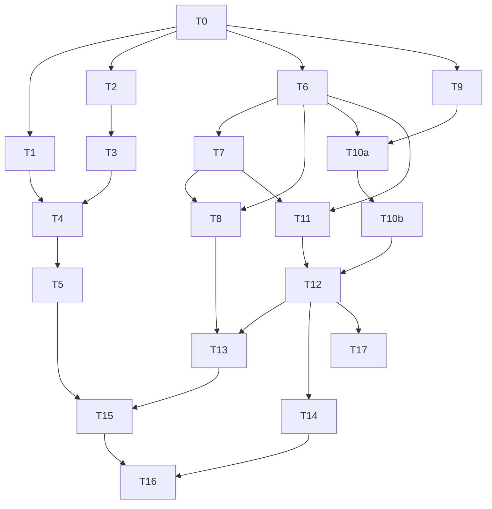

# Tareas: mis-pedidos

Estado: **aprobada, en cierre** (v1, 2026-10-23). Requisitos: `requirements.md`. Diseño: `design.md`. Rama: `feat/mis-pedidos` (desde `main` `fb5f7f5`). Sin commits hasta que el usuario los pida.

Convención: cada tarea con código lleva sus tests, que se nombran con el id del criterio (`REQ-x.y`) y se escriben antes que el código (rojo → verde). Obligatorias salvo marca (O). Los comandos de backend se corren en `backend/` y los de frontend en `frontend/`.

## Backend

- [x] **T0. Línea base** — NFR-2, NFR-6
  - Registrar en «Registro de ejecución»: `npm test` (suites y tests), `npx eslint "{src,apps,libs,test}/**/*.ts"` y `npm run build` en backend; `npm run lint`, `npx ng test --no-watch --browsers=ChromeHeadless` y `npm run build` (con el tamaño del bundle inicial) en frontend. Guardar en el scratchpad el Swagger de desarrollo (`GET /swagger/json`, backend con `NODE_ENV=development`, variables falsas y base descartable) para compararlo en T5.
  - Depende de: —
  - Verificación: números anotados. Criterio de comparación para T5 y T14: **mismo número de suites y tests o más, 0 fallos**, y bundle inicial ≤ 800 kB.

- [x] **T1. DTO de consulta** — REQ-1.5, REQ-1.6
  - `backend/src/orders/dto/list-my-orders-query.dto.ts` (`ListMyOrdersQueryDto`, `DEFAULT_ORDERS_LIMIT = 10`, `MAX_ORDERS_LIMIT = 50`) y `list-my-orders-query.dto.spec.ts`, con las opciones de producción del `ValidationPipe`.
  - Depende de: T0
  - Verificación: tests `REQ-1.5` (sin parámetros: `page 1`, `limit 10`) y `REQ-1.6` (`page` 0, negativo, decimal o texto; `limit` 0, 51 o texto → error de validación).

- [x] **T2. Mapper** — REQ-1.4
  - `backend/src/orders/order.mapper.ts`: `MyOrderSummaryResponse`, `MyOrdersPage` y `toMyOrderSummary(order, itemCount)`; casos nuevos en `order.mapper.spec.ts`.
  - Depende de: T0
  - Verificación: test `REQ-1.4` (devuelve exactamente `id`, `status`, `total`, `createdAt`, `itemCount`; sin `customerName`, `customerEmail`, `shippingAddress` ni `allowedTransitions`).

- [x] **T3. Servicio `getMyOrders`** — REQ-1.1, REQ-1.2, REQ-1.3, REQ-1.4, REQ-1.7, REQ-1.8, REQ-1.10, REQ-2.1, REQ-2.2
  - `backend/src/orders/orders.service.ts`: `findAndCount` con `where: { userId }`, `order: { createdAt: 'DESC', id: 'DESC' }`, `skip`/`take`, sin `relations`; una consulta agrupada `COUNT(*)::int` sobre `order_items`; `totalPages = Math.ceil(total / limit)`. Spec nuevo `orders.service.spec.ts` (el repo no tiene uno hoy).
  - Depende de: T2
  - Verificación: tests `REQ-1.1` (forma `{items,total,page,limit,totalPages}`), `REQ-1.2` (el `where` filtra por el `userId` recibido), `REQ-1.3` (orden por `createdAt` y `id` descendentes), `REQ-1.4` (`itemCount` es número aunque la base devuelva string, y 0 si la orden no tiene filas), `REQ-1.7` (sin órdenes: `[]`, `total 0`, `totalPages 0`, sin consulta de conteo), `REQ-1.8` (página fuera de rango: `[]` y `total` real), `REQ-1.10` (el servicio no distingue rol: recibe solo `userId`), `REQ-2.1` (`getOrderByIdForRole` con un usuario no ADMIN y una orden de otro dueño lanza `NotFoundException`, contra el servicio real con repositorio simulado) y `REQ-2.2` (el dueño recibe la orden con sus líneas). Si el entorno permite una base descartable, el mismo caso corre una vez contra Postgres real y se anota en el registro (O).

- [x] **T4. Endpoint `GET /orders/me`** — REQ-1.1, REQ-1.5, REQ-1.6, REQ-1.9, REQ-1.10, REQ-1.11, REQ-1.12, REQ-2.1, REQ-2.2
  - `backend/src/orders/orders.controller.ts`: `@Get('me')` declarado **antes** de `@Get(':id')`, con `@ApiOperation`, `@ApiResponse`, `@Query() ListMyOrdersQueryDto` y `@CurrentUser() user: Payload`; sin `@Roles`. Casos nuevos en `orders.controller.spec.ts`, con `createControllerApp` (`rejectUnauthenticatedWith401` y las opciones de producción del `ValidationPipe`).
  - Depende de: T1, T3
  - Verificación: tests `REQ-1.1` (200 y llamada a `getMyOrders(user.sub, …)`), `REQ-1.5` (sin parámetros usa 1 y 10), `REQ-1.6` (400 con `page=0` y con `limit=51`), `REQ-1.9` (sin usuario → 401), `REQ-1.10` (con rol ADMIN llama con su propio `sub`), `REQ-1.11` (`GET /orders/me` responde 200 y no se llama a `getOrderByIdForRole`), `REQ-2.1` (el controller propaga el 404 que lanza el servicio simulado), `REQ-2.2` (el dueño recibe la orden); el comportamiento real del servicio lo prueba T3. `REQ-1.12` se verifica en T5.

- [x] **T5. Validación del backend** — REQ-1.12, NFR-1, NFR-6
  - Lint, suite completa y build del backend; Swagger de desarrollo comparado con el de T0.
  - Depende de: T4
  - Verificación: lint 0; `npm test` con suites y tests ≥ línea base y 0 fallos; `npm run build` ok; diff de Swagger = **solo** `GET /orders/me` agregado (REQ-1.12); `git diff --stat` sin archivos de `database/migrations` (NFR-1).

## Frontend

- [x] **T6. Utilidades compartidas** — NFR-3
  - `frontend/src/app/shared/utils/order-status.ts` (`ORDER_STATUS_LABEL`, `orderStatusLabel`) y `order-whatsapp.ts` (`buildWhatsappUrl(order, whatsappNumber)`, mismo mensaje que hoy arma `CheckoutSuccessPage`), con sus specs.
  - Depende de: T0
  - Verificación: tests `NFR-3` (las cuatro etiquetas exactas, «Sin estado» para un valor desconocido; la URL de WhatsApp coincide byte a byte con la que arma hoy la pantalla de éxito para un pedido de ejemplo).

- [x] **T7. Componente `OrderPaymentInfo`** — REQ-4.5, REQ-4.6
  - `frontend/src/app/shared/components/order-payment-info/` (`input.required<OrderResponse>()`, `OnPush`): bloque «Datos de transferencia» (alias, CBU, titular, banco) y botón «Enviar pedido por WhatsApp» (usa T6 y `BANK_TRANSFER_DATA`), con su spec.
  - Depende de: T6
  - Verificación: tests `REQ-4.5` (muestra alias, CBU, titular y banco de `BANK_TRANSFER_DATA`) y `REQ-4.6` (el enlace apunta a la URL de `buildWhatsappUrl`, con `target="_blank"` y `rel="noopener noreferrer"`).

- [x] **T8. Pantalla de éxito del checkout usa lo compartido** — NFR-3
  - `checkout-success-page.ts` / `.html`: reemplazar su `statusLabel`, su `whatsappUrl` y los bloques de transferencia y botón por T6 y T7. Sin cambios de comportamiento.
  - Depende de: T6, T7
  - Verificación: los tests existentes de `checkout-success-page.spec.ts` pasan **sin modificarse**; `grep -rn "Esperando transferencia" frontend/src/app/features/checkout --include=*.ts --include=*.html --exclude=*.spec.ts` no devuelve nada (el spec existente sí conserva el texto y no se toca).

- [x] **T9. Servicio y modelos** — REQ-3.11 (soporte de REQ-3)
  - `frontend/src/app/core/services/orders.service.ts`: `MyOrderSummary`, `MyOrdersResponse` (la interfaz; el componente de la página se llama `MyOrdersPage`) y `getMyOrders(page = 1, limit = 10)` con `HttpParams`. **Crear** `frontend/src/app/core/services/orders.service.spec.ts` (hoy no existe).
  - Depende de: T0
  - Verificación: tests `REQ-3.11` (pide `GET /orders/me?page=2&limit=10` con `HttpTestingController`) y un caso con los valores por defecto (`page=1&limit=10`).

- [x] **T10a. `MyOrdersPage`: lista, carga y error** — REQ-3.2 a REQ-3.9
  - `frontend/src/app/features/orders/my-orders-page.ts` / `.html` / `.spec.ts`: signals `orders`, `page`, `totalPages`, `loading`, `error`; primera página en `ngOnInit`; «Reintentar». Filas con número, `date:'short'`, `orderStatusLabel`, `$ number:'1.0-0'`, cantidad de productos y `routerLink` a `/orders/:id`. Vacío: mensaje y enlace a `/home`. Mobile-first, DaisyUI (`ui-ux-pro`).
  - Depende de: T6, T9
  - Verificación: tests `REQ-3.2` (indicador de carga), `REQ-3.3` (los cinco datos), `REQ-3.4` (enlaces a `/orders/:id`), `REQ-3.5` (etiquetas de los cuatro estados), `REQ-3.6` y `REQ-3.7` (vacío: mensaje y enlace al catálogo), `REQ-3.8` (error de primera página) y `REQ-3.9` (Reintentar repite la petición).

- [x] **T10b. `MyOrdersPage`: «Cargar más»** — REQ-3.10 a REQ-3.14
  - Mismo componente: `loadingMore`, `canLoadMore`, `loadMore()` que agrega con `[...orders(), ...res.items]`, botón `disabled` mientras corre y aviso con `NotificationService` si falla.
  - Depende de: T10a
  - Verificación: tests `REQ-3.10` (botón visible con `page < totalPages` y oculto en la última), `REQ-3.11` (pide `page+1`), `REQ-3.12` (agrega a continuación), `REQ-3.13` (deshabilitado mientras la petición está en curso), `REQ-3.14` (falla «Cargar más»: aviso y lista intacta).

- [x] **T11. `OrderDetailPage`** — REQ-4.2 a REQ-4.11
  - `frontend/src/app/features/orders/order-detail-page.ts` / `.html` / `.spec.ts`: `id` desde `route.snapshot.paramMap`; validación de entero positivo sin llamar al backend; `getOrderById`; `<app-order-payment-info>` solo con `PENDING_PAYMENT`; «Volver a mis pedidos»; estado de error con enlace a `/orders`.
  - Depende de: T6, T7
  - Verificación: tests `REQ-4.2` (carga), `REQ-4.3` (número, etiqueta, fecha, nombre, email, dirección y total), `REQ-4.4` (líneas con producto, cantidad, precio unitario y subtotal), `REQ-4.5` y `REQ-4.6` (el detalle de un pedido `PENDING_PAYMENT` renderiza `<app-order-payment-info>` con alias, CBU, titular, banco y el botón de WhatsApp; T7 prueba el componente aislado), `REQ-4.7` (en `PAID`, `CANCELLED` y `DELIVERED` no aparece `<app-order-payment-info>`), `REQ-4.8` (404 y error de red → «No pudimos cargar este pedido»), `REQ-4.9` (enlace a `/orders` en error), `REQ-4.10` (`abc`, `0` y `-3` no llaman al servicio), `REQ-4.11` (enlace «Volver a mis pedidos»).

- [x] **T12. Rutas y header** — REQ-3.1, REQ-4.1, REQ-5.1, REQ-5.2, REQ-5.3, NFR-2
  - `frontend/src/app/app.routes.ts`: `orders` y `orders/:id` con `authGuard` y `loadComponent`. `shared/header/header.html`: ítem «Mis pedidos» tras «Mi perfil», dentro del bloque con sesión, con `userMenuTrigger.close()`. **Crear** `frontend/src/app/shared/header/header.spec.ts` (hoy no existe) y **ampliar** `frontend/src/app/app.routes.spec.ts` (existe).
  - Depende de: T10b, T11
  - Verificación: tests `REQ-3.1` y `REQ-4.1` (en `app.routes.spec.ts`: ambas rutas llevan `authGuard` y `loadComponent`), `REQ-5.1` (en `header.spec.ts`: con sesión, el ítem existe con `routerLink="/orders"` y aparece junto a «Mi perfil»), `REQ-5.2` (sin sesión no existe), `REQ-5.3` (al elegirlo se cierra el menú). `NFR-2`: el build lista las dos páginas como chunks perezosos y el bundle inicial ≤ 800 kB.

- [x] **T13. Validación del frontend** — NFR-2, NFR-3, NFR-5
  - Lint, suite de Karma completa y build.
  - Depende de: T8, T12
  - Verificación: `npm run lint` 0; Karma con tests ≥ línea base y 0 fallos; `npm run build` ok y bundle inicial ≤ 800 kB; `grep -rn "Esperando transferencia" frontend/src/app` solo en `shared/utils/order-status.ts`, el panel de administración y los specs (NFR-3 acotado); componentes nuevos con `ChangeDetectionStrategy.OnPush` (lo exige el lint).

## Cierre

- [ ] **T14. Medición de interfaz en navegador** — NFR-4
  - Con el stack local arriba, correr la skill `ego-verify-sdd` sobre `/orders` y `/orders/:id` a 360 px: ausencia de scroll horizontal, elementos principales visibles. Adjuntar la salida cruda en «Registro de ejecución».
  - Depende de: T12
  - Verificación: salida de `ego-verify-sdd` con los valores observados, identificada con `NFR-4`. Sin salida, el criterio queda `NO VERIFICABLE`.

- [x] **T15. Auditoría** — todos
  - Subagente `code-auditor` sobre el código implementado (permisos del listado propio, filtro por `userId`, orden de rutas, `itemCount`, convenciones).
  - Depende de: T5, T13
  - Verificación: informe sin hallazgos altos; los medios se corrigen con el `implementer` y se vuelve a correr T5 y T13.

- [x] **T16. Verificación de cierre** — todos
  - Subagente `spec-verifier`; su tabla se pasa a «Verificación final» de `requirements.md` y se muestra completa. Los `NO VERIFICABLE` se confirman con el usuario.
  - Depende de: T14, T15
  - Verificación: 0 `NO`; tabla completa en `requirements.md`.

- [ ] **T17 (O, manual). Humo en local**
  - Lo hace una persona con backend y frontend arriba: comprar con un usuario, ver el pedido en «Mis pedidos», abrir su detalle y ver los datos de transferencia; marcarlo como pagado desde el panel y comprobar que el detalle ya no los muestra; con más de 10 pedidos probar «Cargar más»; intentar abrir `/orders/<id de otro usuario>` y comprobar el mensaje de error.
  - Depende de: T12
  - Verificación: lo que informe el usuario, anotado en el registro.

## Dependencias

Tras T0 son independientes entre sí T1, T2, T6 y T9; el backend (T1 a T5) y el frontend (T6 a T13) no se esperan.

## Trazabilidad

| Requisito | Tareas |
|---|---|
| REQ-1.1 | T3, T4 |
| REQ-1.2, 1.3, 1.7, 1.8 | T3 |
| REQ-2.1, 2.2 | T3 (servicio real), T4 (controller) |
| REQ-1.4 | T2, T3 |
| REQ-1.5, 1.6 | T1, T4 |
| REQ-1.9, 1.11 | T4 |
| REQ-1.10 | T3, T4 |
| REQ-1.12 | T4, T5 |
| REQ-3.1 | T12 |
| REQ-3.2 a 3.9 | T10a |
| REQ-3.10 a 3.14 | T10b (REQ-3.11 también en T9) |
| REQ-4.1 | T12 |
| REQ-4.2 a 4.11 | T11 |
| REQ-4.5, 4.6 | T7 (componente aislado), T11 (en el detalle) |
| REQ-5.1, 5.2, 5.3 | T12 |
| NFR-1 | T5 |
| NFR-2 | T12, T13 |
| NFR-3 | T6, T7, T8, T13 |
| NFR-4 | T14 |
| NFR-5 | T13 |
| NFR-6 | T0, T5 |

## Registro de ejecución

### T0. Línea base (2026-10-23)
- **Backend (`main` `fb5f7f5`):** 44 suites y 421 tests en verde (cifras del cierre de `ia-al-crear-producto`, mismo `main`); lint 0; build ok. **Criterio:** tras T5, suites ≥ 44 y tests ≥ 421 más los nuevos, 0 fallos.
- **Frontend:** 336 tests de Karma en verde; lint 0; bundle inicial 764,54 kB. **Criterio:** tras T13, tests ≥ 336 más los nuevos, 0 fallos y bundle ≤ 800 kB.
- **Tests en rojo (test-writer):** backend 17 nuevos en rojo (69 verdes en `src/orders`); frontend 43 en rojo y 337 en verde. Baseline de hashes en `tests-baseline.txt` (12 archivos).
- **Swagger — desvío:** Docker no está disponible y el backend completo necesita Postgres, así que no se pudo sacar `/swagger/json` de la aplicación. Se tomó el documento OpenAPI **solo de `OrdersController`** (único controller que cambia) con un spec temporal, antes de T4: `scratchpad/orders-swagger.before.json`, 3 rutas (`/orders`, `/orders/{id}`, `/orders/{id}/status`). T5 lo compara con el de después. El spec temporal es `backend/src/orders/swagger-snapshot.tmp.spec.ts` y **se borra en T5**.
- **Lint pendiente de decidir con el usuario:** `orders.service.spec.ts` (2 errores de Prettier y 2 de `any` inseguro) y `header.spec.ts` (el componente anfitrión sin `OnPush`) están en el baseline y fallan el lint; corregirlos exige aprobación y actualizar el baseline. Los demás errores de lint de hoy son de los esqueletos y se van al implementar.

### Resultados por tarea
- **T1 (2026-10-23):** `ListMyOrdersQueryDto` implementado; suite del DTO 11 de 11; lint del archivo 0; baseline de hashes intacto.

- **T2, T3, T4 (2026-10-23):** mapper, `getMyOrders` y `GET /orders/me` implementados; baseline de hashes intacto tras cada tarea.
- **T5 (parcial, 2026-10-23):** suite completa del backend **46 suites y 456 tests, 0 fallos** (línea base 44 y 421); `npm run build` ok; sin cambios en `database/migrations` (NFR-1); Swagger de `OrdersController` antes/después: el diff agrega **solo** `/orders/me` con `page` y `limit` y la respuesta 200 (REQ-1.12), sin otras diferencias. Spec temporal `swagger-snapshot.tmp.spec.ts` borrado. El lint tenía 4 errores, todos en `orders.service.spec.ts` (2 de Prettier y 2 de `any` inseguro). El usuario autorizó corregirlos solo en forma (Prettier y un cast de `mock.calls`); sin cambios de casos ni aserciones; hash actualizado en `tests-baseline.txt` con su nota. **Cierre de T5: lint 0, 46 suites y 456 tests en verde, build ok.**

*(Se completan después: resultado final de T5 y T13, salida de `ego-verify-sdd` de T14, informe del auditor, tabla del verificador y humo de T17.)*

- **T6 a T12 (2026-10-23, sesión retomada):** utilidades, `OrderPaymentInfo`, pantalla de éxito del checkout reutilizando lo compartido, `getMyOrders`, `MyOrdersPage`, `OrderDetailPage`, rutas `orders` y `orders/:id` con `authGuard` y ítem «Mis pedidos» en el header. Karma: **380 de 380 en verde** (línea base 336); build ok, bundle inicial **766,27 kB** (≤ 800); `my-orders-page` sale como chunk perezoso. Hashes de `tests-baseline.txt` intactos. En `order-detail-page.html` el texto de cada línea es «Cantidad: N x $ precio» para que el test `REQ-4.4` encuentre la cantidad como palabra.
- **T13 (2026-10-23):** el usuario autorizó agregar `OnPush` al anfitrión `DummyPage` de `header.spec.ts` (hash actualizado). **Cierre: lint 0, Karma 380 de 380, build ok, bundle inicial 766,27 kB.**
- **T15 (2026-10-23):** `code-auditor`: **aprobable**, sin hallazgos altos ni medios; hashes del baseline intactos. Bajos: L1 (`page` sin `@Max`, mismo patrón que `ListProductsQueryDto`; deuda aparte), L2 (el botón de WhatsApp ya no comparte fila con «Volver al catálogo» en escritorio; se mira en T14), L3 (textos de la spec desactualizados; **corregido**), L4 (`rapidas/` sin versionar, fuera del commit), L5 (id leído de `snapshot`, según el diseño). El usuario aceptó dejar L1, L2, L4 y L5 como están.
- **T16 (2026-10-23):** `spec-verifier`: **cerrable**; 0 `NO`; tabla en «Verificación final» de `requirements.md`. `NO VERIFICABLE`: NFR-4 (depende de T14). REQ-1.12 con evidencia estática. Re-ejecutado: backend 46 suites / 456 tests, lint 0, build ok; frontend 380/380, lint 0, build ok (766,27 kB).
