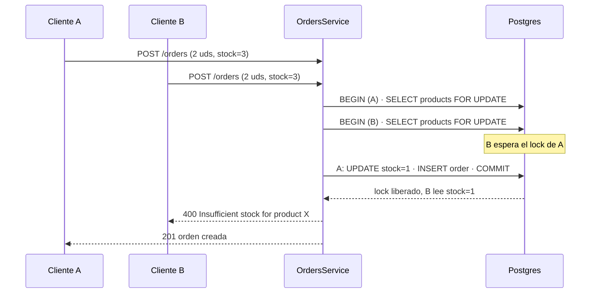
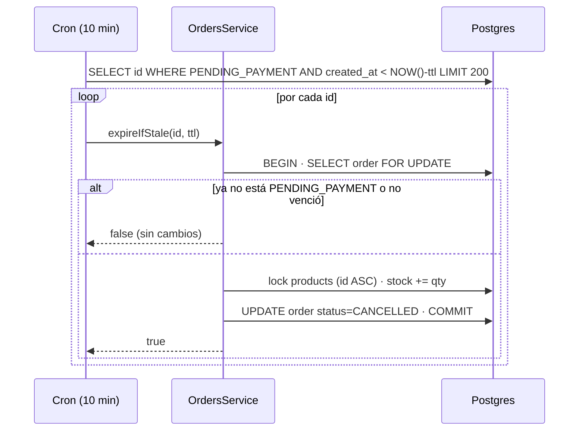

# Diseño: orders-integrity

## Resumen y decisiones clave

El checkout y los cambios de estado pasan a correr **bajo bloqueo de fila de Postgres** (`SELECT … FOR UPDATE`) dentro de la transacción que ya existe. Se bloquean siempre en orden ascendente de `id` para evitar deadlocks. Un `CHECK (stock >= 0)` en la base es la última defensa si alguna ruta de código futura se salta el bloqueo.

Toda la lógica de estados vive en **una sola función pura** (`order-status.machine.ts`) que decide transiciones permitidas. La usan el admin, el vencimiento automático y, vía el campo `allowedTransitions`, el frontend: una única fuente de verdad. El vencimiento y la cancelación manual comparten el mismo método transaccional, por lo que la devolución de stock se implementa una sola vez.

El dinero se guarda en `numeric(12,2)`, se lee como `number` mediante un `transformer` de TypeORM y se opera en **centavos enteros** (sin librería de decimales nueva).

## Arquitectura

```mermaid
graph TD
  subgraph HTTP
    OC[OrdersController]
  end
  subgraph Orders
    OS[OrdersService]
    OM[order.mapper]
    SM[order-status.machine]
    OE[OrderExpirationService<br/>@Cron cada 10 min]
  end
  subgraph Common
    MN[money.ts]
    TR[numeric.transformer]
  end
  subgraph Datos
    PG[(Postgres<br/>FOR UPDATE + CHECK)]
  end
  CS[CartService]
  FE[Frontend: order-admin.page]

  OC --> OS
  OE --> OS
  OS --> SM
  OS --> OM
  OS --> MN
  CS --> MN
  OM --> SM
  OS --> PG
  TR --> PG
  OC -. allowedTransitions .-> FE
```

## Componentes e interfaces

### `common/money.ts` (nuevo)
- **Responsabilidad:** aritmética exacta de dinero sobre centavos enteros.
- **Cubre:** REQ-2.2, REQ-2.3
- **Interfaz:**
  ```ts
  export const toCents = (amount: number): number => Math.round(amount * 100);
  export const fromCents = (cents: number): number => cents / 100;
  export const lineTotal = (unitPrice: number, quantity: number): number => fromCents(toCents(unitPrice) * quantity);
  export const sumMoney = (amounts: number[]): number => fromCents(amounts.reduce((acc, a) => acc + toCents(a), 0));
  ```
  Las entradas siempre salen de columnas `numeric(12,2)`, por lo que ya tienen a lo sumo dos decimales; `Math.round` solo absorbe el error de representación (`0.1 * 100`). Con 12 dígitos el máximo es 10¹² centavos, muy por debajo de `Number.MAX_SAFE_INTEGER`.

### `common/numeric.transformer.ts` (nuevo)
- **Responsabilidad:** Postgres devuelve `numeric` como `string`; este transformer lo convierte a `number` al leer y no toca el valor al escribir.
- **Cubre:** REQ-2.1, REQ-2.3
- **Interfaz:**
  ```ts
  export const numericTransformer: ValueTransformer = {
    to: (value?: number | null) => value,
    from: (value?: string | null) => (value == null ? value : Number(value)),
  };
  ```
- Se aplica a `Product.price`, `Order.total`, `OrderItem.unitPrice`, `OrderItem.subtotal` con `@Column({ type: 'numeric', precision: 12, scale: 2, transformer: numericTransformer })`.

### `orders/order-status.machine.ts` (nuevo)
- **Responsabilidad:** reglas de transición, sin dependencias de Nest ni de la base.
- **Cubre:** REQ-3.1, REQ-3.2, REQ-6.1, REQ-6.2
- **Interfaz:**
  ```ts
  const TRANSITIONS: Record<OrderStatus, readonly OrderStatus[]> = {
    PENDING_PAYMENT: ['PAID', 'CANCELLED'],
    PAID: ['DELIVERED', 'CANCELLED'],
    DELIVERED: [],
    CANCELLED: [],
  };
  export const allowedNext = (from: OrderStatus): readonly OrderStatus[] => TRANSITIONS[from];
  export const canTransition = (from: OrderStatus, to: OrderStatus): boolean => TRANSITIONS[from].includes(to);
  ```

### `OrdersService` (modificado)
- **Responsabilidad:** casos de uso de órdenes, todos transaccionales.
- **Cubre:** REQ-1, REQ-2.2, REQ-2.5, REQ-3, REQ-4, REQ-5.1, REQ-5.6, REQ-5.9
- **Interfaz:**
  ```ts
  createOrder(userId: number, dto: CreateOrderDto): Promise<OrderResponse>;
  updateStatus(orderId: number, status: OrderStatus): Promise<{ id: number; status: OrderStatus; allowedTransitions: OrderStatus[] }>;
  // Usado por el vencimiento; devuelve true si canceló, false si la orden ya no correspondía.
  expireIfStale(orderId: number, ttlHours: number): Promise<boolean>;
  // privado, comparte admin y vencimiento
  private transition(manager: EntityManager, orderId: number, target: OrderStatus): Promise<Order>;
  private restock(manager: EntityManager, orderId: number): Promise<void>;
  ```
- **`createOrder`** (todo dentro de `dataSource.transaction`):
  1. Leer `CartItem` del usuario **sin relaciones**, ordenados por `productId`. Vacío → 400.
  2. Leer los `Product` con `lock: { mode: 'pessimistic_write' }`, `where: { id: In(ids) }`, `order: { id: 'ASC' }`. Se hace en una consulta aparte y sin `relations` porque Postgres no permite `FOR UPDATE` sobre el lado nulable de un outer join.
  3. Validar cada ítem contra el producto ya bloqueado: precio ausente o ≤ 0 → 400 con el nombre (REQ-2.5); stock < cantidad → 400 con el nombre (REQ-1.3, 1.4). Se valida todo **antes** de escribir nada.
  4. Descontar stock (`stock - cantidad`), crear `Order` y `OrderItem` con `lineTotal`/`sumMoney`, borrar el carrito.
  5. Cualquier excepción revierte la transacción: el stock, la orden y el carrito quedan como estaban.
- **`transition`**: `findOne(Order, { lock: pessimistic_write })` (sin relaciones). Si no existe → 404. Si `!canTransition` → `ConflictException` con estado actual y pedido. Si el destino es `CANCELLED` → `restock`. Guarda el estado.
- **`restock`**: lee los `OrderItem` de la orden ordenados por `productId`, bloquea los productos en el mismo orden y suma con `UPDATE products SET stock = COALESCE(stock, 0) + :qty`. `COALESCE` porque `stock` es nullable.
- **`updateStatus`**: `dataSource.transaction(m => this.transition(m, id, status))`. El segundo request concurrente espera el lock de la fila, ve el estado nuevo y recibe 409 (REQ-3.5).
- **`expireIfStale`**: en una transacción bloquea la orden y **revalida** que siga en `PENDING_PAYMENT` y que `created_at < NOW() - ttl`; si no, devuelve `false` sin tocar nada. Esa revalidación es lo que hace idempotente la revisión (REQ-5.9).

### `orders/order.mapper.ts` (nuevo)
- **Responsabilidad:** único lugar que arma `OrderResponse` y `OrderSummaryResponse`, incluyendo `allowedTransitions`.
- **Cubre:** REQ-6.1, REQ-6.2, NFR-4
- **Decisión técnica:** hoy el mapeo está copiado tres veces en `orders.service.ts` (líneas ~79, ~108 y ~152); agregar un campo en tres lugares es una fuente de errores, así que se unifica al tocar esas funciones.

### `OrderExpirationService` (nuevo)
- **Responsabilidad:** disparar la revisión periódica y aislar fallos por orden.
- **Cubre:** REQ-5.1 a REQ-5.9
- **Interfaz:**
  ```ts
  @Cron('0 */10 * * * *') // cada 10 minutos (< 15, REQ-5.5)
  async run(): Promise<void>;
  ```
- **Comportamiento:**
  - En el constructor lee `ORDER_PAYMENT_TTL_HOURS` con `ConfigService`; si falta o no es un número > 0 usa 48 y, solo si estaba definida e inválida, emite `logger.warn` (REQ-5.2, 5.3, 5.4).
  - `run()` consulta hasta 200 ids: `status = 'PENDING_PAYMENT' AND created_at < NOW() - (:ttl * INTERVAL '1 hour') ORDER BY id`. Usa `NOW()` de la base, la misma expresión que el `DEFAULT CURRENT_TIMESTAMP` de la columna, para no depender de la zona horaria de Node.
  - Por cada id llama a `expireIfStale` dentro de `try/catch`; ante error registra `id` y `error.message` (no el stack, para no arrastrar datos de la consulta) y sigue (REQ-5.7, 5.8, NFR-3).
  - Registra el total cancelado en nivel `log`.
- **Dependencia nueva:** `@nestjs/schedule@^6.1.3` (peer `@nestjs/core ^10 || ^11`). *(Enmienda durante la implementación: el diseño decía v12, pero la v12 es ESM-only (`"type": "module"`) y Jest no puede cargarla, lo que dejaría sin tests a todo `OrdersModule`. La 6.1.x es CommonJS y soporta Nest 11.)* `ScheduleModule.forRoot()` se importa en `OrdersModule`.

### `CartService` (modificado)
- **Cubre:** REQ-2.2
- Reemplaza `item.product.price * item.quantity` y el `reduce` por `lineTotal` y `sumMoney`.

### DTOs de producto (modificado)
- **Cubre:** REQ-2.4, REQ-1.6
- `CreateProductDto.price`: `@IsNumber({ maxDecimalPlaces: 2 }) @Min(0)`.
- `CreateProductDto.stock`: `@IsInt() @Min(0)`.
- **Decisión técnica:** sin esto, un stock negativo enviado por el admin llegaría al `CHECK` y se vería como un 500 en lugar de un 400.

### Frontend `order-admin.page` y `orders.service.ts` (modificado)
- **Cubre:** REQ-6.1 a REQ-6.4
- `OrderResponse` y `OrderSummaryResponse` ganan `allowedTransitions: OrderStatus[]`.
- El `<select>` de estado del detalle muestra el estado actual (deshabilitado) más `allowedTransitions`; si la lista está vacía, el control no se muestra (REQ-6.2).
- En `updateSelectedOrderStatus`, si el error es `HttpErrorResponse` con status 409: `notificationService.error` con el mensaje y `selectOrder(order.id)` + `loadOrders()` para recargar (REQ-6.3, 6.4).
- Fuera de este diseño queda el pipe `number:'1.0-0'` que hoy redondea los montos a enteros al mostrarlos: no es parte de la spec, pero conviene revisarlo cuando haya precios con centavos.

## Modelo de datos

Migración nueva `1779000000000-orders-money-and-stock-check.ts` (posterior a `1778100000000`):

| Tabla.columna | Antes | Después |
|---|---|---|
| `products.price` | `double precision` null | `numeric(12,2)` null |
| `orders.total` | `double precision` default 0 | `numeric(12,2)` default 0 |
| `order_items.unit_price` | `double precision` | `numeric(12,2)` |
| `order_items.subtotal` | `double precision` | `numeric(12,2)` |
| `products` | — | `CONSTRAINT CHK_products_stock_non_negative CHECK (stock >= 0)` |

**`up`**
1. `UPDATE products SET stock = 0 WHERE stock < 0` (decisión sobre datos preexistentes; ver "Preguntas resueltas").
2. Por cada columna: `ALTER COLUMN … TYPE numeric(12,2) USING ROUND(col::numeric, 2)`. Para `orders.total` se hace `DROP DEFAULT`, el cambio de tipo y `SET DEFAULT 0`.
3. `ADD CONSTRAINT … CHECK (stock >= 0)`. Un `stock` nulo cumple el `CHECK`; el código lo trata como 0.

**`down`**: `DROP CONSTRAINT`, y cada columna vuelve a `double precision USING col::double precision` (con `SET DEFAULT 0` en `orders.total`). Lo que `up` normalizó (stock negativo → 0 y centavos redondeados) **no es recuperable**; queda documentado en el encabezado de la migración.

Si algún precio existente tiene más de 10 dígitos enteros, el `ALTER` falla con *numeric field overflow* y la migración no se aplica a medias (Postgres ejecuta DDL transaccional).

## Flujos principales

### Checkout concurrente (REQ-1.2)



### Cancelación manual y vencimiento (REQ-3, REQ-4, REQ-5)


El admin entra por `updateStatus` y comparte `transition`; la única diferencia es que el estado de destino viene del request.

## Manejo de errores

| Situación | Respuesta |
|---|---|
| Carrito vacío | 400 `Cart is empty` (igual que hoy) |
| Stock insuficiente | 400 `Insufficient stock for product <nombre>` (igual que hoy); transacción revertida |
| Producto sin precio o ≤ 0 | 400 `Product <nombre> has no valid price`; transacción revertida |
| Transición no permitida / carrera de dos cambios | 409 `Cannot change order from <A> to <B>` |
| Estado fuera del enum | 400 (ValidationPipe, sin cambios) |
| Orden inexistente | 404 (sin cambios) |
| Usuario no ADMIN | 403 (`RolesGuard`, sin cambios) |
| Precio/stock inválido en producto | 400 por DTO |
| Falla de la base durante restock | la transacción revierte estado y stock (REQ-4.3); 500 al admin, sin detalles |
| Falla de una orden en el cron | log con `id` + `message`; se sigue con las demás |

## Estrategia de testing

**Unitarios (Jest, sin base)**

| Archivo | Criterios |
|---|---|
| `common/money.spec.ts` | REQ-2.2 (`3 × 0.10 = 0.30`, sumas de `0.1 + 0.2`) |
| `common/numeric.transformer.spec.ts` | REQ-2.1, 2.3 (`'12.50'` → `12.5`, `null` → `null`) |
| `orders/order-status.machine.spec.ts` | REQ-3.1, 3.2, 6.1, 6.2: las 16 combinaciones origen × destino |
| `product/dto/create-product.dto.spec.ts` | REQ-2.4 (negativo, 3 decimales, stock negativo o decimal) |
| `orders/order-expiration.service.spec.ts` | REQ-5.2 a 5.4 (TTL por defecto, inválido + warn), 5.7/5.8 (un fallo no corta el lote, el log no incluye PII) |

**Integración contra Postgres real (NFR-1)** — `backend/test/orders-integrity.e2e-spec.ts`. Se conecta a una base de pruebas indicada por `TEST_DB_*`; si no están definidas, la suite se **omite con un aviso explícito** (no pasa en silencio). Antes de correr ejecuta las migraciones sobre esa base, lo que de paso ejercita la migración (NFR-2). Se levanta con el servicio `db` de `backend/docker-compose.yml` (puerto 5433). Se agrega el `moduleNameMapper` de `src/` a `test/jest-e2e.json`.

| Prueba | Criterios |
|---|---|
| 10 checkouts simultáneos sobre un producto con stock 3 y 1 unidad c/u → exactamente 3 órdenes, stock final 0 | REQ-1.2 |
| Orden con dos productos donde el segundo no alcanza → stock de ambos intacto, sin orden, carrito conservado | REQ-1.3, 1.4 |
| Insertar `stock = -1` directo por SQL falla por el `CHECK` | REQ-1.6 |
| Producto con precio `NULL` o `0` en el carrito → 400 | REQ-2.5 |
| 3 unidades a 0.10 → total `0.3` en la base y en la respuesta | REQ-2.2, 2.3 |
| Migración `up` sobre datos de ejemplo (floats con 3 decimales, stock negativo) y `down` | REQ-2.6, 2.7, 1.6 |
| `PATCH status` por HTTP (app Nest con `AuthGuard('jwt')` sobrescrito para inyectar usuario y `RolesGuard` real): ADMIN válido 200; transición inválida 409; enum inválido 400; id inexistente 404; CLIENT 403 | REQ-3.1 a 3.4, 3.6 |
| Dos `PATCH` simultáneos a la misma orden → un 200 y un 409 | REQ-3.5 |
| Cancelar `PENDING_PAYMENT` y `PAID` devuelve stock; `PAID`/`DELIVERED` no lo cambian; segunda cancelación → 409 y stock igual | REQ-4.1, 4.4, 4.5 |
| Fallo forzado en `restock` (producto bloqueado con constraint o error simulado) → orden y stock sin cambios | REQ-4.2, 4.3 |
| Órdenes viejas y recientes, `PAID` vieja: `run()` cancela solo la `PENDING_PAYMENT` vencida; segunda ejecución no vuelve a sumar | REQ-5.1, 5.6, 5.9 |

**Frontend** — `order-admin.page.spec.ts` (TestBed con `HttpTestingController`): el selector ofrece solo `allowedTransitions` (REQ-6.1), no aparece en `DELIVERED`/`CANCELLED` (REQ-6.2), y ante un 409 se muestra el error y se vuelve a pedir la orden (REQ-6.3, 6.4). Más una verificación manual en el navegador.

**Criterio de cron (REQ-5.5):** se verifica leyendo el decorador (`0 */10 * * * *`) en un test que lo inspecciona con `Reflect.getMetadata`, no esperando 10 minutos.

## Decisiones descartadas

- **`UPDATE products SET stock = stock - :q WHERE id = :id AND stock >= :q` sin bloqueo explícito.** Es atómico y más corto, pero el precio se leería fuera del lock: otro request podría cambiar el precio entre la validación y el `INSERT` del ítem. Con `FOR UPDATE` el precio y el stock validados son los que se usan. Si la contención llegara a ser un problema real, esta alternativa es el siguiente paso.
- **Control optimista (columna `version`).** Obliga a reintentar en el cliente y agrega un campo al esquema; el bloqueo pesimista es más simple para este volumen.
- **Dinero en centavos `int`.** Descartado por el usuario (cambia el contrato de la API y todo el frontend).
- **`decimal.js` / `big.js`.** Una dependencia nueva para sumar y multiplicar por enteros que se resuelve con centavos.
- **`@nestjs/schedule` v12.** ESM-only: Jest falla al parsearlo (`Jest encountered an unexpected token`). Se fija la serie 6.x.
- **`setInterval` en `OnModuleInit` en vez de `@nestjs/schedule`.** No agrega dependencia, pero reinventa lo que el paquete ya hace (cron legible, manejo del ciclo de vida). Como la revisión es idempotente, ambas opciones son seguras con varias réplicas; se elige la estándar.
- **`pg_cron` o un trigger en la base.** Esconde lógica de negocio fuera del código versionado y complica el despliegue.
- **Usar `reserved_stock`.** Un modelo de reserva separado del stock real es más complejo y ninguna spec lo pide; queda fuera de alcance.
- **Duplicar el mapa de transiciones en el frontend.** Dos copias que se desincronizan; se prefiere que el backend informe `allowedTransitions`.
- **Validar solo en el DTO sin `CHECK` en la base** (o al revés): se necesitan ambos; el DTO da un 400 claro, el `CHECK` protege contra cualquier otra ruta de escritura.

## Trazabilidad

| Requisito | Cubierto por |
|---|---|
| REQ-1.1, 1.2 | `createOrder` con `FOR UPDATE` ordenado + test de 10 checkouts concurrentes |
| REQ-1.3, 1.4 | Validación previa a cualquier escritura + rollback de la transacción |
| REQ-1.5 | `createOrder` paso 1 (ya existente, se conserva) |
| REQ-1.6 | `CHECK` en la migración + `@IsInt @Min(0)` en DTO |
| REQ-2.1 | Migración + `numericTransformer` en 4 columnas |
| REQ-2.2, 2.3 | `money.ts` en `OrdersService` y `CartService` |
| REQ-2.4 | `@IsNumber({ maxDecimalPlaces: 2 }) @Min(0)` en `CreateProductDto` |
| REQ-2.5 | Validación de precio en `createOrder` |
| REQ-2.6, 2.7 | `up`/`down` de la migración |
| REQ-3.1 a 3.4 | `order-status.machine.ts` + `transition` + `ValidationPipe` existente |
| REQ-3.5 | Lock de la fila de la orden en `transition` |
| REQ-3.6 | `RolesGuard` existente, cubierto con test HTTP |
| REQ-4.1 a 4.5 | `restock` dentro de `transition`, misma transacción |
| REQ-5.1 | `OrderExpirationService.run` + `expireIfStale` |
| REQ-5.2 a 5.4 | Lectura de `ORDER_PAYMENT_TTL_HOURS` con fallback y `warn` |
| REQ-5.5 | `@Cron('0 */10 * * * *')` |
| REQ-5.6 | Filtro `status = 'PENDING_PAYMENT'` + revalidación en `expireIfStale` |
| REQ-5.7, 5.8 | `try/catch` por orden en `run` |
| REQ-5.9 | Revalidación bajo lock en `expireIfStale` |
| REQ-6.1, 6.2 | `allowedTransitions` desde `order.mapper` + `<select>` filtrado |
| REQ-6.3, 6.4 | Manejo de 409 en `updateSelectedOrderStatus` |
| NFR-1, NFR-2 | Suite de integración contra Postgres real que corre las migraciones |
| NFR-3 | Logs solo con `id` y `message` |
| NFR-4 | Campo aditivo `allowedTransitions`; rutas y campos actuales intactos |
| *(decisión técnica)* `order.mapper.ts` | Quita la triple copia del mapeo; necesario para agregar `allowedTransitions` en un solo lugar |
| *(decisión técnica)* `@IsInt @Min(0)` en `stock` | Convierte en 400 un valor que de otro modo fallaría el `CHECK` como 500 |

## Desvíos respecto del diseño aprobado (registrados al implementar)

| # | El diseño decía | Se hizo | Por qué |
|---|---|---|---|
| 1 | `@nestjs/schedule` v12 | `@nestjs/schedule@^6.1.3` | La v12 es ESM-only y Jest no puede cargarla (ya anotado arriba) |
| 2 | Panel con un `<select>` filtrado | **Botones de acción**, uno por transición permitida | Un select cuyas opciones cambian con el estado se desincroniza del DOM; los botones no tienen estado propio y cumplen REQ-6.1 igual |
| 3 | `run()` ejecuta la consulta de órdenes vencidas | La consulta vive en `OrdersService.findStaleOrderIds`; `run()` solo orquesta | Mantiene el SQL y las reglas de negocio juntas y deja `run()` testeable con mocks |
| 4 | Un único archivo `orders-integrity.e2e-spec.ts` | 4 archivos (`integrity`, `status`, `expiration`, `migration`) más `orders-integrity.helpers.ts` | La prueba de migración necesita su propia base vacía; separar por tema mantiene cada archivo legible |
| 5 | Base de pruebas: servicio `db` de `backend/docker-compose.yml` | Contenedor efímero propio (`docker run`, sin volumen, puerto 55432) | Ese servicio monta el volumen `postgres_data` con los datos de desarrollo y cargaría el `.env` de `backend/`; los tests vacían las tablas |
| 6 | El arnés inicializa el módulo | El arnés **no** llama a `moduleRef.init()` | Inicializar registraba el cron real durante los tests y, junto con `app.init()`, lo duplicaba (`Cron Job ... already exists`) |
| 7 | El test de concurrencia de estados dispara 3 PATCH a la vez | El test retiene un `FOR UPDATE` y recién después lo libera | La ventana natural de carrera era demasiado corta: la mutación sin lock **sobrevivía**. Con el lock retenido, la mutación falla |

---
**Estado:** Diseño aprobado por el usuario (2026-10-12) e implementado. Desvíos registrados arriba.
