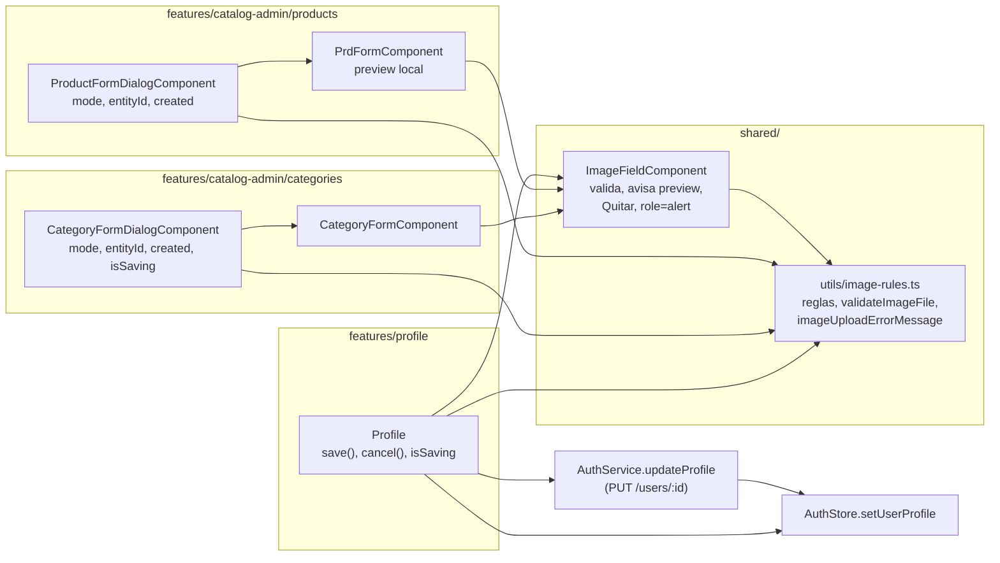
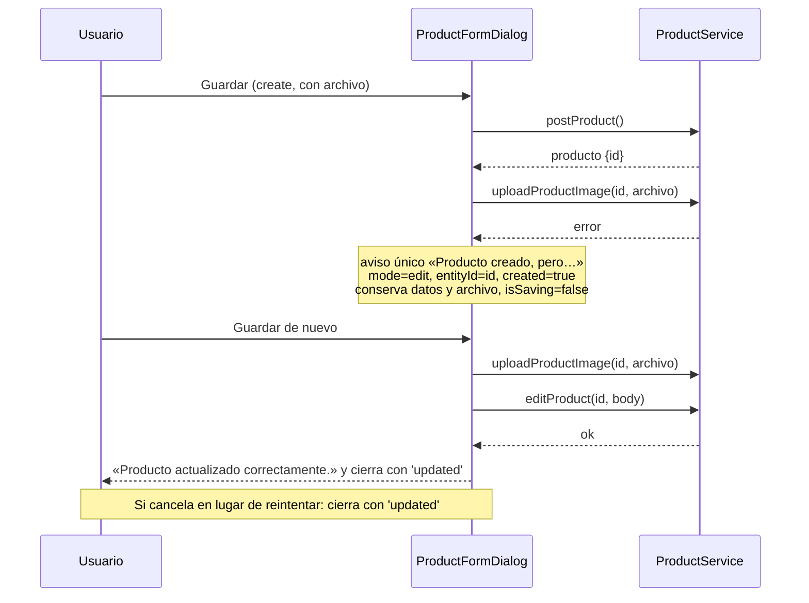

# Diseño: profile-and-images

Responde a `requirements.md` (REQ-1 a REQ-4 y NFR-1 a 9). Es **solo frontend**: un servicio HTTP nuevo, una utilidad compartida de reglas de imagen y cambios en cinco componentes.

Estado: **aprobado el 2026-10-19** (v2) y enmendado el mismo día con la sección 3.9 (Profile perezoso, NFR-8 y NFR-9) tras la parada de bundle en T4. La v1 fue revisada por `spec-reviewer` (4 bloqueantes y 6 menores, incorporados en esta versión). Incluye tres enmiendas a los requisitos aprobados (REQ-2.14/2.15, REQ-3.1, REQ-3.2) que se confirman al aprobar.

## 1. Hallazgos del código que condicionan el diseño

| # | Hallazgo | Consecuencia |
|---|---|---|
| H1 | La «vista previa» que echa en falta el usuario es el panel grande de `product-form.html` («Vista previa del producto» / «Sin imagen seleccionada»), que solo muestra `imageUrl` (la imagen **ya subida**). `ImageFieldComponent` tiene su propio `previewUrl`, pero en `mode="controls"` no lo dibuja. | La vista previa se dibuja en ese panel (REQ-3.1). `ImageFieldComponent` pasa a **avisar** su `previewUrl` con un `@Output` nuevo; no dibuja miniatura propia en `controls`. |
| H2 | `PrdFormComponent.createProduct()` (`product-form.component.ts:70-79`) y `CategoryFormComponent.submitCategory()` hacen `reset()` del formulario justo después de emitir `submitForm` cuando `mode === 'create'`. Si la subida falla, o la creación da 403 u otro error, el formulario ya está vacío y los controles `required` pasan a inválidos: el reintento nunca llega al `PUT`. | Hay que quitar ese `reset()` en **los dos** componentes (REQ-4.4, 4.15, 4.24, 4.26). Al éxito el diálogo se cierra, así que no hace falta. |
| H3 | Ambos diálogos leen `mode` e `id` de `DIALOG_DATA` (`this.data`), objeto que no se muta. Los usos están repartidos: producto en `onSubmit`, `onUploadImage`, `onDeleteImage`, `deleteImageFromEntity` y la plantilla; categoría en `onSubmit` (`data.mode === 'edit' && data.id != null`), `onUploadImage`, `onDeleteImage`, `deleteImageFromEntity` y `[mode]="data.mode"`. | Para «pasar a modo edición» (REQ-4.3, 4.15) cada diálogo mantiene `mode` y `entityId` como signals propios, inicializados desde `data`, y **todos** esos usos pasan a leer `mode()` y `entityId()` (sección 3.5 y 3.7). `data` no se muta. |
| H4 | `CategoryFormDialogComponent` no tiene `isSaving` ni botones deshabilitados, y su rama `edit` no captura el error de `uploadImageForEntity`. | Se agrega `isSaving` y se captura el error (REQ-4.17 a 4.19). `CategoryFormComponent` recibe `isSaving` como `@Input`. |
| H5 | `ProductFormDialogComponent` y `CategoryFormDialogComponent` ya avisan el error de imagen dentro de `uploadImageForEntity` (toast + `imageError`) y luego relanzan; el `catch` externo agrega «No se pudo crear…». | En el flujo de creación se pide a `uploadImageForEntity` que **no** muestre el toast (parámetro), y el que decide el aviso es `onSubmit` (REQ-4.1). Fuera de la creación, el comportamiento actual se mantiene. |
| H6 | `profile.spec.ts` REQ-3.7 espera «No se pudo subir la imagen.» bajo el selector y `notifications.error('No se pudo subir la imagen de perfil.')`. | Se enmendó REQ-2.14/2.15 para conservar esos dos textos (ver requisitos). |
| H7 | `Profile` ya tiene `enableEdit`, un `effect` que copia el perfil del store al formulario solo fuera de edición, y `edit()`. Los validadores usan `Validators.required`, que acepta «   ». | Se agregan `save()`, `cancel()`, `isSaving` y un validador que rechaza espacios. |

## 2. Arquitectura



Capas (steering): componentes → servicios/stores → HTTP. `shared/` no importa de `features/`.

## 3. Interfaces

### 3.1 `shared/utils/image-rules.ts` (nuevo)

Es el único archivo con los límites (NFR-4). Sin dependencias de Angular salvo `HttpErrorResponse`.

```ts
// Deben igualar ALLOWED_IMAGE_MIME_TYPES y DEFAULT_MAX_IMAGE_SIZE_BYTES / MAX_IMAGE_SIZE_BYTES
// de backend/src/files/file.constants.ts. El 413/415 del backend es la red de seguridad.
export const ALLOWED_IMAGE_MIME_TYPES: readonly string[] = ['image/jpeg', 'image/png', 'image/webp'];
export const MAX_IMAGE_SIZE_BYTES = 5 * 1024 * 1024;
const MAX_IMAGE_SIZE_MB = MAX_IMAGE_SIZE_BYTES / (1024 * 1024);   // 5: los textos derivan de aquí

export const IMAGE_RULES_HINT = `Formatos permitidos: JPG, PNG o WebP. Tamaño máximo: ${MAX_IMAGE_SIZE_MB} MB.`;
export const IMAGE_FORMAT_ERROR = 'Formato no permitido. Usa JPG, PNG o WebP.';
export const IMAGE_UPLOAD_GENERIC_ERROR = 'No se pudo subir la imagen.';
export const IMAGE_TOO_LARGE_SERVER_ERROR = `La imagen supera el máximo de ${MAX_IMAGE_SIZE_MB} MB.`;   // 413 sin conocer el tamaño

/** null si el archivo es válido; si no, el mensaje de rechazo. Formato primero, después tamaño. */
export function validateImageFile(file: File): string | null;

/** "La imagen pesa 7,2 MB y el máximo es 5 MB." Una decimal, redondeada hacia arriba (5 242 881 bytes → «5,1 MB»), coma decimal. */
export function imageTooLargeMessage(sizeBytes: number): string;

/**
 * 415 → IMAGE_FORMAT_ERROR; 413 → IMAGE_TOO_LARGE_SERVER_ERROR; cualquier otro → `generic`.
 * `generic` es opcional (por defecto IMAGE_UPLOAD_GENERIC_ERROR): permite que el perfil use su texto
 * propio en el aviso emergente sin comparar textos.
 */
export function imageUploadErrorMessage(error: unknown, generic?: string): string;
```

`validateImageFile`: `!ALLOWED_IMAGE_MIME_TYPES.includes(file.type)` → `IMAGE_FORMAT_ERROR` (incluye `file.type === ''`); `file.size > MAX_IMAGE_SIZE_BYTES` → `imageTooLargeMessage(file.size)` (exactamente 5 MB es válido). El tipo `readonly string[]` evita el error de TypeScript de `includes` sobre una tupla de literales.

### 3.2 `ImageFieldComponent` (modificado)

Mantiene sus `@Input`/`@Output` actuales. Cambios:

```ts
// nuevo
@Output() previewChanged = new EventEmitter<string | null>();   // URL blob actual o null
readonly rejectionMessage = signal<string | null>(null);
readonly rulesHint = IMAGE_RULES_HINT;
```

- `onFileInputChange`: toma el archivo; si `validateImageFile(file)` devuelve mensaje → `rejectionMessage.set(msg)`, `input.value = ''`, **no** toca `selectedFile`/`previewUrl`, **no** emite `fileSelected`, `uploadRequested` ni `previewChanged`, y retorna (REQ-2.2 a 2.5, 2.8, 2.9). Si es válido → `rejectionMessage.set(null)` y el flujo actual; además emite `previewChanged(url)`.
- **Contrato de `previewChanged`:** emite **solo por acciones del usuario**: la URL blob cuando elige un archivo válido, y `null` cuando pulsa «Quitar» (`clearSelection()` público). **No** emite desde `ngOnChanges` ni desde `ngOnDestroy`: un `@Output` que escribe un signal del padre durante la actualización de las entradas del padre produce `NG0100`. `revokePreview()` libera la URL sin emitir (REQ-3.4); la destrucción también.
- `ngOnChanges` (llega `imageUrl` con una selección activa) usa un método privado `discardSelection()` que hace lo mismo que hoy (libera la URL, vacía `selectedFile`/`previewUrl` y emite `fileSelected(null)`), sin emitir `previewChanged`. El padre se entera por su propio `ngOnChanges` (sección 3.6).
- `clearSelection()` (público, lo llama «Quitar»): `discardSelection()` + `rejectionMessage.set(null)` + `previewChanged.emit(null)` (REQ-2.7, 3.2). Elegir un archivo válido también limpia el rechazo.
- Plantilla: el texto fijo «Formatos permitidos…» pasa a `{{ rulesHint }}` (REQ-2.1). Debajo, si hay `rejectionMessage()` se muestra `<p role="alert" class="text-error text-sm">`; el `errorMessage` del padre se muestra **solo si no hay rechazo** (evita dos alertas). En `mode="controls"`, si `previewUrl()` y no `isUploading`: botón «Quitar» (`btn-ghost`, llama `clearSelection()`) (REQ-3.2). No se dibuja miniatura propia.
- Se borra `console.log('User confirmed deletion')` (NFR-5).

Cuando llega `imageUrl` nuevo con selección activa (`ngOnChanges`), el componente descarta su selección (`discardSelection()`); el panel grande pasa a la imagen guardada porque `PrdFormComponent` limpia su `localPreviewUrl` al ver cambiar `imageUrl` (REQ-3.5, sección 3.6).

### 3.3 `AuthService.updateProfile` (nuevo)

```ts
updateProfile(id: number, profile: { name: string; lastName: string }) {
  return this.http.put<unknown>(`${this.apiUrl}/users/${id}`, { profile });
}
```
Solo manda `{ profile: { name, lastName } }` (REQ-1.1). Se ignora la respuesta (el store se actualiza con los valores enviados, REQ-1.5).

### 3.4 `Profile` (modificado)

```ts
readonly isSaving = signal(false);
readonly canSave: Signal<boolean>;     // enableEdit && !isSaving && valid && hayCambios
readonly nameError / lastNameError: Signal<string | null>;   // «El nombre es obligatorio.» etc.
save(): Promise<void>;
cancel(): void;
```

- **Validador** `notBlank` local a `profile.ts`: `ValidationErrors | null`, error `required` si `value.trim() === ''`; reemplaza a `Validators.required` en los dos controles (REQ-1.13).
- **Estado del formulario como signals:** `Profile` no tiene hoy una señal que cambie con el formulario, y con OnPush `valid`/`touched` no refrescan solos. Se usa `toSignal(this.profileForm.events, { initialValue: null })` y los `computed` (`canSave`, `nameError`, `lastNameError`) lo leen antes de consultar el formulario. `events` incluye cambios de valor, estado y *touched* (Angular 20).
- `hayCambios`: compara `name.trim()` y `lastName.trim()` contra `profile()?.name` y `profile()?.lastName` (REQ-1.15).
- `canSave` es `false` si falta `store.userLite()?.id` o `store.userProfile()` (perfil todavía no cargado).
- `save()`: si `isSaving()` o `!canSave()` retorna (REQ-1.2); `const userId = store.userLite()!.id` y `const current = store.userProfile()!` (garantizados por `canSave`); `isSaving.set(true)`; `await firstValueFrom(authService.updateProfile(userId, {name, lastName}))` con los valores recortados; éxito → `store.setUserProfile({ ...current, name, lastName })`, `notificationService.success('Perfil actualizado correctamente.')`, `enableEdit.set(false)` (el `effect` ya existente restaura el formulario desde el store y lo deshabilita, REQ-1.5 a 1.7); error → `notificationService.error('No se pudo guardar el perfil.')`, queda `enableEdit` en `true` (REQ-1.8 a 1.10); `finally` → `isSaving.set(false)`.
- `cancel()`: `enableEdit.set(false)`; el `effect` restaura valores del store; sin HTTP (REQ-1.11, 1.12).
- Plantilla (`profile.html`): `<form (ngSubmit)="save()">`; en edición «Guardar» (`type="submit"`, `[disabled]="!canSave()"`, muestra «Guardando…» y spinner si `isSaving()`) y «Cancelar» (`type="button"`, `[disabled]="isSaving()"`, `(click)="cancel()"`); «Editar» pasa a `type="button"` para que no envíe el formulario. Mensajes de error bajo cada campo con `@if`.
- Subida de imagen (REQ-2.10 a 2.15): `imageError.set(imageUploadErrorMessage(error))` (genérico «No se pudo subir la imagen.») y el toast `notificationService.error(imageUploadErrorMessage(error, 'No se pudo subir la imagen de perfil.'))`. Con 413 y 415 los dos mensajes coinciden; solo difiere el genérico.

### 3.5 `ProductFormDialogComponent` (modificado)

```ts
readonly mode = signal<FormMode>(this.data.mode);        // 'create' | 'edit'
readonly entityId = signal<number | null>(this.data.id ?? null);
readonly selectedImageFile = signal<File | null>(null);  // antes: campo plano (NFR-6)
private readonly created = signal(false);               // true tras crear con la subida fallida

private uploadImageForEntity(productId: number, options?: { notify: boolean }): Promise<void>;
```

- **Todos** los usos de `this.data.mode` y `this.data.id` pasan a `mode()` y `entityId()`: la plantilla (título «Nuevo producto»/«Editar producto» y `[mode]` de `app-product-form`), `onSubmit`, `onUploadImage` (el aviso «Primero guarda el producto…» solo aparece si `mode() === 'create'`), `onDeleteImage` y `deleteImageFromEntity`. Así, tras crear con fallo, elegir otro archivo (que dispara `autoUploadOnSelect` por `mode() === 'edit'`) sube al producto recién creado. `data` solo se lee en el constructor para inicializar los signals y el formulario.
- `onSubmit`, rama `edit` (también la posterior a crear): igual que hoy, usando `entityId()` en lugar de `data.id` (REQ-4.7 a 4.12). Sube el archivo si hay uno elegido y no hay `imageUrl()`; si no hay archivo, solo el `PUT` (REQ-4.9). Si la subida falla, `uploadImageForEntity` ya muestra el aviso (REQ-2.11/2.13/2.15) y `imageError`, el `catch` existente hace `isSaving.set(false)` y retorna (REQ-4.13, 4.14).
- `onSubmit`, rama `create`: tras `postProduct` éxito, si hay archivo → `try { await uploadImageForEntity(id, { notify: false }) } catch { … }` en un `try` **propio**, separado del que maneja la creación: en el `catch` interior `entityId.set(id)`, `mode.set('edit')`, `created.set(true)`, `notificationService.error('Producto creado, pero no se pudo subir la imagen. Puedes reintentarlo.')`, `isSaving.set(false)` y retorno (REQ-4.1 a 4.6). El `catch` externo sigue mostrando «Límite de demo alcanzado» (403) o «No se pudo crear el producto.» y dejando el diálogo en `create` (REQ-4.23 a 4.26).
- `uploadImageForEntity`: en su `catch`, `const message = imageUploadErrorMessage(error)`; `imageError.set(message)`; si `options?.notify !== false` → `notificationService.error(message)` (el toast del uso es el mismo mensaje; para producto, el genérico ya coincide con el de hoy). Relanza como hoy.
- `onCancel`: si `created()` cierra con `'updated'`, si no con `'cancel'` (REQ-4.20).
- **Cierre por Escape o clic en el fondo (REQ-4.20):** esos cierres devuelven `undefined` y las listas (`product-list`, `category-list`) solo recargan con `'updated'`. Cuando `created()` pasa a `true`, el diálogo hace `this.dialogRef.disableClose = true` (`DialogRef.disableClose` es una propiedad mutable de CDK), de modo que solo se pueda cerrar con la «X» o «Cancelar», que usan `onCancel`. Plan B si en un test o en el navegador no alcanza: suscribirse a `dialogRef.backdropClick` y `keydownEvents` y llamar `close('updated')`.
- `onImageFileSelected(file)` hace `selectedImageFile.set(file)`; el resto de los usos (`onSubmit`, `uploadImageForEntity`, `onDeleteImage`) leen `selectedImageFile()`.
- `deleteImageFromEntity` usa `entityId()` (ya no `data.id`).

### 3.6 `PrdFormComponent` (modificado)

```ts
readonly localPreviewUrl = signal<string | null>(null);   // viene de (previewChanged)
displayImageUrl(): string | null {                        // método, no computed: imageUrl es un @Input plano
  return this.localPreviewUrl() ?? this.resolvedImageUrl();
}
ngOnChanges(changes: SimpleChanges): void {               // el componente ahora implementa OnChanges
  if (changes['imageUrl']) this.localPreviewUrl.set(null);
}
```
- No hay `hasSelectedFile`: «hay un archivo sin subir» es `localPreviewUrl() !== null`.
- `ngOnChanges` limpia `localPreviewUrl` cuando llega una imagen guardada nueva (REQ-3.5). Es una escritura del propio componente antes de evaluar su plantilla: no produce `NG0100`.
- **Se quita** `this.productForm.reset()` de `createProduct()` (H2).
- `product-form.html`: el panel grande usa `displayImageUrl()` en lugar de `resolvedImageUrl()` (REQ-3.1, 3.5); el `@if (localPreviewUrl() && mode === 'create')` muestra «La imagen se subirá al guardar el producto.» (REQ-3.3); `app-image-field` recibe `(previewChanged)="localPreviewUrl.set($event)"`.
- El análisis con IA (`canAnalyzeImageWithAi`) sigue usando solo `resolvedImageUrl()` (una imagen sin subir no se puede analizar): fuera de alcance.
- Caso conocido: si en edición se elige un archivo y la subida automática se cancela (el usuario no confirma el reemplazo), la vista previa local queda hasta que se quite o se recargue el diálogo. Es coherente con que el archivo siga elegido; no se agrega lógica extra.

### 3.7 `CategoryFormDialogComponent` y `CategoryFormComponent` (modificados)

Mismo esquema que producto (REQ-4.15 a 4.19), con estas diferencias:
- `CategoryFormDialogComponent`: `mode`, `entityId`, `created`, `selectedImageFile` como signals; **todos** los usos de `data.mode`/`data.id` pasan a `mode()`/`entityId()`: la condición de la rama `edit` de `onSubmit` (`mode() === 'edit' && entityId() != null`), `onUploadImage`, `onDeleteImage`, `deleteImageFromEntity` y el `[mode]` de `app-category-form`; sin eso, tras crear con fallo el reintento se trataría como creación y duplicaría la categoría. Al pasar `created()` a `true` también hace `dialogRef.disableClose = true`. **Nuevo** `isSaving`; la rama `edit` de `onSubmit` pasa a un `try/catch` que captura el error de subida (REQ-4.17), muestra el aviso (lo hace `uploadImageForEntity`, REQ-4.18) y hace `isSaving.set(false)` (REQ-4.19); tras crear con la subida fallida: aviso «Categoría creada, pero no se pudo subir la imagen. Puedes reintentarlo.»; `onCancel` cierra con `'updated'` si `created()` y no hace nada mientras `isSaving()`.
- `CategoryFormComponent`: nuevo `@Input() isSaving = false` que deshabilita «Guardar» y «Cancelar»; se **quita** `this.categoryForm.reset()` de `submitCategory()` (H2).

## 3.8 Estrategia de testing

Los specs usan Jasmine + Karma, `provideZonelessChangeDetection()` y dobles de servicio (patrón de `profile.spec.ts` y de los specs de los diálogos). Un test por criterio, con el id en el nombre, como en `frontend-cleanup` (`it('REQ-2.3: …')`).

| Archivo de test | Cubre | Notas |
|---|---|---|
| `shared/utils/image-rules.spec.ts` (nuevo) | REQ-2.2 a 2.5, 2.10 a 2.15, NFR-4 | `validateImageFile` (3 formatos válidos, `application/pdf`, `file.type === ''`, 5 MB exactos válidos, 5 MB + 1 byte inválido); `imageTooLargeMessage` (7,2 MB; 5 242 881 → «5,1 MB»); `imageUploadErrorMessage` con `HttpErrorResponse` 415, 413, 500 y no-HTTP, con y sin `generic`. |
| `image-field.component.spec.ts` (existente, se amplía) | REQ-2.1 a 2.9, 3.1 (evento), 3.2, 3.4, NFR-5 | Para simular un archivo grande sin reservar memoria: `new File(['x'], 'a.png', { type: 'image/png' })` + `Object.defineProperty(file, 'size', { value: 6 * 1024 * 1024 })`. Se comprueba que `fileSelected`/`uploadRequested`/`previewChanged` no se emiten al rechazar, que el `<input>` queda vacío y que `role="alert"` aparece y desaparece. |
| `auth.service.spec.ts` (existente) | REQ-1.1 | `HttpTestingController`: `PUT /users/:id` con cuerpo exacto `{ profile: { name, lastName } }`. |
| `profile.spec.ts` (existente, se amplía) | REQ-1.1 a 1.17, 2.14, 2.15 | El doble de `AuthService` (hoy sin `updateProfile`, `profile.spec.ts:60`) gana `updateProfile` controlable (Subject). Se mantiene `REQ-3.7` y los demás. |
| `product-form.component.spec.ts` (existente) | REQ-3.1 a 3.5, 4.4 | Panel con `previewChanged`; aviso en `create`; sin `reset()` tras `submitForm`. |
| `product-form-dialog.component.spec.ts` (existente) | REQ-4.1 a 4.14, 4.20 a 4.26 | `ProductService` doble con `postProduct`, `uploadProductImage`, `editProduct` controlables; `DialogRef` doble con `close` y propiedad `disableClose`. |
| `category-form-dialog.component.spec.ts`, `category-form` spec (existentes) | REQ-4.15 a 4.19, 4.20 a 4.26 | Igual que producto, más que el formulario conserva datos tras `submitForm`. |
| Verificación por comandos (T de cierre) | NFR-1 a 7 | `npm run lint`, `ng test`, `npm run build`, `grep` de `image/jpeg` y `5 * 1024 * 1024` fuera de `image-rules.ts` y los specs, `grep console.log image-field.component.ts`, `git diff origin/main --stat`. |

REQ-1.16 (conservar lo escrito al subir imagen) y los tests actuales de `Profile` (REQ-3.1 a 3.11 de la spec anterior) son de regresión: ya existen y deben seguir en verde.


## 3.9 Profile con carga perezosa (agregado el 2026-10-19)

Tras T4 el bundle inicial midió 799,15 kB (límite 800) y faltan cuatro tareas que suman código. El usuario eligió cargar `Profile` de forma perezosa (NFR-8). `ImageFieldComponent` solo lo importan `Profile` (hoy en el bundle inicial) y los formularios de producto y categoría (ya perezosos), así que `Profile`, `ImageFieldComponent` y `image-rules.ts` salen del bundle inicial.

En `app.routes.ts` se reemplaza `component: Profile` por `loadComponent: () => import('./features/profile/profile').then((m) => m.Profile)`, sin tocar `canActivate: [authGuard]`, y se elimina el `import { Profile }` estático. El mismo patrón ya lo usan las tres rutas de administración. `app.routes.spec.ts` solo comprueba `canActivate`, así que no cambia. Ningún otro archivo importa `Profile` estáticamente (se comprueba con `grep` en T4b).


## 3.10 Correcciones de la auditoría de código (agregado el 2026-10-19)

La auditoría de `code-auditor` dio 5 menores; el usuario eligió corregir M1, M2 y M4 (M3 y M5 quedan anotados en `pendientes.md`).

- **M4 → REQ-3.6.** En `PrdFormComponent.ngOnChanges`, limpiar `localPreviewUrl` solo cuando el nuevo `imageUrl` es verdadero (`changes['imageUrl']?.currentValue`), igual que hace `ImageFieldComponent` con su selección. Si `imageUrl` pasa a `null` con un archivo pendiente, la vista previa local se conserva.
- **M2 → REQ-4.27 a 4.29.** En `product-form.html` y `category-form.html`, «Guardar» suma `|| isUploadingImage` a su `[disabled]` y «Cancelar» suma `|| isUploadingImage` (en `category-form.html` es un input que el hijo ya tiene). En ambos diálogos: `onSubmit()` retorna si `isUploadingImage()`, `onCancel()` retorna si `isUploadingImage()` (además de `isSaving()`), y la «X» del encabezado suma `isUploadingImage()` a su `[disabled]`.
- **M1 → REQ-4.30 y 4.31.** En ambos diálogos, `onUploadImage()` envuelve su `await uploadImageForEntity(...)` en `try { … } catch { /* uploadImageForEntity ya avisó */ }`, y `onDeleteImage()` hace lo mismo con `deleteImageFromEntity(true)` (con `await`). Es el mismo patrón que `Profile.onDeleteImage`.

## 4. Flujo de creación con fallo de imagen



## 5. Trazabilidad

| Requisito | Dónde se resuelve |
|---|---|
| REQ-1.1, 1.2 | `AuthService.updateProfile`, `Profile.save()` (guardas `isSaving`/`canSave`) |
| REQ-1.3, 1.4 | plantilla de `Profile` con `isSaving()` |
| REQ-1.5 a 1.7 | `Profile.save()` éxito + `effect` existente |
| REQ-1.8 a 1.10 | `Profile.save()` error |
| REQ-1.11, 1.12 | `Profile.cancel()` |
| REQ-1.13 a 1.15 | validador `notBlank`, `canSave`, `nameError`/`lastNameError` |
| REQ-1.16 | `effect` existente (test existente) |
| REQ-1.17 | `edit()` existente + plantilla |
| REQ-2.1 | `rulesHint` en `ImageFieldComponent` |
| REQ-2.2 a 2.9 | `validateImageFile` + `onFileInputChange`/`rejectionMessage` |
| REQ-2.10 a 2.15 | `imageUploadErrorMessage` en `Profile`, `ProductFormDialog`, `CategoryFormDialog` |
| REQ-3.1, 3.5 | `previewChanged` → `PrdFormComponent.displayImageUrl` |
| REQ-3.2 | botón «Quitar» en `ImageFieldComponent` modo `controls` |
| REQ-3.3 | aviso en `product-form.html` con `localPreviewUrl() !== null` |
| REQ-3.4 | `revokePreview()` + `previewChanged(null)` |
| REQ-4.1 a 4.14 | `ProductFormDialogComponent` (sección 3.5) |
| REQ-4.15 a 4.19 | `CategoryFormDialogComponent`, `CategoryFormComponent` (sección 3.7) |
| REQ-4.20 | `onCancel` + `dialogRef.disableClose = true` mientras `created()` (Escape y fondo no cierran sin refrescar) |
| REQ-4.21 a 4.26 | `onSubmit` de ambos diálogos; sin `reset()` del formulario hijo (H2) |
| NFR-1 a 3 | lint, tests y build al cerrar cada tarea |
| NFR-4 | `image-rules.ts` único |
| NFR-5 | borrado del `console.log` |
| NFR-6 | signals de la sección 3 y `OnPush` conservado |
| NFR-7 | ningún cambio fuera de `frontend/src/app` (y dentro, solo lo de esta spec y `app.routes.ts`) |
| NFR-8, NFR-9 | `app.routes.ts` con `loadComponent` para `profile` y chunk perezoso en el build (sección 3.9) |

## 6. Riesgos y decisiones

- **Presupuesto de bundle (NFR-3, línea base 795,99 kB, margen 4,01 kB):** `Profile` e `ImageFieldComponent` estaban en el bundle inicial y el margen se agotó tras T4 (799,15 kB). Se mitiga con la carga perezosa de `Profile` (sección 3.9, NFR-8 y NFR-9). El código nuevo estimado es de 2 a 3 kB de JS sin comprimir; se mide con `npm run build` al cerrar cada tarea. Si aun así se agota, se para y se vuelve a la spec (no se toca `angular.json`).
- **`toSignal(profileForm.events)`:** la API `events` de `AbstractControl` existe desde Angular 18 y el proyecto está en 20.3. Si en un test zoneless no refresca, el plan B es un `signal` incrementado en un `valueChanges`/`statusChanges` combinados.
- **Tests existentes que se tocan:** ninguno debería romper si se respetan H5 y H6. Los specs de `product-form-dialog` y `category-form-dialog` no leen `selectedImageFile` (verificado con `grep`). Si un test existente cambia legítimamente, se aprueba y se actualiza el baseline (regla de `sdd-run`).
- **Alternativa descartada:** validar solo por extensión del nombre. Se descarta porque el backend decide por MIME declarado; seguir la misma regla evita aceptar en el cliente algo que el servidor va a rechazar.
- **Alternativa descartada:** un servicio/store propio para el estado de subida de imágenes. Tres usos con matices distintos no justifican una abstracción nueva (steering: sin frameworks ni capas nuevas sin acordarlo).
