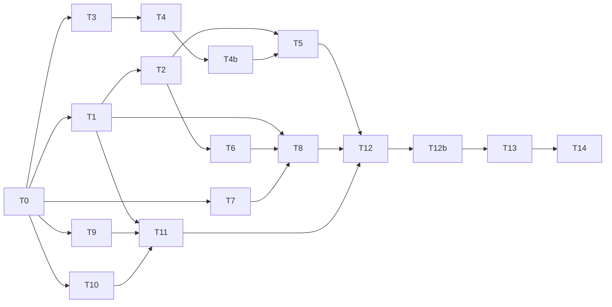

# Tareas: profile-and-images

Implementan `design.md` (aprobado, con la enmienda de la sección 3.9) para cumplir `requirements.md`. **Solo frontend.** Cada tarea deja el frontend compilando, el lint en 0 y los tests en verde; los tests de cada tarea los escribe `test-writer` antes (en rojo) y la tarea los hace pasar sin modificarlos.

Convenciones: `[ ]` pendiente, `[x]` hecha. Todas las tareas son obligatorias. Comandos desde `frontend/`:
- **Lint:** `npm run lint`.
- **Tests:** `npx ng test --no-watch --browsers=ChromeHeadless`.
- **Build:** `npm run build`; anotar siempre el total inicial (límite 800 kB, hoy 794,70 kB).

Rama: `feat/profile-and-images`, desde `origin/main`. Commits solo cuando el usuario los pida; código y docs de la spec van separados. Cada test lleva el id del criterio en su nombre (`it('REQ-2.3: ...')`).

**Paradas** (parar y llevarlo al usuario, no improvisar):
- El build supera 800 kB o emite aviso de presupuesto, en **cualquier** tarea (NFR-3).
- Una tarea exige tocar código fuera de `frontend/src/app`. Las únicas ediciones de documentación permitidas son las de `.claude/specs/` (T12).
- Un test existente tiene que cambiar. Lo actualiza `test-writer` (nunca el `implementer`) con aprobación del usuario, y se anota en `tests-baseline.txt`.
- Aparece `NG0100` o cualquier desviación del diseño no listada abajo.
- **Planes B del diseño (se pueden aplicar sin parar, anotándolo en el registro):** `disableClose` insuficiente → suscribirse a `backdropClick` y `keydownEvents` y cerrar con `'updated'` (design §3.5); `toSignal(profileForm.events)` sin refrescar en test → un `signal` incrementado desde `valueChanges` y `statusChanges` (design §6).

## Grupo A: línea base

- [x] **T0. Línea base** — NFR-1, 2, 3
  - Con la rama limpia y **antes de tocar código**: correr lint, tests y build y anotar los números en el registro (esperado: lint 0, 172 tests en verde, total inicial 794,70 kB sin aviso). Anotar `git status --short` (esperado: solo los archivos de la spec). Correr `grep -rn "Formatos permitidos" src --include=*.spec.ts` y anotar el resultado (hoy, ninguno): ese texto cambia en T2.
  - Depende de: —
  - Verificación: los números en el registro. Si no coinciden, parar y avisar.

## Grupo B: reglas y componente de imagen

- [x] **T1. Utilidad `shared/utils/image-rules.ts`** — REQ-2.2 a 2.5, 2.10 a 2.15 (helper), NFR-4
  - Crear el archivo con las constantes y funciones de `design.md` §3.1: `ALLOWED_IMAGE_MIME_TYPES` (`readonly string[]`), `MAX_IMAGE_SIZE_BYTES`, `IMAGE_RULES_HINT`, `IMAGE_FORMAT_ERROR`, `IMAGE_UPLOAD_GENERIC_ERROR`, `IMAGE_TOO_LARGE_SERVER_ERROR`, `validateImageFile`, `imageTooLargeMessage` (una decimal, hacia arriba, coma decimal) e `imageUploadErrorMessage(error, generic?)`. Con el comentario que cita las constantes del backend.
  - Depende de: T0
  - Verificación: los tests de `image-rules.spec.ts` pasan; lint 0; build: anotar el total inicial. `grep -rn "5 \* 1024 \* 1024\|image/jpeg" src/app --include=*.ts` fuera de `*.spec.ts` solo encuentra `image-rules.ts`.

- [x] **T2. `ImageFieldComponent`: validar, avisar la vista previa, «Quitar»** — REQ-2.1 a 2.9, 3.2, 3.4, NFR-5, NFR-6
  - Aplicar `design.md` §3.2: validación con `validateImageFile` en `onFileInputChange` (rechazo sin emitir, `input.value = ''`, `rejectionMessage` con `role="alert"`); `rulesHint` en lugar del texto fijo; `@Output() previewChanged` que emite solo por acciones del usuario; `discardSelection()` privado para `ngOnChanges`; `clearSelection()` público con `previewChanged(null)`; botón «Quitar» en modo `controls` cuando hay `previewUrl()` y no está subiendo; `errorMessage` del padre oculto si hay rechazo; borrar el `console.log`.
  - Depende de: T1
  - Verificación: los tests nuevos y los existentes de `image-field.component.spec.ts` pasan; `grep -n "console.log" src/app/shared/components/image-field/image-field.component.ts` vacío; lint 0; los specs de perfil, producto y categoría siguen en verde (usan el componente real); build: anotar el total inicial.

## Grupo C: perfil

- [x] **T3. `AuthService.updateProfile`** — REQ-1.1
  - Agregar `updateProfile(id, profile)` con `PUT ${apiUrl}/users/${id}` y cuerpo `{ profile }` (`design.md` §3.3).
  - Depende de: T0
  - Verificación: el test de `auth.service.spec.ts` con `HttpTestingController` pasa (método, URL y cuerpo exactos); lint 0.

- [x] **T4. `Profile`: guardar y cancelar** — REQ-1.1 a 1.12, 1.16, 1.17, NFR-6
  - Aplicar la parte de `design.md` §3.4: `isSaving`; `save()` (con la guarda de doble envío y la lectura de `userLite()` y `userProfile()`) y `cancel()`; `canSave` (por ahora `enableEdit && !isSaving && form.valid && hay cambios`, con `toSignal(profileForm.events)`); plantilla con `(ngSubmit)`, «Guardar» (`type="submit"`, «Guardando…»), «Cancelar» (`type="button"`) y «Editar» como `type="button"`.
  - Depende de: T3
  - Verificación: los tests de `profile.spec.ts` para esos criterios y los 12 existentes (incluido `REQ-3.7` sin cambios) pasan; lint 0; build: anotar el total inicial.

- [x] **T4b. `Profile` con carga perezosa** — NFR-3, NFR-8, NFR-9 *(agregada el 2026-10-19 por la parada de bundle tras T4)*
  - En `frontend/src/app/app.routes.ts`: la ruta `profile` pasa a `loadComponent: () => import('./features/profile/profile').then((m) => m.Profile)`, conserva `canActivate: [authGuard]`, y se quita el `import { Profile }` estático (`design.md` §3.9). No se toca ningún test ni `angular.json`.
  - Depende de: T4
  - Verificación: `grep -rn "import { Profile }\|features/profile/profile'" src/app --include=*.ts` solo muestra el `import()` dinámico de `app.routes.ts` y el `profile.spec.ts`; `app.routes.spec.ts` y el resto de la suite sin nuevas fallas (hoy 239 pasan, 51 fallan); lint 0; `npm run build`: `Profile` aparece como chunk perezoso y el total inicial baja de 799,15 kB (anotar el valor y el margen resultante).

- [x] **T5. `Profile`: validación sin espacios, errores bajo los campos y mensajes de imagen** — REQ-1.13 a 1.15, 2.10 a 2.15 (perfil)
  - Aplicar el resto de `design.md` §3.4: validador `notBlank` en los dos controles, `nameError` y `lastNameError` («El nombre es obligatorio.» / «El apellido es obligatorio.» al tocar) y comparación recortada en la detección de cambios; en la subida de imagen, `imageError` con `imageUploadErrorMessage(error)` y el toast con `imageUploadErrorMessage(error, 'No se pudo subir la imagen de perfil.')`.
  - Depende de: T2, T4b
  - Verificación: los tests de `profile.spec.ts` (nuevos y existentes) pasan; lint 0; build: anotar el total inicial.

## Grupo D: producto

- [x] **T6. `PrdFormComponent`: vista previa en el panel y sin `reset()`** — REQ-3.1, 3.3, 3.5, NFR-6
  - Aplicar `design.md` §3.6: `localPreviewUrl`, método `displayImageUrl()`, `OnChanges` que limpia `localPreviewUrl` cuando cambia `imageUrl`; quitar `productForm.reset()` de `createProduct()`; el panel grande usa `displayImageUrl()`; aviso «La imagen se subirá al guardar el producto.»; `(previewChanged)` conectado.
  - Depende de: T2
  - Verificación: los tests de `product-form.component.spec.ts` (nuevos y existentes) pasan, incluido que el formulario conserva sus datos tras `submitForm`; lint 0; build: anotar el total inicial.

- [x] **T7. `ProductFormDialogComponent`: pasar a signals, sin cambiar el comportamiento** — NFR-6
  - Refactor puro (`design.md` §3.5, primera mitad): `mode`, `entityId` y `selectedImageFile` como signals; **todos** los usos de `this.data.mode` y `this.data.id` pasan a `mode()` y `entityId()` (plantilla, `onSubmit`, `onUploadImage`, `onDeleteImage`, `deleteImageFromEntity`). Nada de la lógica nueva todavía.
  - Depende de: T0
  - Verificación: los tests existentes de `product-form-dialog.component.spec.ts` pasan sin cambios; `grep -n "this.data.mode\|this.data.id" …/product-form-dialog.component.ts` solo encuentra el constructor; lint 0.

- [x] **T8. `ProductFormDialogComponent`: fallo de imagen tras crear** — REQ-4.1 a 4.14, 4.20 a 4.26 (producto), 2.10 a 2.15 (producto)
  - `design.md` §3.5, segunda mitad: `created`; `uploadImageForEntity(id, { notify })` con `imageUploadErrorMessage`; en la rama `create`, `try` propio para la subida con el aviso único «Producto creado, pero…», paso a modo edición (`mode.set('edit')`, `entityId.set(id)`, `created.set(true)`) y `dialogRef.disableClose = true`; `onCancel` cierra con `'updated'` si `created()`.
  - Depende de: T1, T6, T7
  - Verificación: los tests de `product-form-dialog.component.spec.ts` (nuevos y existentes: guardar, éxito, error, 403, «Primero guarda…») pasan; lint 0; build: anotar el total inicial.

## Grupo E: categoría

- [x] **T9. `CategoryFormComponent`: `isSaving` y sin `reset()`** — REQ-4.15 (conservar los datos), 4.19 (parcial: el input `isSaving` deshabilita los botones)
  - Aplicar `design.md` §3.7 al formulario hijo: `@Input() isSaving = false` que deshabilita «Guardar» y «Cancelar»; quitar `categoryForm.reset()` de `submitCategory()`.
  - Depende de: T0
  - Verificación: los tests de `category-form` (nuevos y existentes) pasan: el formulario conserva los datos tras `submitForm`, y los botones se deshabilitan con `isSaving`; lint 0.

- [x] **T10. `CategoryFormDialogComponent`: pasar a signals, sin cambiar el comportamiento** — NFR-6
  - Refactor puro: `mode`, `entityId` y `selectedImageFile` como signals; **todos** los usos de `data.mode`/`data.id` pasan a `mode()`/`entityId()` (condición de la rama `edit`, `onUploadImage`, `onDeleteImage`, `deleteImageFromEntity`, `[mode]` de la plantilla).
  - Depende de: T0
  - Verificación: los 3 tests existentes de `category-form-dialog.component.spec.ts` pasan sin cambios; `grep -n "this.data.mode\|this.data.id" …/category-form-dialog.component.ts` solo encuentra el constructor; lint 0.

- [x] **T11. `CategoryFormDialogComponent`: fallo de imagen tras crear y captura en edición** — REQ-4.15 a 4.19, 4.20 a 4.26 (categoría), 2.10 a 2.15 (categoría)
  - `design.md` §3.7: `created` y `isSaving`; `isSaving` pasado a `app-category-form`; rama `edit` con `try/catch` en la subida (sin rechazo de promesa sin manejar); aviso único «Categoría creada, pero…», paso a modo edición, `disableClose` y cierre con `'updated'` si `created()`; `onCancel` sin efecto mientras `isSaving()`; mensajes de imagen con `imageUploadErrorMessage`.
  - Depende de: T1, T9, T10
  - Verificación: los tests de `category-form-dialog.component.spec.ts` (nuevos y los 3 existentes) pasan; lint 0; build: anotar el total inicial.

## Grupo F: cierre

- [x] **T12. Verificación completa y documentación de la spec** — NFR-1 a 7
  - Correr lint, tests y build completos; `git diff origin/main --stat` (solo `frontend/src/app` y `.claude/specs/profile-and-images/`; ni `backend/`, `.github/`, `angular.json` ni `package.json`); los `grep` de NFR-4 y NFR-5; contar `eslint-disable` (no deben aumentar). Comprobar con la lista `REQ-n.m → it()` que entregó `test-writer` que **cada criterio tiene al menos un test** o está marcado como manual. Actualizar `.claude/specs/pendientes.md` (los hallazgos del humo pasan a resueltos por esta spec; anotar lo abierto: análisis con IA antes de guardar y subida previa a una carpeta temporal). Proponer al usuario, sin editarlo, si `.claude/steering/structure.md` debe mencionar `shared/utils/image-rules.ts`.
  - Depende de: T5, T8, T11
  - Verificación: salidas anotadas en el registro; build sin aviso de presupuesto; la lista de cobertura sin criterios huérfanos.

- [x] **T12b. Correcciones de la auditoría: M1, M2 y M4** — REQ-3.6, REQ-4.27 a 4.31 *(agregada el 2026-10-19 tras la auditoría de código)*
  - Antes: `test-writer` escribe los tests de REQ-3.6 y REQ-4.27 a 4.31 (en rojo) y el usuario los aprueba; el baseline se actualiza con una línea `# 2026-10-19: …`. Después, aplicar `design.md` §3.10 en `product-form.component.ts`, `product-form.html`, `product-form-dialog.component.ts`, `category-form.html` y `category-form-dialog.component.ts`.
  - Depende de: T12
  - Verificación: los tests nuevos pasan; los 290 anteriores siguen en verde; lint 0; build sin aviso (hoy 764,37 kB); ningún test existente modificado (hashes del baseline iguales salvo los archivos que `test-writer` amplió, con aprobación).

- [x] **T13. Humo manual en el navegador** — requirements §4
  - Lo hace una persona con el backend local. Resultado esperado de cada paso: (1) editar nombre y apellido, guardar, recargar y ver los datos nuevos; con el backend apagado, ver «No se pudo guardar el perfil.» y que lo escrito sigue ahí; «Cancelar» restaura. (2) Elegir un `.pdf` y un `.png` de más de 5 MB en perfil, producto y categoría: aparece el mensaje y no se sube. (3) Crear un producto con imagen: se ve en el panel «Vista previa del producto» antes de guardar. (4) Provocar el fallo del servidor tras crear, **sin editar `.env` ni el código**: arrancar el backend local con una variable de entorno solo para esa terminal (por ejemplo, en PowerShell `$env:MAX_IMAGE_SIZE_BYTES = 10000; npm run start:dev`) y elegir una imagen de menos de 5 MB pero de más de 10 kB (el cliente la acepta y el servidor responde 413); o elegir un `.txt` renombrado a `.png` (el cliente lo acepta por el MIME del sistema y el servidor responde 415). Resultado: un solo aviso, el diálogo pasa a edición, «Guardar» no duplica, y al cerrar la lista muestra el producto. (5) Lo mismo con una categoría. (6) La consola sin errores en esas pantallas.
  - Depende de: T12b
  - Verificación: cada paso anotado con su resultado en el registro.

- [ ] **T14. Cierre de la spec** — todos
  - `code-auditor` y después `spec-verifier` con su tabla en «Verificación final» de `requirements.md`; ningún criterio en NO. Después, PR y CI en Actions (lo informa una persona).
  - Depende de: T13
  - Verificación: tabla completa; ningún criterio en NO.

## Dependencias

Por defecto, secuencial: T0, T1, T2, T3, T4, T4b, T5, T6, T7, T8, T9, T10, T11, T12. Paralelizables solo si el usuario lo pide y tocan archivos distintos: T3/T4 con T1/T2; T7 y T9/T10 con casi todo lo demás.

## Cobertura de requisitos

Los rangos se desglosan para poder comprobar cada criterio. `test-writer` entrega la lista `REQ-n.m → it()` y T12 la contrasta con esta tabla.

| Requisito | Tarea |
|---|---|
| REQ-1.1 | T3 (servicio), T4 (envío) |
| REQ-1.2 a 1.12 | T4 |
| REQ-1.13 a 1.15 | T5 |
| REQ-1.16, 1.17 | T4 (regresión del `effect` existente y botón «Editar») |
| REQ-2.1 a 2.9 | T2 (reglas en T1) |
| REQ-2.10, 2.11 (415) | T1 (helper); T5 (perfil), T8 (producto), T11 (categoría) |
| REQ-2.12, 2.13 (413) | T1 (helper); T5, T8, T11 |
| REQ-2.14, 2.15 (genérico) | T1 (helper); T5, T8, T11 |
| REQ-3.1, 3.3, 3.5 | T6 |
| REQ-3.2, 3.4 | T2 |
| REQ-4.1 a 4.14 | T8 |
| REQ-4.15 | T9 (formulario conserva datos), T11 (aviso y modo edición) |
| REQ-4.16 | T11 |
| REQ-4.17 a 4.19 | T11 (4.19 también usa el input de T9) |
| REQ-3.6 | T12b |
| REQ-4.20 a 4.26 producto | T8 |
| REQ-4.20 a 4.26 categoría | T11 |
| REQ-4.27 a 4.31 | T12b (producto y categoría) |
| NFR-1 a 3 | T0 y cada tarea; T12 (T4b resuelve el margen de NFR-3) |
| NFR-8, NFR-9 | T4b |
| NFR-4 | T1, T12 |
| NFR-5 | T2, T12 |
| NFR-6 | T2, T4, T6, T7, T10 (refactor) y T8, T11 |
| NFR-7 | T12 |

## Registro

*(se completa al ejecutar cada tarea)*

### Línea base (T0), 2026-10-19
Rama `feat/profile-and-images` desde `origin/main` `f1d4542`, con los tests en rojo de `test-writer` y sus dos stubs (`image-rules.ts`, `AuthService.updateProfile`).

| Comprobación | Resultado |
|---|---|
| `npm run lint` | 0 errores |
| `ng test` | 290 tests: 188 en verde (los 172 anteriores más 16 de regresión nuevos) y 102 en rojo, todos nuevos (esperado) |
| `npm run build` | código 0; total inicial **796,05 kB** con los stubs y **795,99 kB sin ellos** (los stubs pesan ~0,06 kB) |
| `grep "Formatos permitidos" *.spec.ts` | sin coincidencias (el cambio de texto de T2 no rompe ningún test existente) |

**Corrección de la cifra de partida:** la spec decía 794,70 kB (medido por `frontend-cleanup` el 2026-10-16); hoy el mismo código mide 795,99 kB. El margen real hasta 800 kB es de **4,01 kB**, no de 5,30. Es el dato a vigilar en NFR-3.

### T1 (utilidad `image-rules.ts`), 2026-10-19
`implementer`: COMPLETADA. Verificación del orquestador: los 18 tests de `image-rules.spec.ts` pasan (206 en verde y 84 en rojo de 290; 188 + 18 = 206), lint 0, build **796,05 kB** (+0,06 kB sobre la línea base 795,99), `grep` de NFR-4 solo en `image-rules.ts`, hashes del baseline sin cambios, sin `not implemented` en el archivo.

### T2 (`ImageFieldComponent`), 2026-10-19
`implementer`: COMPLETADA. Verificación del orquestador: `ng test` 224 en verde y 66 en rojo (+18 sobre T1: los tests de image-field; los 66 restantes son de tareas posteriores), lint sin errores, `console.log` ausente, hashes del baseline sin cambios, build **797,26 kB** (+1,21 kB sobre T1). **Margen restante hasta 800 kB: 2,74 kB**, con T4, T5, T6, T8 y T11 todavía por hacer: riesgo alto para NFR-3.

### T3 (`AuthService.updateProfile`), 2026-10-19
`implementer`: COMPLETADA. Verificación del orquestador: el diff es solo el método (`PUT /users/:id` con `{ profile }`), `ng test` 225 en verde y 65 en rojo (+1: REQ-1.1), lint 0, baseline intacto, build **797,29 kB** (+0,03 kB). Margen restante: 2,71 kB.

### T4 (`Profile`: guardar y cancelar), 2026-10-19
`implementer`: COMPLETADA. Verificación del orquestador: `ng test` 239 en verde y 51 en rojo (+14), lint 0, baseline intacto, build **799,15 kB** (+1,86 kB). Sin plan B (`toSignal(events)` refresca bien). «Guardando…» va como texto sin spinner, para ahorrar bytes. **Margen restante: 0,85 kB** y faltan T5, T6, T8 y T11: se agota. **Parada por NFR-3** antes de T5: la decisión sobre el bundle es del usuario (ver abajo).

### T4b (`Profile` con carga perezosa), 2026-10-19
`implementer`: COMPLETADA. Verificación del orquestador: el diff de `app.routes.ts` es solo el `import` estático quitado y la ruta con `loadComponent` (conserva `authGuard`); `app.routes.spec.ts` 10 en verde; suite completa 239 en verde y 51 en rojo (sin cambios); lint 0; baseline intacto; build **764,13 kB** (−35,02 kB; antes 799,15) con `profile` como chunk perezoso de 5,72 kB. **Margen restante hasta 800 kB: 35,87 kB.** NFR-3, NFR-8 y NFR-9 cubiertos. NFR-8 no tiene test automático (solo `grep` y build); anotado como observación.

### T5 (`Profile`: validación, errores bajo los campos y mensajes de imagen), 2026-10-19
`implementer`: COMPLETADA. Verificación del orquestador: `profile.spec.ts` **35 de 35 en verde**; suite completa 247 en verde y 43 en rojo (+8, los de Profile); lint 0; baseline intacto; build **764,13 kB** (sin cambio). Grupo del perfil (REQ-1.x y REQ-2.10 a 2.15 del perfil) cerrado.

### T6 (`PrdFormComponent`: vista previa y sin `reset()`), 2026-10-19
`implementer`: COMPLETADA. Verificación del orquestador: `product-form.component.spec.ts` **8 de 8**; suite completa 254 en verde y 36 en rojo (+7); lint 0; baseline intacto; build **764,37 kB** (+0,24 kB). REQ-3.1, 3.3, 3.5 y REQ-4.4 (producto) cubiertos.

### T7 (`ProductFormDialogComponent` a signals, sin cambiar comportamiento), 2026-10-19
`implementer`: COMPLETADA. Verificación del orquestador: `this.data` solo aparece al inicializar `mode` y `entityId` y en el constructor; spec del diálogo 15 en verde y 16 en rojo (los 16 son de T8, lista idéntica antes y después); suite 254 en verde y 36 en rojo (sin cambios); lint 0; baseline intacto; build **764,37 kB** (sin cambio).

### T8 (`ProductFormDialogComponent`: fallo de imagen tras crear), 2026-10-19
`implementer`: COMPLETADA. Verificación del orquestador: spec del diálogo **31 de 31** en verde; suite completa 270 en verde y 20 en rojo (+16; los 20 restantes son de categoría: T9 y T11); lint 0; baseline intacto; build **764,37 kB** (sin cambio). Sin plan B: `dialogRef.disableClose = true` alcanzó para los tests. Los únicos `this.data.mode/id` son los inicializadores de T7. Grupo de producto (REQ-3.x y REQ-4.1 a 4.14, 4.20 a 4.26) cerrado.

### T9 (`CategoryFormComponent`: `isSaving` y sin `reset()`), 2026-10-19
`implementer`: COMPLETADA. Verificación del orquestador: el diff es solo `@Input() isSaving`, el `reset()` quitado y los dos `[disabled]`; `category-form.component.spec.ts` **3 de 3**; `category-form-dialog.component.spec.ts` 14 en verde y 14 en rojo (los 14 son de T11); suite 276 en verde y 14 en rojo (+6: los 3 del hijo y 3 del diálogo que dependían del `reset()`); lint 0; baseline intacto; build **764,37 kB**. Nada conecta todavía `isSaving` desde el diálogo (T11).

### T10 (`CategoryFormDialogComponent` a signals, sin cambiar comportamiento), 2026-10-19
`implementer`: COMPLETADA. Verificación del orquestador: `data` solo en los inicializadores de `mode`/`entityId` y en el constructor; spec del diálogo 14 en verde y 14 en rojo (los 14 son de T11, misma lista antes y después); suite 276 en verde y 14 en rojo (sin cambios); lint 0; baseline intacto; build **764,37 kB** (sin cambio).

### T11 (`CategoryFormDialogComponent`: fallo de imagen tras crear), 2026-10-19
`implementer`: COMPLETADA. Verificación del orquestador: suite completa **290 de 290 en verde** (incluye los 28 del diálogo de categoría); lint 0; baseline intacto; build **764,37 kB**; `this.data` solo en inicializadores y constructor; sin plan B (`disableClose` alcanzó). REQ-4.15 a 4.19, 4.20 a 4.26 (categoría) y REQ-2.10 a 2.15 (categoría) cubiertos.

### Verificación completa (T12), 2026-10-19
Hecha por el orquestador:
- **NFR-1:** `npm run lint` 0. `eslint-disable`: 1 (el preexistente de `product-list`, igual que en `origin/main`): no aumentó.
- **NFR-2:** `ng test` **290 de 290 en verde** (172 anteriores + 118 nuevos), ningún test desactivado.
- **NFR-3 y NFR-9:** `npm run build` código 0, total inicial **764,37 kB**, sin aviso de presupuesto; `Profile` sale como chunk perezoso (6,34 kB).
- **NFR-4:** `5 * 1024 * 1024` e `image/jpeg` solo en `shared/utils/image-rules.ts`. **NFR-5:** 0 `console.log` en `image-field.component.ts`.
- **NFR-6:** `OnPush` en los 6 componentes tocados; `selectedImageFile` es signal en los dos diálogos.
- **NFR-7:** `git diff origin/main` sin cambios en `backend/`, `.github/`, `angular.json`, `package.json` ni `package-lock.json`; en `frontend/src/app` solo los archivos de la spec y `app.routes.ts` (NFR-8).
- **NFR-8:** `app.routes.ts` con `loadComponent` y `authGuard` (diff revisado).
- **Cobertura por id:** todos los `REQ-n.m` de `requirements.md` aparecen en alguno de los 8 specs del baseline, salvo REQ-1.16, que cubre el test existente `REQ-3.1: subir una imagen mientras se edita…` de `profile.spec.ts` (regresión).
- **Baseline:** los 8 hashes coinciden con `tests-baseline.txt`: ningún test se tocó tras la aprobación.
- **Documentación:** `pendientes.md` actualizado con la sección de esta spec. `structure.md` **no se tocó**: queda la propuesta al usuario de mencionar `shared/utils/image-rules.ts`.

### Auditoría de código y correcciones (T12b), 2026-10-19
`code-auditor`: **aprobable, 0 bloqueantes y 5 menores** (M1 a M5, todos riesgos preexistentes que el flujo nuevo deja más a la vista). El usuario eligió corregir **M1, M2 y M4**; se agregaron REQ-3.6 y REQ-4.27 a 4.31 (requisitos, diseño §3.10 y tarea T12b). `test-writer` escribió 20 tests (17 en rojo), el usuario los aprobó y el baseline se actualizó con una línea fechada. `implementer`: COMPLETADA. Verificación del orquestador: suite **310 de 310 en verde**, 0 mensajes «Unhandled promise rejection», lint 0, build **764,37 kB**, 8 hashes del baseline OK, sin cambios en `backend/`, `.github/`, `angular.json` ni `package.json`.
**Quedan como deuda (decisión del usuario):** M3 (`disableClose` recién cuando la subida falla; mientras se crea, Escape o el fondo cierran el diálogo sin refrescar la lista) y M5 (tras «Quitar» no se puede volver a elegir el mismo archivo: no se vacía el `<input>`). Anotadas en `pendientes.md`.

### Humo manual (T13), 2026-10-19
Lo hizo el usuario con el backend local. Informó: **«todo ok»**, sin detalle por paso (los seis pasos de la tarea: perfil guardar/cancelar/error, imágenes inválidas en perfil, producto y categoría, vista previa al crear, fallo tras crear sin duplicar en producto y en categoría, consola sin errores). Se registra tal como se informó; no se anotaron resultados individuales.
