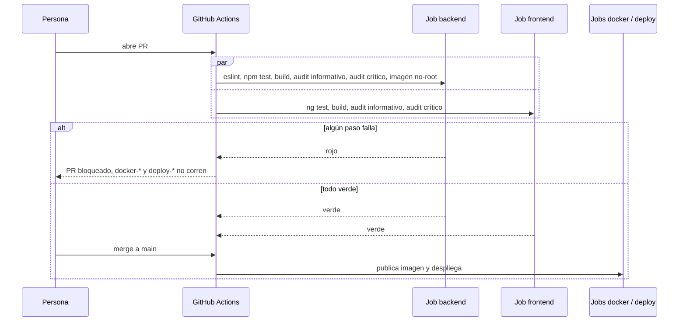

# Diseño: quality-baseline

Respuesta directa a `requirements.md`. No hay endpoints, tablas ni pantallas nuevas: es un cambio de tests, tipos, configuración y dependencias, sin cambios de comportamiento.

## 1. Hallazgos que condicionan el diseño

Leídos del código el 2026-10-13, no estaban en los requisitos:

- **`@types/multer` no está instalado** (ni en `package.json` ni transitivo). Por eso `multer-image-options.factory.ts` da `no-unsafe-call` / "error typed value": `diskStorage` llega como tipo `error`. Los demás errores de ese archivo (`req.params`, `file.originalname`) salen de lo mismo.
- **`openai.service.ts:91`**: `JSON.parse(text)` devuelve `any`; es el origen de los 3 errores del archivo.
- **`category.service.ts` y `product.service.ts`** desestructuran `imageUrl` / `thumbnailUrl` solo para sacarlos del objeto: el patrón correcto, pero la regla `no-unused-vars` no tiene `ignoreRestSiblings`.
- **Los 4 errores `no-unsafe-member-access .user`** son `req` sin tipo en `@Request() req` (`favorites`, `orders`, `cart`) y `getRequest()` sin genérico en `RolesGuard`. `Payload` ya existe en `auth/models/payload.model.ts` (`{ sub, role }`).
- **`app.spec.ts` (frontend)** espera un `<h1>` con "Hello, frontend", que el template (`<app-layout/>`) ya no tiene: es un test de scaffold obsoleto, no solo un problema de configuración.
- **La app es zoneless** (`provideZonelessChangeDetection()` en `app.config.ts`; `main.ts` importa `zone.js` solo por hydration). Los specs sanos (`home-page.spec.ts`) ya incluyen `provideZonelessChangeDetection()`. Los 3 `NG0908` de los specs rotos son por no incluirlo.

## 2. Arquitectura: qué cambia y dónde

```mermaid
flowchart LR
  subgraph Backend
    T[Specs unitarios<br/>6 suites reescritas] --> JEST[npm test]
    TIP[AuthenticatedRequest<br/>auth/models] --> CTRL[favorites / orders / cart<br/>controllers + RolesGuard]
    TM[@types/multer<br/>devDependency] --> MF[multer-image-options.factory]
    CFG[eslint.config.mjs<br/>ignora migraciones<br/>ignoreRestSiblings] --> LINT[eslint]
    CTRL --> LINT
    MF --> LINT
  end
  subgraph Frontend
    FS[5 specs corregidos<br/>provideHttpClientTesting + zoneless] --> KARMA[ng test]
  end
  subgraph Dependencias
    AF[npm audit fix<br/>sin --force] --> PJ[package.json + lock<br/>backend y frontend]
  end
  subgraph CI[ci.yml]
    JEST --> GATE
    LINT --> GATE
    KARMA --> GATE
    PJ --> AUD[audit --audit-level=critical]
    AUD --> GATE[jobs backend y frontend<br/>sin continue-on-error]
    GATE --> DOCKER[docker-* y deploy-*<br/>needs: backend / frontend]
  end
```

## 3. Componentes

### D1. Specs unitarios del backend (REQ-1)

Cada spec de scaffold se reemplaza por pruebas con dobles de prueba. Patrón ya usado en el repo (`auth.service.security.spec.ts`): `Test.createTestingModule` con `{ provide: X, useValue: mock }`, sin base ni red.

| Suite | Cambio | Pruebas mínimas propuestas (REQ-1.2) |
|---|---|---|
| `auth/controllers/auth.controller.spec.ts` | Import `./controllers/auth.controller` → `./auth.controller` (REQ-1.3). Se provee `AuthService` doble. | `login` delega en `AuthService.login` y devuelve su resultado; propaga el error del servicio. |
| `auth/services/auth.service.spec.ts` | Se proveen `UsersService`, `JwtService`, `MailService` dobles. | Camino feliz de `login` (firma el token con `sub` y `role`) y credenciales inválidas → `UnauthorizedException`. Complementa a `auth.service.security.spec.ts`, que ya cubre reset y registro: no se duplica. |
| `users/users.controller.spec.ts` | Se provee `UsersService` doble. | Delegación de una acción de lectura y de una de escritura, respetando que el service recibe el `actor`. |
| `users/users.service.spec.ts` | Se proveen `getRepositoryToken(User)`, `getRepositoryToken(Profile)` y `FileStorageService` dobles. | `findOne` inexistente → `NotFoundException`; el `create` de usuario no devuelve el hash de la contraseña (si el servicio lo garantiza; se confirma leyendo el código al implementar). |
| `mail/mail.service.spec.ts` | Se provee `ConfigService` doble; el transporte (Resend) se reemplaza. Ya existe `mail.service.contact.spec.ts` que prueba el contacto: se reutiliza su forma. | Un envío de verificación arma el destinatario y el asunto esperados; una falla del proveedor se propaga o se registra (lo que haga hoy el código). |
| `ai/service/openai.service.spec.ts` | Se provee `ConfigService` doble y se reemplaza el cliente `openai`. | Respuesta JSON válida → `{ description, slug }`; respuesta que no es JSON → `Error('Invalid AI response format')` (el código ya lo lanza, `openai.service.ts:99`). |

**Regla de implementación:** antes de escribir cada prueba se lee el servicio real y la prueba afirma lo que el código hace hoy. Si una suite no tiene nada que probar más allá del `should be defined`, se **detiene y se consulta** antes de borrarla (REQ-1.5, `AGENTS.md`).

### D2. Specs del frontend (REQ-2)

Cambios por spec, solo en `providers` del `TestBed`:

| Spec | Falla hoy | Cambio |
|---|---|---|
| `auth.facade.spec.ts` | `NG0201: No provider for HttpClient` (`AuthFacade → AuthService → HttpClient`) | `provideHttpClient()` + `provideHttpClientTesting()` + `provideRouter([])` si el facade lo inyecta (se ve al correr). |
| `login-form.spec.ts` | `NG0908` / HttpClient | Las mismas, más `provideZonelessChangeDetection()`. |
| `profile.spec.ts` | `NG0908` / HttpClient | Las mismas. |
| `app.spec.ts` (×2) | `NG0908` / HttpClient en `App → Layout → …`; y la expectativa de "Hello, frontend" es de scaffold | Las mismas providers. El 2.º test se reescribe: el `<app-layout>` se renderiza. Cambia solo el test, no el componente (REQ-2.4). |

`provideZonelessChangeDetection()` es el mismo proveedor que usan `home-page.spec.ts` y la app, así que se alinea con lo existente. No se agrega un archivo de helpers: son 3 líneas por spec y 5 specs.

### D3. Request autenticado tipado (REQ-3.3)

Archivo nuevo `backend/src/auth/models/authenticated-request.model.ts`:

```ts
import type { Request } from 'express';
import { Payload } from './payload.model';

export interface AuthenticatedRequest extends Request {
  user: Payload;
}
```

- `favorites`, `orders` y `cart`: `@Request() req: AuthenticatedRequest` y se usa `req.user.sub` directo (se elimina el `as Payload` de cada método).
- `RolesGuard`: `ctx.switchToHttp().getRequest<Partial<AuthenticatedRequest>>()`, y `user?.role`. Se quita el `eslint-disable` actual. Comportamiento idéntico: sin `user` → `false`.
- **Alternativa descartada:** el decorador `@CurrentUser()`. Es mejor diseño y resuelve lo mismo, pero cambia la firma de todos los controladores y es el tema de `backend-architecture`. Esta interfaz queda como paso intermedio: cuando llegue el decorador, la interfaz desaparece sin tocar nada más.

### D4. Multer y OpenAI (REQ-3.4)

- **`@types/multer` como `devDependency`** en `backend/package.json`. Solo tipos, 0 código en producción ni en la imagen (que instala con `--omit=dev`; se confirma con `grep` en el Dockerfile). Es una dependencia nueva: se pide aprobación explícita con este documento. **Alternativa descartada:** declarar a mano los tipos de `diskStorage` en un `.d.ts` propio; es más código que mantener que un paquete de tipos del mismo organismo.
- Si tras instalar `@types/multer` quedan errores en `req.params?.id`, se usa `req.params['id']`; no se cambia la lógica del nombre de archivo.
- **`openai.service.ts`:** `const parsed = JSON.parse(text) as { description: string };`. Mismo comportamiento que hoy (si el JSON no trae `description`, devuelve `undefined`, igual que antes). **Alternativa descartada:** validar el campo con `class-validator` o lanzar si falta: mejora real pero cambia el comportamiento (REQ-3.6) y pertenece a la spec de seguridad de la IA.

### D5. Configuración de ESLint (REQ-3.1, 3.2, 3.5)

En `backend/eslint.config.mjs`:

- `ignores: ['eslint.config.mjs', 'src/database/migrations/**']`
- Regla agregada: `'@typescript-eslint/no-unused-vars': ['error', { ignoreRestSiblings: true }]`. Es la opción estándar para el patrón `const { a, ...rest } = obj` y deja `category.service.ts` y `product.service.ts` **sin tocar**, lo que cumple REQ-3.5 por construcción (no hay forma de cambiar qué se persiste si no se edita el código). **Alternativa descartada:** renombrar a `_x` + `varsIgnorePattern`, que además obliga a editar los servicios.
- Los ~3 errores de formato restantes y los de `auth.service.security.spec.ts:26` / `self-or-admin.guard.spec.ts:5` se corrigen con `eslint --fix` sobre esos archivos puntuales (no se corre `--fix` global).
- `auth.service.security.spec.ts:40-41` (`no-unsafe-member-access [0]/[1]`): se tipa el acceso a `mock.calls` con un cast a `[[string, string]]`. Los controladores `auth.controller.spec.ts` (2 errores) desaparecen al reescribirse (D1).
- `roles.guard.ts` y `self-or-admin.guard.spec.ts`: ver D3.

### D6. CI (REQ-4)

Cambios en `.github/workflows/ci.yml`:

| Paso | Antes | Después |
|---|---|---|
| Backend: `npx eslint …` | `continue-on-error: true` + comentario TODO | Bloqueante, sin comentario TODO. |
| Backend: `npm test` | `continue-on-error: true` | Bloqueante. |
| Frontend: `ng test` | `continue-on-error: true` | Bloqueante; se quita el TODO. |
| `npm audit --omit=dev` (ambos) | Informativo | **Dos pasos:** `npm audit --omit=dev --audit-level=critical` (bloqueante) y `npm audit --omit=dev` (informativo, `continue-on-error: true`). Orden: primero el informativo para que se vea la lista completa aunque el bloqueante falle, y luego el bloqueante. |

`docker-backend`/`docker-frontend` ya tienen `needs: [changes, backend|frontend]` y `deploy-*` dependen de ellos, así que REQ-4.4 se cumple sin cambios: no se agrega nada, solo se verifica en Actions que el job en rojo corta la cadena.

**Documentación (REQ-4.3):** se actualizan `CLAUDE.md` ("Estado conocido") y `steering/tech.md` ("Estado actual de calidad") para decir que lint, tests y audit crítico **bloquean**. El nombre de `CLAUDE.md` en el repo es de un proyecto con regla de "no arreglar tests rotos fuera del alcance"; esa frase se reescribe: ya no hay tests rotos.

### D7. Dependencias (REQ-5)

Procedimiento, igual en cada proyecto y en este orden:

1. Se anota el `npm audit --omit=dev` inicial (ya medido: backend 24, frontend 15).
2. `npm audit fix` **sin `--force`**: actualiza dentro del rango de `package.json` y del lock. Para las directas de Angular (`@angular/*` 20.3.x y `@angular/ssr` 20.3.39) y de Nest, si el rango de `package.json` no alcanza, se sube el rango a la versión parche/minor indicada, sin cambiar de mayor.
3. `npm audit --omit=dev` de nuevo; lo que quede alto o crítico y requiera mayor se escribe en `specs/pendientes.md` (REQ-5.4).
4. Se corre la lista de verificación: build, tests, lint, imagen Docker (REQ-5.5).
5. Los paquetes `@angular/*` deben quedar en la **misma versión** entre sí (se comprueba con `npm ls @angular/core @angular/common @angular/compiler @angular/router @angular/forms @angular/platform-browser`).

**Riesgo conocido:** una actualización compatible puede cambiar comportamiento en runtime sin romper ni build ni tests. Mitigación: REQ-6.3 (comprobación manual en producción) y que el cambio de dependencias vaya en **un commit separado** del resto, para poder revertirlo solo.

**Alternativa descartada:** Renovate/Dependabot. Resolvería el problema de fondo, pero es una herramienta nueva a acordar; se anota como idea en `pendientes.md`, no se incluye.

### D8. Orden de entrega

Para que el CI quede verde en cada paso y se pueda revertir cada parte:

1. Backend: lint + tipos + tests (D1, D3, D4, D5).
2. Frontend: specs (D2).
3. Dependencias (D7), en su propio commit.
4. CI y documentación (D6), **al final**: antes de eso los `continue-on-error` siguen puestos, y recién cuando local está todo verde se quitan.

## 4. Flujo de verificación de un pull request



## 5. Decisiones técnicas sin requisito directo

- **`@types/multer` como devDependency**: necesaria para REQ-3.4; es una dependencia nueva, requiere aprobación (`CLAUDE.md` regla 2).
- **`ignoreRestSiblings`**: ver D5; es la forma de cumplir REQ-3.5 sin editar los servicios.
- **Cambios de dependencias en commit propio**: ver D7, para poder revertirlas aisladas.

## 6. Trazabilidad

| Requisito | Qué lo cubre |
|---|---|
| REQ-1.1 | D1 (las 6 suites) |
| REQ-1.2 | D1, tabla de pruebas mínimas |
| REQ-1.3 | D1, `auth.controller.spec.ts` |
| REQ-1.4 | D1, patrón con dobles y sin red ni base |
| REQ-1.5 | D1, regla de implementación |
| REQ-2.1, 2.2, 2.3 | D2 |
| REQ-2.4 | D2, `app.spec.ts` (se cambia el test, no el componente) |
| REQ-3.1 | D3, D4, D5 en conjunto |
| REQ-3.2 | D5, `ignores` |
| REQ-3.3 | D3 |
| REQ-3.4 | D4 |
| REQ-3.5 | D5, `ignoreRestSiblings` |
| REQ-3.6 | D3, D4 (casts y tipos sin cambio de lógica) y verificación con `npm test` y `build` |
| REQ-4.1, 4.2 | D6 |
| REQ-4.3 | D6, documentación |
| REQ-4.4 | D6, `needs` existentes |
| REQ-4.5, 4.6 | D6, dos pasos de audit |
| REQ-5.1, 5.2, 5.3, 5.4 | D7 |
| REQ-5.5, 5.6 | D7, pasos 4 y 5 y commit separado |
| REQ-6.1, 6.2, 6.3 | D8 y la verificación final en `tasks.md` |

**Auto-revisión:** todos los REQ tienen componente. Los 3 componentes sin REQ directo están en la sección 5. Lo que no puedo confirmar sin ejecutarlo: qué hace exactamente `users.service` y `mail.service` hoy (por eso D1 dice "si el servicio lo garantiza" y "lo que haga hoy el código": las pruebas se escriben leyendo el código real, no antes).
