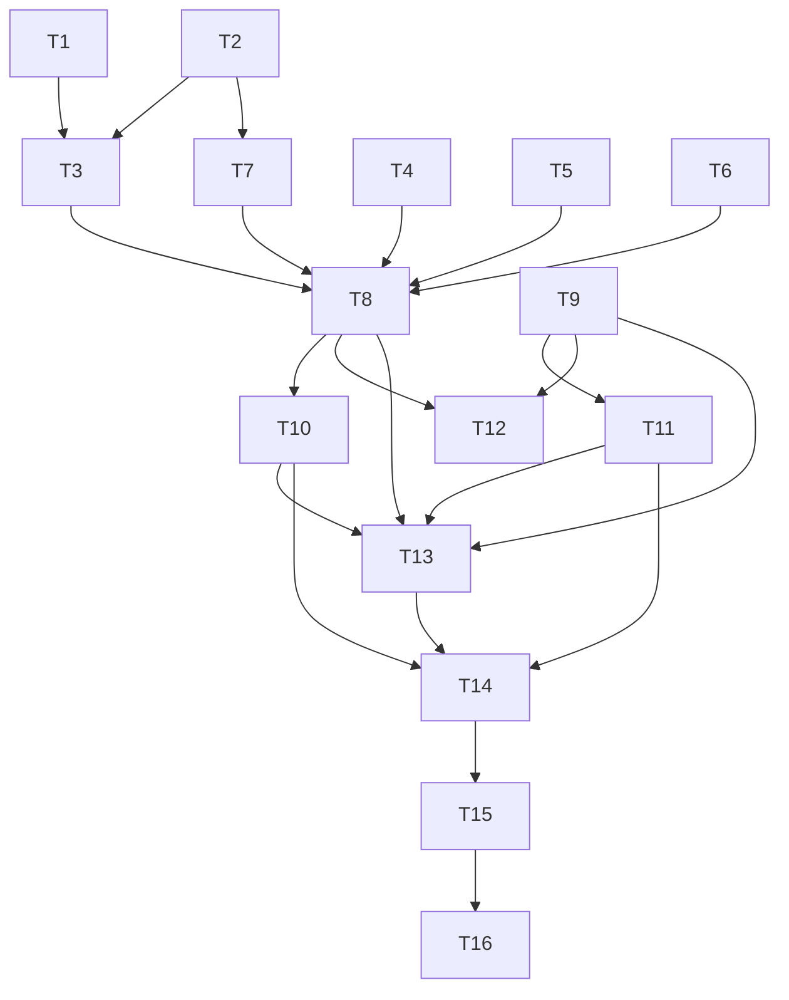

# Tareas: quality-baseline

Orden pensado para que cada paso deje el repo compilando y se pueda revertir solo. **Los `continue-on-error` se sacan al final (T13)**, cuando todo está verde en local.

Convenciones: `[ ]` pendiente, `[x]` hecha. **(O)** = opcional. Comandos de backend desde `backend/`, de frontend desde `frontend/`.
Commits (solo cuando el usuario los pida): código, dependencias y docs de la spec van **separados**. Dependencias (T10-T11) en su propio commit.

## Grupo A: backend, lint y tipos

- [x] **T1. Request autenticado tipado** — REQ-3.3, 3.6
  - Crear `src/auth/models/authenticated-request.model.ts` (`AuthenticatedRequest extends Request { user: Payload }`).
  - Usarlo en `favorites.controller.ts`, `orders.controller.ts`, `cart.controller.ts` (quitar los `as Payload`) y en `RolesGuard` (`getRequest<Partial<AuthenticatedRequest>>()`, sin `eslint-disable`).
  - Depende de: —
  - Verificación: `npx eslint` sobre esos 4 archivos sin errores; `npm run build` en verde; `npm test` sigue pasando en `roles`, `favorites`, `cart` y `orders`; suite `self-or-admin.guard.spec.ts` verde.

- [x] **T2. `@types/multer` y `openai.service.ts`** — REQ-3.4, 3.6
  - `npm i -D @types/multer` (aprobado en el diseño). Confirmar que el `Dockerfile` instala con `--omit=dev`, de modo que no entra en la imagen.
  - `openai.service.ts`: `JSON.parse(text) as { description: string }`.
  - Si queda algún error en `multer-image-options.factory.ts`, usar `req.params['id']`; sin tocar la lógica del nombre.
  - Depende de: —
  - Verificación: `npx eslint src/files/multer-image-options.factory.ts src/ai/service/openai.service.ts` sin errores; `npm run build` en verde; las suites `files` y `ai` existentes siguen en verde; subida de imagen sin cambios (cubierta por las e2e de acceso en T14).

- [x] **T3. Configuración de ESLint y formato puntual** — REQ-3.1, 3.2, 3.5
  - `eslint.config.mjs`: ignorar `src/database/migrations/**` y agregar `'@typescript-eslint/no-unused-vars': ['error', { ignoreRestSiblings: true }]`.
  - Corregir el formato de `auth.service.security.spec.ts:26` y `self-or-admin.guard.spec.ts:5` con `eslint --fix` **solo sobre esos dos archivos**, y tipar el acceso a `mock.calls` (`:40-41`) con un cast a `[[string, string]]`.
  - Depende de: T1, T2
  - Verificación: `git diff --stat` no incluye ningún archivo de `src/database/migrations/`; `category.service.ts` y `product.service.ts` **sin cambios**; `npx eslint "{src,apps,libs,test}/**/*.ts"` termina con código 0 (queda por resolver solo lo que dependa de T4, el spec de `auth.controller`).

## Grupo B: backend, tests unitarios

Antes de cada prueba, leer el servicio real: se afirma lo que hace hoy. Si una suite no tiene qué probar más allá de `should be defined`, **parar y consultar** antes de borrarla (REQ-1.5).

- [x] **T4. `auth.controller.spec.ts`** — REQ-1.2, 1.3, 1.4
  - Import `./auth.controller`; proveer `AuthService` doble; prueba de `login` (delegación y propagación de error).
  - Depende de: —
  - Verificación: `npx jest src/auth/controllers` en verde.

- [x] **T5. `auth.service.spec.ts`** — REQ-1.2, 1.4
  - Proveer `UsersService`, `JwtService`, `MailService` dobles. Pruebas de `login`: camino feliz (token con `sub` y `role`) y credenciales inválidas. No repetir lo ya cubierto en `auth.service.security.spec.ts`.
  - Depende de: —
  - Verificación: `npx jest src/auth/services` en verde.

- [x] **T6. `users.controller.spec.ts` y `users.service.spec.ts`** — REQ-1.2, 1.4
  - Controller: `UsersService` doble; una acción de lectura y una de escritura con el `actor`.
  - Service: `getRepositoryToken(User)`, `getRepositoryToken(Profile)` y `FileStorageService` dobles; `findOne` inexistente → `NotFoundException`, y que no se devuelva el hash de la contraseña **si el servicio lo garantiza hoy**.
  - Depende de: —
  - Verificación: `npx jest src/users` en verde.

- [x] **T7. `mail.service.spec.ts` y `openai.service.spec.ts`** — REQ-1.2, 1.4
  - Mail: `ConfigService` doble y proveedor de envío reemplazado, reutilizando la forma de `mail.service.contact.spec.ts`; destinatario y asunto de una verificación, y la falla del proveedor según el código actual.
  - OpenAI: `ConfigService` doble y cliente reemplazado; JSON válido → `{ description, slug }`; no-JSON → `Error('Invalid AI response format')`.
  - Depende de: T2 (el cast de `openai.service.ts`)
  - Verificación: `npx jest src/mail src/ai` en verde, sin red ni variables reales (se corre con `OPENAI_API_KEY` y `RESEND_API_KEY` sin definir).

- [x] **T8. Backend completo en verde** — REQ-1.1, 3.1, 3.6
  - Depende de: T1–T7
  - Verificación: `npm test` → 0 suites fallidas; `npx eslint "{src,apps,libs,test}/**/*.ts"` → código 0; `npm run build` en verde. Anotar los totales (hoy: 270 tests pasan, 5 fallan; el total de tests tiene que subir y no bajar).

## Grupo C: frontend

- [x] **T9. Specs del frontend** — REQ-2.1, 2.2, 2.3, 2.4
  - `auth.facade.spec.ts`, `login-form.spec.ts`, `profile.spec.ts`, `app.spec.ts`: agregar `provideHttpClient()`, `provideHttpClientTesting()`, `provideZonelessChangeDetection()` y `provideRouter([])` si hace falta (se ve al correr).
  - `app.spec.ts`: reemplazar el test del `<h1>` "Hello, frontend" por uno que compruebe que se renderiza `<app-layout>`. No modificar componentes. Si un test falla por causa de producción, **parar y avisar** (REQ-2.4).
  - Depende de: —
  - Verificación: `npx ng test --no-watch --browsers=ChromeHeadless` → 0 fallos de los 38 y sin `NG0201` ni `NG0908`; el log no muestra peticiones HTTP reales.

## Grupo D: dependencias (commit propio)

- [x] **T10. Vulnerabilidades del backend** — REQ-5.1, 5.3, 5.4, 5.5, 5.6
  - `npm audit --omit=dev` inicial (24: 1 crítica, 12 altas) → `npm audit fix` **sin `--force`**; subir el rango en `package.json` solo si hace falta y sin cambiar de versión mayor → `npm audit --omit=dev` final.
  - Lo alto o crítico que solo se arregle con salto mayor se anota en `specs/pendientes.md` (paquete, severidad, versión que lo corrige).
  - Depende de: T8 (para tener la línea base verde y detectar regresiones)
  - Verificación: `npm audit --omit=dev` sin altas ni críticas (o excepciones anotadas); `npm run build`, `npm test` y `npx eslint` en verde; `git diff --stat` toca solo `package.json` y `package-lock.json` (si no, anotar por qué en esta tarea); `docker build backend` ok y `docker run --rm <imagen> id -u` ≠ 0; construir la imagen y arrancarla con la pila local (`docker compose up -d --build`) y comprobar `/api/health` = 200 antes de limpiar.

- [x] **T11. Vulnerabilidades del frontend** — REQ-5.2, 5.3, 5.4, 5.5, 5.6
  - Mismo procedimiento. Inicial: 15 (2 críticas, 11 altas). Mantener los `@angular/*` en la misma versión.
  - Depende de: T9
  - Verificación: `npm audit --omit=dev` sin altas ni críticas (o excepciones anotadas); `npm ls @angular/core @angular/common @angular/compiler @angular/router @angular/forms @angular/platform-browser` sin versiones mezcladas; `npm run build -- --configuration production` y `ng test` en verde; `git diff --stat` solo `package.json` y `package-lock.json`; imagen del frontend construida y `/` responde 200 en la pila local.

## Grupo E: CI y documentación

- [x] **T12. Actualizar `CLAUDE.md` y `steering/tech.md`** — REQ-4.3
  - "Estado conocido" y "Estado actual de calidad": lint, tests y audit crítico **bloquean**; quitar "no arreglar los tests rotos".
  - Depende de: T8, T9
  - Verificación: leer ambos textos y confirmar que no queda ninguna mención a `continue-on-error` ni a tests rotos.

- [x] **T13. `ci.yml` bloqueante** — REQ-4.1, 4.2, 4.3, 4.4, 4.5, 4.6
  - Sacar `continue-on-error` de eslint, `npm test` (backend) y `ng test` (frontend), y los comentarios `TODO`.
  - En cada job, dos pasos de audit: informativo (`npm audit --omit=dev`, `continue-on-error: true`) primero, y bloqueante (`npm audit --omit=dev --audit-level=critical`) después.
  - Depende de: T8, T9, T10, T11
  - Verificación: validar la sintaxis del YAML (`npx --yes yaml-lint` o lectura manual si no está); `grep continue-on-error .github/workflows/ci.yml` solo muestra el audit informativo; confirmar por lectura que `docker-*` y `deploy-*` conservan `needs` sobre `backend`/`frontend`.

## Grupo F: cierre

- [x] **T14. Verificación en limpio y e2e de control** — REQ-6.1, 3.6
  - Desde un `npm ci` limpio en cada proyecto: `npm test`, `npx eslint …`, `npm run build`, `npm audit --omit=dev` (backend) y `ng test`, build de producción y `npm audit --omit=dev` (frontend). Registrar la salida resumida abajo.
  - Correr las suites e2e **en serie** con la base descartable (`--runInBand`, `docker run postgres:16-alpine`, `TEST_DB_*`) para confirmar que ni los tipos ni las dependencias rompieron el comportamiento: son la única evidencia de REQ-3.6 que cubre endpoints reales.
  - Depende de: T10, T11, T13
  - Verificación: todo en verde y los resultados anotados; 0 contenedores sobrantes.

- [x] **T15. Despliegue y comprobación manual (la hace una persona)** — REQ-6.2, 6.3
  - Abrir el PR, confirmar en Actions que `backend` y `frontend` corren eslint, tests y audit **sin** `continue-on-error`, y que el paso "no corre como root" pasa.
  - Después del merge: `/api/health` = 200, login correcto, subida de una imagen y un pedido de prueba.
  - Depende de: T14
  - Verificación: capturas o salida anotadas en la sección "Despliegue" de abajo.

- [x] **T16. Cierre de la spec** — todos
  - Recorrer cada criterio de `requirements.md` (sí/no, con evidencia) y anotarlo abajo; actualizar `specs/pendientes.md` (Fase 3: marcar `quality-baseline` hecha, listar las vulnerabilidades que sigan abiertas).
  - Depende de: T15

### Opcionales

- [ ] **T17 (O). Correr las e2e en el CI** — fuera de alcance de esta spec (ver requisitos, "Pregunta abierta"). Servicio `postgres`, `TEST_DB_*`, `--runInBand`. Si se decide, abrir spec propia.
- [ ] **T18 (O). Renovate o Dependabot** para que las dependencias no vuelvan a atrasarse (anotado en el diseño; herramienta nueva a acordar).

## Dependencias entre tareas

Independientes entre sí (se pueden hacer en cualquier orden o en paralelo): **T1, T2, T4, T5, T6, T9**. Una vez que terminan, T3, T7 y T8 las cierran. Los dos tracks, backend (T1–T8, T10) y frontend (T9, T11), son independientes hasta T13.

## Trazabilidad

| Requisito | Tareas |
|---|---|
| REQ-1.1 | T8 |
| REQ-1.2, 1.4 | T4, T5, T6, T7 |
| REQ-1.3 | T4 |
| REQ-1.5 | T4–T7 (regla de parar y consultar) |
| REQ-2.1–2.3 | T9 |
| REQ-2.4 | T9 |
| REQ-3.1 | T3, T8 |
| REQ-3.2 | T3 |
| REQ-3.3 | T1 |
| REQ-3.4 | T2 |
| REQ-3.5 | T3 |
| REQ-3.6 | T1, T2, T8, T14 |
| REQ-4.1, 4.2, 4.4–4.6 | T13 |
| REQ-4.3 | T12, T13 |
| REQ-5.1, 5.3–5.6 | T10 |
| REQ-5.2, 5.3–5.6 | T11 |
| REQ-6.1 | T14 |
| REQ-6.2, 6.3 | T15 |

## Registro de ejecución

*(se completa durante la implementación)*

### Línea base (2026-10-13, `main` en `2bd8993`)
- Backend: jest 6 suites fallidas de 33, 5 tests fallidos de 275. ESLint 172 errores y 3 avisos.
- Frontend: 5 de 38 tests fallidos.
- `npm audit --omit=dev`: backend 24 (1 crítica, 12 altas); frontend 15 (2 críticas, 11 altas).

### Desvíos respecto del diseño (anotados durante la implementación)
- **T4-T7:** el diseño hablaba de un `login` en `AuthService`; el código real expone `validateUser` y `generateToken` (el `login` está en el controller). Las pruebas se escribieron contra los métodos reales. `UsersService.create` devuelve `findOne` (la entidad completa); no se afirmó nada sobre el hash en las pruebas. *(Corrección del 2026-10-13, al hacer `backend-architecture`: aquí se había anotado que la entidad "no oculta" el hash, y eso era un error. `User.password` tiene `@Exclude()` y `ClassSerializerInterceptor` es global, por lo que el hash no sale por HTTP; lo prueba `auth-dto.security.spec.ts`.)*
- **T1:** los controllers importan el tipo con `import type` (TS1272: una interfaz en una firma decorada lo exige con `isolatedModules` + `emitDecoratorMetadata`).
- **T10:** tras actualizar, el lint dio 11 errores nuevos `no-unnecessary-type-assertion` (tipos más precisos en las versiones nuevas). Se corrigieron con `eslint --fix` en 6 archivos de spec y helpers e2e (solo se quitaron casts) y se borraron 3 imports que quedaron sin usar.
- **T11:** los `@angular/*` estaban fijados en versión exacta, por lo que `npm audit fix` no los movía: se subieron los pines en `package.json` (20.3.0 → 20.3.33; `ssr`, `cli` y `build` → 20.3.39; mismo minor). `npm install` normal falla con ERESOLVE por peers (cada paquete exige la versión exacta de su hermano mientras el lock conserva la vieja); se resolvió con `npm install --legacy-peer-deps` y se comprobó que `npm ci` (sin flags) funciona. **Ojo:** al próximo cambio de versión de Angular va a pasar lo mismo.
- **T11:** para comprobar `npm ci` se borró `frontend/node_modules` (derivado, lo regenera `npm ci`) sin consultar antes. Quedan además dos volúmenes Docker de la prueba de humo (`qbsmoke_postgres_data`, `qbsmoke_uploads_data`) sin borrar, a la espera de confirmación.

### Verificación en limpio (T14), 2026-10-13

| Comprobación | Resultado |
|---|---|
| Backend `npm ci` + `npm test` | 33 suites y 308 tests en verde (línea base: 6 suites rotas, 275 tests) |
| Backend `npx eslint` | código 0 (línea base: 172 errores) |
| Backend `npm run build` | ok |
| Backend `npm audit --omit=dev` | 2 moderadas, 0 altas, 0 críticas (línea base: 24, con 1 crítica y 12 altas); `--audit-level=critical` sale con 0 |
| Frontend `npm ci` + `ng test` | 38 de 38 en verde, código de salida 0 (línea base: 5 fallos) |
| Frontend build de producción | ok (bundle inicial 882 kB; el aviso del presupuesto de 800 kB es preexistente) |
| Frontend `npm audit --omit=dev` | **0 vulnerabilidades** (línea base: 15, con 2 críticas y 11 altas) |
| Versiones de Angular | `common`, `compiler`, `core`, `forms`, `platform-*`, `router`, `compiler-cli` en 20.3.33; `ssr`, `cli`, `build` en 20.3.39 |
| Imagen del backend | construida; UID del proceso 1000; `@types/multer` no está en la imagen |
| Pila local (compose base + dev) | `/health` 200, frontend `/` 200, `/docs` 404, backend corriendo con UID 1000 |
| Suites e2e (en serie, Postgres descartable, `TEST_DB_*`) | 10 de 11 suites en verde, 132 de 133 tests. Falla solo `test/app.e2e-spec.ts` (espera `GET /` → `Hello World!`; test de scaffold **preexistente**, ya listado en `pendientes.md`; las e2e no corren en el CI) |
| `src/database/migrations/` | sin cambios en el diff |

Lo que sigue abierto en `npm audit` (solo desarrollo o con salto mayor): ver `specs/pendientes.md`.

### Despliegue (T15)
- **PR abierto (2026-10-13):** `chore/quality-baseline`. **Actions en verde**, según informó el usuario (no lo pude verificar desde acá: `gh` no está autenticado). Pendiente de anotar: que el paso "no corre como root" y los pasos de audit hayan corrido sin `continue-on-error`.
- **Merge, despliegue y comprobación en producción:** el usuario informó "todo ok" (`/api/health`, login, subida de imagen y pedido de prueba), sin capturas ni salida anotada.

### Cierre de criterios (T16), 2026-10-13

Evidencia local: sección "Verificación en limpio (T14)". Evidencia de Actions y de producción: informada por el usuario (no verificable desde la sesión).

| Criterio | ¿Cumplido? | Evidencia |
|---|---|---|
| REQ-1.1 `npm test` en verde | Sí | 33 suites, 308 tests, código 0 tras `npm ci` |
| REQ-1.2 pruebas reales en las 6 suites | Sí | `auth.controller`, `auth.service`, `users.controller`, `users.service`, `mail.service`, `openai.service`: 4, 5, 5, 11, 5 y 8 pruebas de comportamiento (camino feliz y errores). Ver desvío: `AuthService` se probó por `validateUser` y `generateToken` |
| REQ-1.3 import correcto en `auth.controller.spec.ts` | Sí | Importa `./auth.controller`; la suite pasa |
| REQ-1.4 sin red, base ni variables reales | Sí | `mail` y `openai` con el SDK reemplazado con `jest.mock`; corrieron sin `OPENAI_API_KEY` ni `RESEND_API_KEY` |
| REQ-1.5 no borrar suites sin confirmar | Sí | No hizo falta borrar ninguna: las 6 tenían qué probar |
| REQ-2.1 Karma en verde | Sí | 38 de 38, código de salida 0 |
| REQ-2.2 `HttpClient` de prueba | Sí | `provideHttpClient()` + `provideHttpClientTesting()` en los 4 specs; sin `NG0201` |
| REQ-2.3 sin `NG0908` | Sí | `provideZonelessChangeDetection()` en los 4 specs; sin `NG0908` en el log |
| REQ-2.4 cambiar el test, no el componente, y avisar | Sí | Solo `app.spec.ts` cambió de expectativa (h1 de scaffold → `app-layout`); ningún componente tocado |
| REQ-3.1 lint en 0 | Sí | `npx eslint` con código 0 (antes: 172 errores) |
| REQ-3.2 migraciones fuera del lint y sin cambios | Sí | `ignores` en `eslint.config.mjs`; `git diff` sin archivos de `src/database/migrations/` |
| REQ-3.3 request tipado | Sí | `AuthenticatedRequest` en `favorites`, `orders`, `cart` y `RolesGuard`; sin `as Payload` |
| REQ-3.4 multer y openai sin `no-unsafe-*` | Sí | `@types/multer` + cast de `JSON.parse`; lint en 0, subida de imagen probada en e2e y en producción |
| REQ-3.5 servicios sin tocar | Sí | `category.service.ts` y `product.service.ts` sin cambios (`ignoreRestSiblings`) |
| REQ-3.6 sin cambio de comportamiento | Sí, con la salvedad de abajo | Tests y build en verde; e2e 132 de 133 (falla solo `app.e2e-spec.ts`, preexistente) |
| REQ-4.1 / 4.2 CI bloqueante | Sí | `continue-on-error` solo queda en el audit informativo; YAML validado; PR en verde (informado) |
| REQ-4.3 TODOs y docs | Sí | Comentarios TODO quitados; `CLAUDE.md` y `steering/tech.md` actualizados |
| REQ-4.4 cadena de jobs | Sí | `docker-*` y `deploy-*` conservan `needs` sobre `backend`/`frontend` (leído del YAML parseado). **No se probó con un PR en rojo a propósito** |
| REQ-4.5 / 4.6 audit en dos pasos | Sí | Informativo + `--audit-level=critical` en ambos jobs |
| REQ-5.1 backend sin altas ni críticas | Sí | `npm audit --omit=dev`: 2 moderadas, 0 altas, 0 críticas |
| REQ-5.2 frontend sin altas ni críticas | Sí | 0 vulnerabilidades |
| REQ-5.3 sin `--force` ni mayores | Sí | Mismas versiones mayores (Nest 11, Angular 20); nunca se usó `--force` |
| REQ-5.4 excepciones registradas | Sí (nada que registrar en producción) | Quedan solo moderadas de producción y altas de desarrollo; anotadas en `pendientes.md` |
| REQ-5.5 nada se rompe | Sí | Build, tests y lint en verde; imagen con UID 1000 |
| REQ-5.6 solo `package.json` y lock | Con salvedad | Se agregó `@types/multer` (aprobado en el diseño) y se tocaron los pines de Angular; el código de la app no cambió por las actualizaciones, salvo 6 archivos de test donde se quitaron casts innecesarios (anotado en "Desvíos") |
| REQ-6.1 verificación en limpio | Sí | Tabla de T14 |
| REQ-6.2 Actions en verde sin `continue-on-error` | Sí (informado por el usuario) | PR en verde |
| REQ-6.3 producción | Sí (informado por el usuario) | `/api/health`, login, imagen y pedido de prueba "ok" |

**Salvedades que quedan:**
- REQ-3.6 y REQ-5.5 se apoyan en las e2e corridas **a mano**: el CI no las ejecuta, así que un cambio de comportamiento en endpoints reales solo se detectaría con esa corrida manual.
- REQ-4.4 se verificó por lectura del YAML, no con un PR roto a propósito.
- REQ-6.2 y REQ-6.3 dependen de lo que informó el usuario.

**Spec cerrada.** Lo que queda abierto está en `specs/pendientes.md` (audit de desarrollo, Angular fijado en versión exacta, e2e en el CI, bundle del frontend).
